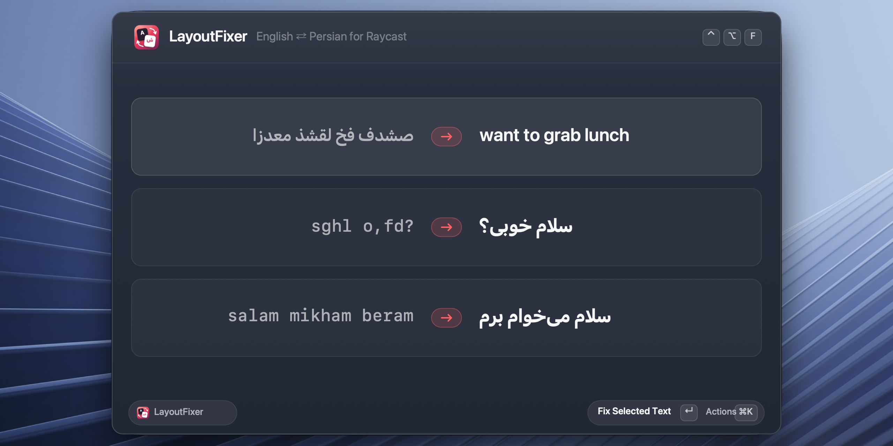

<p align="center">
  
</p>

<p align="center">
  <a href="https://github.com/boxiboy/LayoutFixer/actions/workflows/ci.yml"></a>
  
  
  <a href="LICENSE"></a>
</p>

# LayoutFixer for Raycast

**Typed a whole sentence with the wrong keyboard layout? Press one hotkey.**

LayoutFixer for Raycast fixes English ⇄ Persian keyboard layout mistakes right where you typed them,
switches your keyboard to the right layout, and adds a full Persian writing toolkit on top:
spelling suggestions, Finglish conversion, Persian copy-editing, Jalali dates, numbers in words and
AI rewriting.

You meant to write `want to grab lunch today`, but the keyboard was still on Persian:

```
صشدف فخ لقشذ معدزا فخیشغ      →      want to grab lunch today
```

It works the other way too: `sghl o,fd?` → `سلام خوبی؟`

> LayoutFixer for Raycast is built on [**LayoutFixer**](https://github.com/sina-developer/LayoutFixer)
> by Sina Gholizadeh, a macOS and Windows app that fixes layout mistakes as you type. We took its
> detection rules and word lists, rebuilt it as a Raycast extension, and added a set of new
> features. See [What's new compared to LayoutFixer](#whats-new-compared-to-layoutfixer).

---

## Contents

- [Features](#features)
- [Commands](#commands)
- [Getting started](#getting-started)
- [Settings](#settings)
- [How it works](#how-it-works)
- [What's new compared to LayoutFixer](#whats-new-compared-to-layoutfixer)
- [Privacy](#privacy)
- [Development](#development)
- [Credits](#credits)
- [License](#license)

## Features

**Layout fixing**

- **One hotkey, no selection needed.** With nothing selected, LayoutFixer selects the current line
  (or the last word) for you and fixes it in place.
- **Smart by default.** Only words that are clearly typed on the wrong layout are converted. Names,
  brands, URLs and typos (`github`, `figma`, `teh`) are left alone, and so are the correct words
  around a mistake.
- **Both directions at once.** Each word's direction comes from its own script, so
  `sghl صشدف فخ لقشذ` becomes `سلام want to grab`.
- **Switches your keyboard** to the right layout after fixing, and **Undo Last Fix** switches it back.
- **Caps Lock aware.** `hELLO` → `Hello`, and `SGHL` is still read as `سلام`.
- **Reads your real layout.** Detects Persian – Standard (ISIRI 2901) or Persian – Legacy from your
  Mac's input sources. The key maps are generated from macOS itself.

**Writing tools**

- **Check Spelling** for English (macOS spell checker or the built-in word list) and Persian (the
  built-in Persian word list, since macOS has no Persian spell checker). Pick a suggestion per word,
  keep it, or add it to your dictionary, then replace the text in one go.
- **Finglish to Persian:** `salam khobi?` → `سلام خوبی؟`, `ketab` → `کتاب`, matched against 50,000
  Persian words.
- **Clean up Persian Text:** half-spaces (`می خواهم` → `می‌خواهم`, `کتاب ها` → `کتاب‌ها`), Persian
  punctuation (`، ؛ ؟ «»`), Arabic `ي`/`ك` → `ی`/`ک`, extra spaces, kashida and optional Persian
  digits. English words, numbers in English sentences and URLs keep their own spelling and digits.
- **Persian Tools:** numbers in words (`۱۲۵` → `صد و بیست و پنج`, `2.5` → `دو و پنج دهم`),
  Jalali ⇄ Gregorian dates (`1405/08/06` ⇄ `2026-10-28`), thousands separators and Persian ⇄ Latin
  digits. Opens with today's date in both calendars.
- **AI Writing Tools** (Raycast Pro): fix everything, rewrite as formal or casual Persian, translate
  to English or Persian, convert Finglish, or shorten. Layout mistakes are fixed before the text is
  sent, so the model sees real words.

**Everyday comfort**

- **Setup** opens on first use, checks your keyboard layouts and Accessibility access, suggests
  hotkeys and lets you try it out.
- **Menu bar** shows `EN` or `فا`, with quick actions for every command.
- **Personal Dictionary** and **Ignored Words** for names and slang that should never be converted.
- **Fix History** (off by default) keeps your last 100 fixes on this Mac.
- **Restores your clipboard** after pasting the fixed text.
- **Every feature can be turned on or off** in the extension settings.

## Commands

| Command | What it does | Suggested hotkey |
|---|---|---|
| **Setup and Shortcuts** | Checklist, hotkeys and a quick try-out. Opens on first use. | |
| **Fix Selected Text** | Fixes the selection in place, or the current line when nothing is selected. | `⌃ ⌥ F` |
| **Undo Last Fix** | Undoes the last fix and switches the keyboard layout back. | `⌃ ⌥ Z` |
| **Fix Clipboard** | Fixes the text on the clipboard. | |
| **Check Spelling** | Spelling suggestions for the selection (or clipboard), English and Persian. | `⌃ ⌥ S` |
| **Finglish to Persian** | `salam khobi` → `سلام خوبی`. | `⌃ ⌥ P` |
| **Clean up Persian Text** | Half-spaces, punctuation, `ی`/`ک`, spaces and digits. | `⌃ ⌥ C` |
| **Persian Tools** | Numbers in words, Jalali ⇄ Gregorian dates, digits. | `⌃ ⌥ T` |
| **AI Writing Tools** | Fix, formal or casual Persian, translate, shorten. Needs Raycast Pro. | `⌃ ⌥ A` |
| **Convert Text** | Type or paste text and preview every fix live. | |
| **Switch Keyboard Layout** | English ⇄ Persian. | `⌃ ⌥ L` |
| **Keyboard Layout in Menu Bar** | `EN` / `فا` in the menu bar, with quick actions. | |
| **Fix History** | Recent fixes, to copy or paste again. | |
| **Personal Dictionary** | Words that are never converted or marked as misspelled. | |

> Avoid `⌃ Space` and `⌃ ⌥ Space` for hotkeys: macOS uses them to switch input sources.

## Getting started

### Requirements

- macOS 13 or later with [Raycast](https://raycast.com)
- An **English** and a **Persian** keyboard layout (System Settings → Keyboard → Text Input → Edit… → **+**)
- Optional: **Accessibility** access for Raycast, to fix without selecting and for Undo
  (System Settings → Privacy & Security → Accessibility)
- Optional: Raycast Pro, for AI Writing Tools

### Install from source

LayoutFixer for Raycast isn't in the Raycast Store yet. To install it from this repository:

```bash
git clone https://github.com/boxiboy/LayoutFixer.git
cd LayoutFixer
npm install
npm run dev
```

`npm run dev` builds the extension and adds it to Raycast. It stays installed after you stop the
command.

### First run

Run any LayoutFixer command and **Setup and Shortcuts** opens:

1. **Checklist:** confirms both keyboard layouts are enabled and Raycast has Accessibility access,
   with buttons that open the right System Settings pages. Shows which Persian layout was detected.
2. **Hotkeys:** suggested hotkeys for every command, and a shortcut to the settings page where you
   record them.
3. **Try it:** copy an example sentence, paste it into Notes and fix it.

Open Setup again any time from Raycast or the menu bar icon.

## Settings

Everything is configurable in **Raycast Settings → Extensions → LayoutFixer**.

| Group | Setting | Default |
|---|---|---|
| Layout | Persian Layout: Automatic, Standard (ISIRI 2901) or Legacy | Automatic |
| | Fix Mode: Smart or Convert Everything | Smart |
| | When Nothing Is Selected: fix the current line, the last word, or do nothing | Current line |
| Fixing | Convert the whole selection when no word looks wrong | On |
| | Switch the keyboard layout after fixing | On |
| | Fix text typed with Caps Lock on | On |
| | Correct obvious spelling mistakes in converted words | Off |
| | Type digits as Persian (۱۲۳) when converting to Persian | On |
| | Clean up Persian text after converting to Persian | Off |
| Behavior | Restore the clipboard after pasting | On |
| | Show the fixed text in the HUD | On |
| | Keep a history of fixes | Off |
| Spelling | English Spell Checker: macOS or built-in word list | macOS |
| Persian Clean-up | Half-spaces, punctuation, Persian digits, extra spaces and kashida | On, on, off, on |
| Words | Ignored Words: comma-separated words to leave alone | Empty |
| Menu bar | Show: layout name, icon and name, or icon only | Layout name |

## How it works

### Detecting a layout mistake

Every key has a twin on the other layout: `t` is also `ف`, `h` is also `ا`. LayoutFixer reads each
word as if the same keys had been pressed on the other layout, and only converts it when that
reading is a **real word**:

| Text written in… | Converted when… | Into |
|---|---|---|
| Persian letters | the same keys spell a common English word (`صشدف` → `want`) | English |
| English letters | it isn't an English word **and** the same keys spell a real Persian word (`sghl` → `سلام`) | Persian |

- 2-letter words are ambiguous (`شد` is `an` on English keys), so they are only converted next to a
  word that is clearly wrong.
- Words between two wrong words are part of the same mistake, unless they are real words as typed.
- Words are checked against 50,000-word English and Persian frequency lists plus macOS's
  `/usr/share/dict/words`. Half-spaces are ignored when looking words up, because the Persian list
  writes `میخوام` without one.

### Spelling and Finglish

- Spelling suggestions use edit distance over the frequency lists: the closest words first, then
  the most common. Automatic corrections are only made when one suggestion is at least three times
  more common than the next.
- Finglish is matched with a trie of the Persian word list: each Latin chunk maps to the Persian
  letters it can stand for (short vowels may map to nothing), and the most common real word wins.
  Unknown words fall back to a letter-by-letter reading.

### Talking to macOS without native code

Keyboard layouts, layout switching, the macOS spell checker, the Accessibility check and selecting
the current line all go through macOS's built-in JavaScript for Automation (`osascript -l JavaScript`),
so the extension is pure TypeScript.

### Project structure

```
src/
├── fix-selection.ts … personal-dictionary.tsx   one file per Raycast command
└── lib/
    ├── layouts.ts, layout-data.ts   key maps (generated from macOS) and conversion
    ├── dictionaries.ts              word lists and wrong-layout detection
    ├── convert.ts                   smart / convert-everything fixing, Caps Lock, digits
    ├── spelling.ts                  English and Persian spell checker
    ├── finglish.ts                  Finglish → Persian
    ├── persian.ts                   Persian clean-up
    ├── persian-tools.ts             numbers in words, Jalali dates
    ├── macos.ts                     input sources, spell checker, keystrokes (JXA)
    ├── engine.ts                    settings, selection, paste, history
    ├── storage.ts                   personal dictionary, history, undo, onboarding
    └── onboarding.ts                opens Setup on first use
assets/        extension icon and word lists
design/        script that draws the icon and cover
media/         README and social preview images
scripts/       script that generates the key maps
test/          unit tests (Vitest)
```

## What's new compared to LayoutFixer

LayoutFixer is a background app that watches every key you press and offers a fix with
<kbd>Tab</kbd>. A Raycast extension only runs when you call it, so this project works on demand
instead, and uses that to add a lot more.

| | LayoutFixer | LayoutFixer for Raycast |
|---|---|---|
| How you use it | Automatic popup while typing, <kbd>Tab</kbd> to fix | One hotkey on the selection or the current line |
| Platforms | macOS and Windows apps | macOS, inside Raycast |
| Layout detection rules | ✓ | ✓ ported, plus per-word direction for mixed text |
| Switches the keyboard layout | ✓ | ✓, plus Undo Last Fix to switch back |
| Caps Lock handling | | ✓ |
| Spelling suggestions (English and Persian) | | ✓ |
| Finglish to Persian | | ✓ |
| Persian copy-editing (half-spaces, punctuation, ی/ک) | | ✓ |
| Numbers in words, Jalali dates | | ✓ |
| AI rewriting and translation | | ✓ (Raycast Pro) |
| Menu bar layout indicator | Menu bar app | ✓ |
| Personal dictionary, history, settings page | | ✓ |
| Guided setup | | ✓ |

## Privacy

- Text is only read when you run a command, and only the selection, the current line or the
  clipboard.
- Everything runs offline, except **AI Writing Tools**, which send the selected text to Raycast AI
  when you choose a task.
- The personal dictionary, the optional history and the last fix (for Undo) are kept in Raycast's
  local storage on your Mac. Nothing else is stored.

## Development

```bash
npm install
npm run dev        # build and load into Raycast, rebuilding on change
npm test           # unit tests
npm run lint       # Raycast lint, ESLint and Prettier
npm run build      # production build
```

Regenerate the key maps from the layouts installed on your Mac:

```bash
npm run layouts
```

Regenerate the icon, cover and social preview:

```bash
swift design/make-artwork.swift
```

Contributions are welcome. Please open an issue or a pull request, and run `npm test` and
`npm run lint` first.

## Credits

- [**LayoutFixer**](https://github.com/sina-developer/LayoutFixer) by
  [Sina Gholizadeh](https://github.com/sina-developer): the original idea, the wrong-layout
  detection rules and the bundled word lists. Thank you for making it open source.
- [**FrequencyWords**](https://github.com/hermitdave/FrequencyWords) by Hermit Dave: English and
  Persian word frequency lists (CC BY-SA 4.0).
- [Raycast](https://raycast.com) for the extension platform and Raycast AI.

## License

MIT, see [LICENSE](LICENSE). The bundled word lists are CC BY-SA 4.0, see
[THIRD_PARTY_NOTICES.md](THIRD_PARTY_NOTICES.md).
