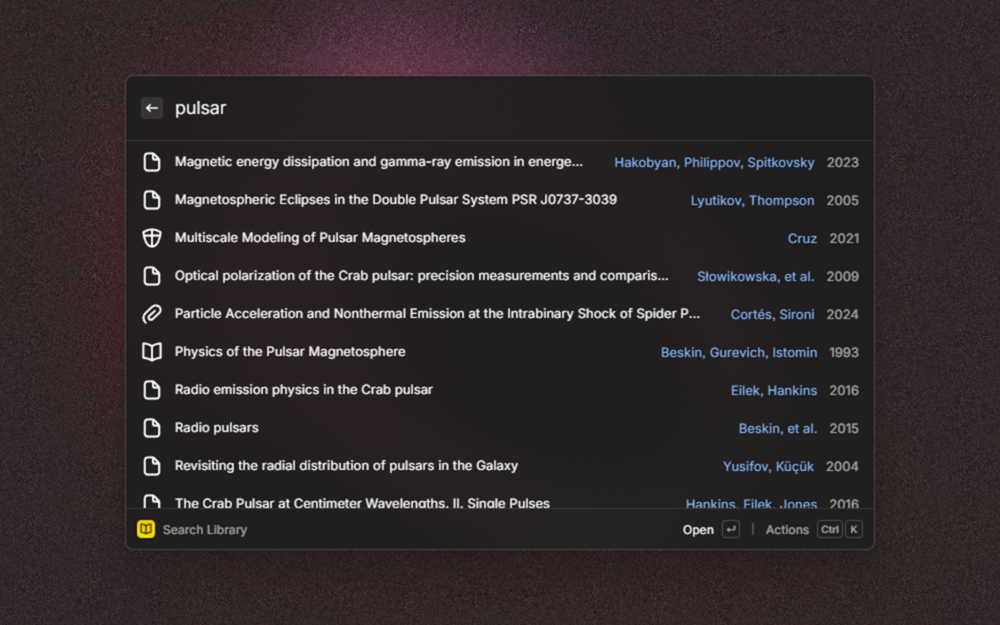
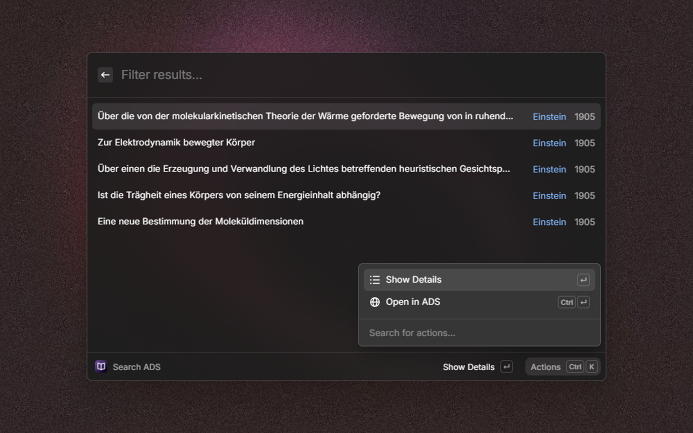

# Llyfr

Llyfr is a lightweight bibliography manager for scientific papers. Your library is a plain BibTeX (`.bib`) file and a folder of PDFs, so it works with LaTeX, JabRef, and other tools that read BibTeX.



## Commands

### Search Library

Search the papers in your `.bib` file by title, author, year, or journal.

- **Open** the PDF attached to an entry
- **Show Details**: authors, journal, year, abstract, and link
- **Copy BibTeX** for the entry
- **Open URL** in your browser (the `url` field, or the `adsurl` field)
- **Add New Entry**: pick a PDF, paste its BibTeX, and Llyfr copies the PDF into your library folder and adds the entry to your `.bib` file

### Search ADS

Search the [NASA Astrophysics Data System (ADS)](https://ui.adsabs.harvard.edu) and import papers into your library.

- Browse results and **Show Details** with the abstract
- **Add to Library** downloads the BibTeX and the PDF (the arXiv version first, the publisher version otherwise), then adds both to your library
- **Open in ADS** in your browser



## Setup

Llyfr asks for these settings the first time you open it. You can change them later in Raycast Settings → Extensions → Llyfr.

| Setting                      | Required for  | Description                                                                                                                     |
| ---------------------------- | ------------- | ------------------------------------------------------------------------------------------------------------------------------- |
| **Path to the bibliography** | Both commands | The folder where your PDFs are stored.                                                                                          |
| **Path to the .bib file**    | Both commands | Your BibTeX file. It can be anywhere, including inside the folder above. Start with an empty `.bib` file if you don't have one. |
| **ADS API Token**            | Search ADS    | Your personal ADS token (see below).                                                                                            |

### Getting an ADS API token

1. Sign in or create a free account at [ui.adsabs.harvard.edu](https://ui.adsabs.harvard.edu).
2. Go to **Account → Settings → API Token** and click **Generate a new key**.
3. Paste the token into the **ADS API Token** setting of the Search ADS command.

## How the library is stored

PDFs are linked to entries with the `file` field, in the same format JabRef uses. The path is relative to your library folder:

```bibtex
@ARTICLE{1938Natur.141..333L,
   author = {{Landau}, L.},
    title = "{Origin of Stellar Energy}",
  journal = {\nat},
     year = 1938,
   adsurl = {https://ui.adsabs.harvard.edu/abs/1938Natur.141..333L},
     file = {:Landau_1938_origin_of_stellar_energy.pdf:PDF}
}
```

When you add a paper, Llyfr names the PDF `<authors>_<year>_<title>.pdf`, where `<authors>` is `Smith`, `Smith.Jones`, or `Smith.etal`. It then appends the entry to the end of your `.bib` file. Existing entries are never modified.

Entries without a `file` field still appear in the list, with a dimmed icon.

## ADS query examples

Search ADS accepts the full [ADS search syntax](https://ui.adsabs.harvard.edu/help/search/search-syntax):

| Query                                        | Finds                                  |
| -------------------------------------------- | -------------------------------------- |
| `author:"Einstein" year:1905`                | Papers by Einstein from 1905           |
| `author:"^Landau"`                           | Papers with Landau as the first author |
| `title:"stellar energy"`                     | Papers with the phrase in the title    |
| `abs:"magnetic reconnection" year:2020-2024` | Abstract search within a year range    |
| `bibcode:1938Natur.141..333L`                | A specific paper                       |

