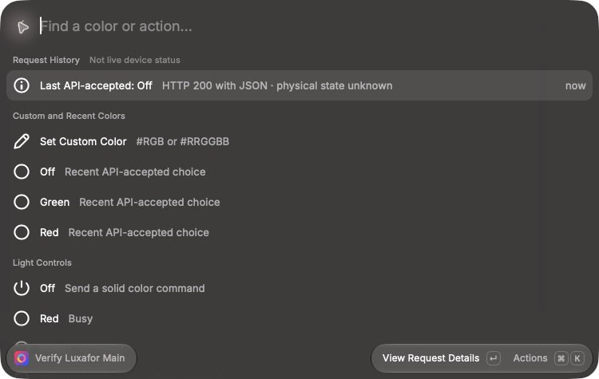
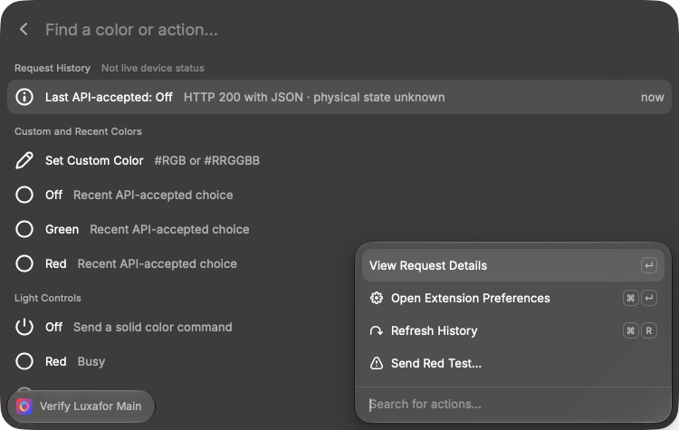

# Luxafor Controller

Change your Luxafor light from Raycast. Set a color, blink the light or switch it off, with quick controls in the menu bar.

[Install from the Raycast Store](https://www.raycast.com/smcnab1/luxafor-controller) · macOS

## Setup

You'll need a compatible Luxafor device and the Luxafor companion app running with **Webhook** mode enabled. The [Luxafor Webhook guide](https://luxafor.helpscoutdocs.com/article/25-webhook-api-basics-and-guidelines) lists supported devices and software.

1. Copy your **User ID** from the Luxafor app's **Webhook** tab.
2. Open **Raycast Settings → Extensions → Luxafor Controller**.
3. Enter **Luxafor User ID** and select **api.luxafor.com** as the API endpoint.
4. Open **Control Luxafor** and choose a color or **Turn off**.

Keep the companion app running while using the extension. The older `api.luxafor.co.uk` option is retained, but its current operation is unverified; use the documented `.com` endpoint. Opening a command or refreshing history never changes the light.

## Commands

| Command          | What it does                                              |
| ---------------- | --------------------------------------------------------- |
| Control Luxafor  | Set a color, blink a color, turn off or view history.     |
| Luxafor Menu Bar | Change colors and view request history from the menu bar. |
| Set Busy         | Send solid red.                                           |
| Set Available    | Send solid green.                                         |
| Turn off         | Send custom `000000` to switch the light off.             |
| Set Custom Color | Send a three- or six-digit hex color.                     |

Choose red, green, blue, yellow, cyan, magenta or white. In **Control Luxafor**, open Actions on a color to blink it. Blink duration and restoration are not controlled by the extension. **Menubar Layout** in extension settings offers Busy/Available actions or the full color menu.

Assign aliases or hotkeys to Busy, Available and Off in Raycast's command settings. No Raycast Pro subscription is needed.

## Custom and recent colors

Enter `#RGB` or `#RRGGBB` in **Set Custom Color**; the `#` is optional. For example, `#3A7` expands to `33aa77`, and `#000` turns the light off. Invalid input sends nothing.

The main view keeps your five most recent API-accepted solid colors. Select one to send it again. **Clear Recent Colors** clears that list without changing the light or request history. A saved color from the older release appears separately as **Previous saved choice · unverified**; **Forget Saved Choice** removes it locally.

## Understanding history

The extension shows API request history, not live device status. **Request Accepted** means the API returned HTTP 200 and a JSON object without an explicit error indicator. It cannot confirm that the light changed.

Previous accepted history is preserved when a request fails or delivery is uncertain. Requests time out after ten seconds and are never retried automatically. Overlapping commands are refused, not queued. Check the light before deliberately sending another command.

Use **View Request Details** for the full timestamp and recovery guidance, or **Refresh History** to reload the saved record. History older than five minutes is marked stale. An interrupted pending request has an unknown outcome. The menu reloads local history on Raycast's approximate one-minute schedule; this does not contact Luxafor.

## Troubleshooting

If the light does not change, check the User ID, device connection and Webhook mode, then restart the companion app if needed. A successful API response alone does not confirm that the light changed.

**Send Red Test…** asks for confirmation. Cancel sends nothing; confirming sends red once and does not restore the previous color. Closing a command cannot undo a request already sent.

For menu bar controls, enable **Luxafor Menu Bar** in Raycast's extension settings. See [setup and troubleshooting](SETUP.md) for more detail, or [report a bug or request a feature](https://github.com/smcnab1/luxafor-controller/issues). Keep your User ID out of issue reports and screenshots.

## Compatibility and privacy

This extension supports macOS. Device compatibility depends on the Luxafor companion software and Webhook support; real-device and upgrade checks for this update remain unverified.

Your User ID is masked in preferences and sent only in the HTTPS request body to the selected Luxafor host. Redirects are refused. Raw request bodies, responses and errors are not logged or exported. No analytics or AI tools are included. Existing preference keys and the original storage record are retained; old online/offline flags are not treated as device telemetry.

See the [changelog](CHANGELOG.md). [MIT licensed](LICENSE).
