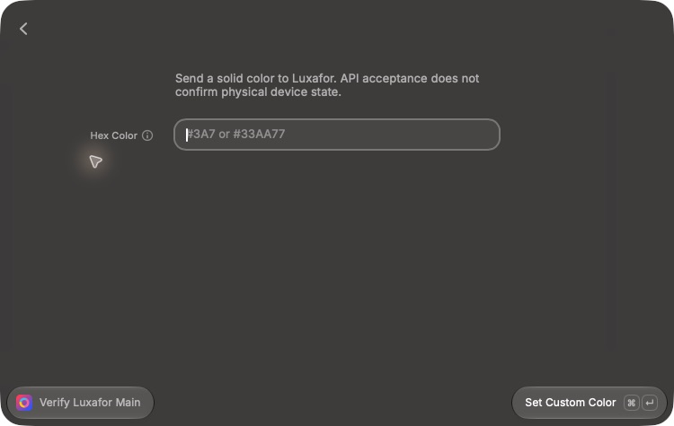

# Luxafor Controller

Send color commands to your Luxafor from Raycast.

> The extension displays request history, not live device status. An API-accepted request does not prove the light changed. Opening a command or refreshing history never changes the light.

## Setup

1. Use current Raycast on macOS and a compatible Luxafor device connected to the Luxafor companion app.
2. Enable **Webhook** mode in the Luxafor app and copy its User ID.
3. In Raycast extension preferences, enter **Luxafor User ID**. Keep it private. Use **api.luxafor.com**, the documented endpoint.
4. Open **Control Luxafor**. Choose a color or **Turn off** when you want to change the light.
5. Optionally enable **Luxafor Menu Bar** for quick controls and request history.

The existing `.co.uk` option is retained for migration compatibility. Its current operation is unverified; it is not described as a regional alternative. No setup step automatically sends a test request. See [setup and troubleshooting](SETUP.md).

## Commands

| Command              | Use                                                          |
| -------------------- | ------------------------------------------------------------ |
| **Control Luxafor**  | Base colors, blink, Off, request details and recent choices. |
| **Set Busy**         | Send solid red.                                              |
| **Set Available**    | Send solid green.                                            |
| **Turn off**         | Send custom `000000`.                                        |
| **Set Custom Color** | Enter `#RGB` or `#RRGGBB`; the `#` is optional.              |
| **Luxafor Menu Bar** | Quick controls and shared request history on macOS.          |

Assign aliases or hotkeys to Busy, Available and Off using Raycast's command settings. No keyboard hooks or Raycast Pro subscription are needed.

## Controls

- Solid red, green, yellow, blue, white, cyan and magenta; Off sends custom `000000`.
- Blink with a named base color. No duration or restoration is promised.
- **Send Red Test…** asks for confirmation. Cancel does nothing. Confirm sends one red command and does not restore the previous color.
- **Set Custom Color** accepts three or six hexadecimal digits (0–9, A–F), for example `#3A7` → `33aa77`. Invalid values are rejected without sending. `#000` means Off.
- The main view keeps up to five successful solid-color choices, newest first, deduplicated by color. **Clear Recent Colors** clears this list without changing the light or accepted history. A migrated old color appears separately as **Previous saved choice · unverified**, with **Forget Saved Choice** to remove it.
- **View Request Details** shows the full acceptance timestamp and recovery guidance without truncation.
- Menu layout preferences retain the simple Busy/Available or full-color choice.

## Understanding history

| Display                     | What it means                                                                                                        |
| --------------------------- | -------------------------------------------------------------------------------------------------------------------- |
| Request pending             | A request is in progress; no new acceptance is recorded yet.                                                         |
| Last API-accepted           | The service returned HTTP 200 and a JSON object without an explicit error indicator. Physical state remains unknown. |
| Failed / delivery uncertain | Previous accepted history is preserved. Check the light before deliberately resending.                               |
| Stale history               | Acceptance was over five minutes ago. This is a display hint, not a device timeout.                                  |
| Interrupted request         | A command ended before an outcome was recorded; delivery is unknown.                                                 |

Requests time out after ten seconds and are never retried automatically. Simultaneous actions are rejected, not queued. Closing a command does not undo a request already sent.

History is shared through Raycast storage. The main view reloads it when opened or when you choose **Refresh History**. Completed actions request a menu refresh; the menu also reloads history on Raycast's one-minute schedule. That schedule is approximate and does not contact Luxafor.

## Compatibility and privacy

- This extension supports **macOS only**.
- The [vendor's Webhook guide](https://luxafor.helpscoutdocs.com/article/25-webhook-api-basics-and-guidelines) lists Flag, Colorblind Flag, Orb, Bluetooth Pro and Bluetooth with Luxafor 2.0 software. Compatibility depends on your device and companion software.
- Your User ID is sent only in the HTTPS request body to the selected Luxafor host. Redirects are refused. Raw request bodies, responses and errors are not logged or exported. The preference is masked; no AI tools or analytics are included.
- Existing preference names are retained. The legacy debug preference is retained but inactive. Old online/offline flags are discarded because they were not telemetry. The old storage record is left intact for recovery; useful saved color choices are validated during migration.
