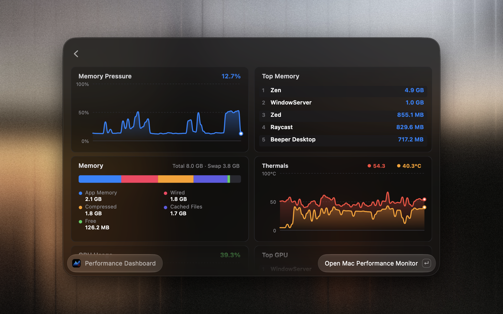
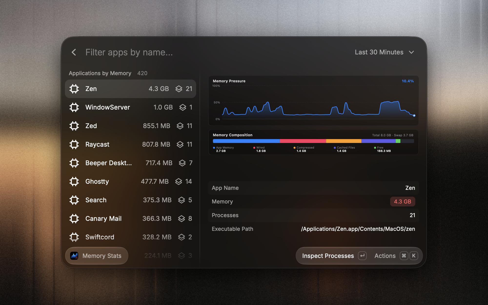
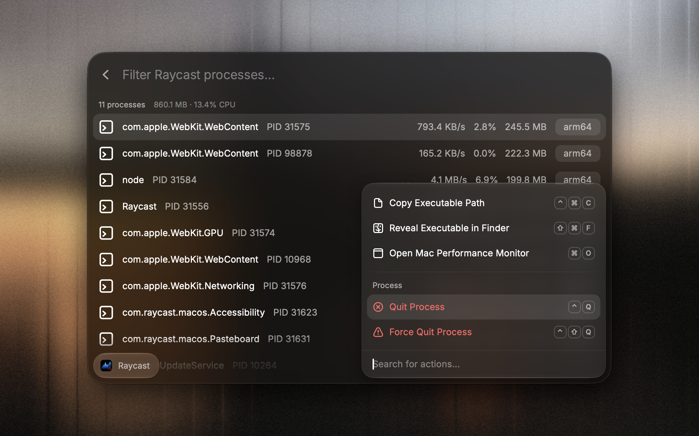

# Mac Performance Monitor

Check what is putting your Mac under pressure, and which app is causing it, without leaving Raycast. The extension displays the history recorded by [Mac Performance Monitor](https://github.com/Zesty0wl/mac-performance-monitor): memory pressure, CPU, GPU, disk, power and thermals, with every running app ranked by its share.

  
  

  

## Requirements

- [Mac Performance Monitor](https://github.com/Zesty0wl/mac-performance-monitor/releases) installed in `/Applications`.
- The app running with history recording turned on.

## Commands

| Command | Shows |
| --- | --- |
| **Performance Dashboard** | The panels you pick in preferences, two per row, with warning pills for high memory pressure, thermal throttling, high CPU temperature, heavy CPU load and low battery. |
| **Memory Stats** | Memory pressure over time, RAM composition, and apps sorted by memory footprint. |
| **CPU Stats** | CPU usage over time and apps sorted by CPU (one full core = 100%). |
| **GPU Stats** | GPU usage over time and apps sorted by GPU usage. |
| **Disk Stats** | Read and write throughput over time and apps sorted by disk activity. |
| **Power & Thermals Stats** | Power draw and CPU / GPU die temperatures over time, and apps sorted by energy impact. |
| **Copy AI Instructions** | Copies the app's own instructions for AI agents (from its `mpm prompt` command), so an assistant can query your recorded data. |

Every app row groups the app's helper processes under it the way Mac Performance Monitor does, so a browser's WebKit processes and the shells and tools started from a terminal or IDE count toward that app.

### Actions

| Action | Shortcut |
| --- | --- |
| Inspect Processes: every process of the app, with Copy PID, Copy Path, Reveal in Finder, Quit Process and Force Quit Process | `↵` |
| Open Mac Performance Monitor | `⌘` `O` |
| Quit App | `⌃` `Q` |
| Force Quit App | `⌃` `⇧` `Q` |

Quit and Force Quit always ask for confirmation first.

## History ranges

Charts can show the last 5 minutes up to the last 48 hours. The range dropdown only offers ranges that fit inside the **high-res history** length set in Mac Performance Monitor's settings (2 hours by default), so raise that setting in the app to get longer ranges here.

## Preferences

| Preference | Description |
| --- | --- |
| Default Time Range | The range each view opens with. Capped at the app's high-res history length. |
| Live Refresh Cadence | How often an open view refreshes- every 1, 2 or 5 seconds. |
| Panel 1 to Panel 12 (Dashboard) | Which panel goes in each dashboard position: odd numbers on the left, even on the right, one row per pair. Choose None to leave a position empty. |

## Privacy

Everything stays on your Mac. The extension-

- reads the app's database at `~/Library/Application Support/MacPerformanceMonitor/macperfmonitor.sqlite` in read-only mode and never writes to it
- lists running processes with a small bundled Swift helper, to group helper processes under their apps the way Mac Performance Monitor does and to check that the app is running
- reads the app's recording settings with `defaults read uk.co.bzwrd.macperfmonitor`
- makes no network requests

## Troubleshooting

- **"Mac Performance Monitor isn't running"**: open the app (press `↵` on the message).
- **A chart drops to zero**: nothing was recorded for that stretch. Check that history recording is turned on in the app.
- **"Could not read performance data"**: the database could not be read. Make sure the app has recorded at least once since it was installed.
