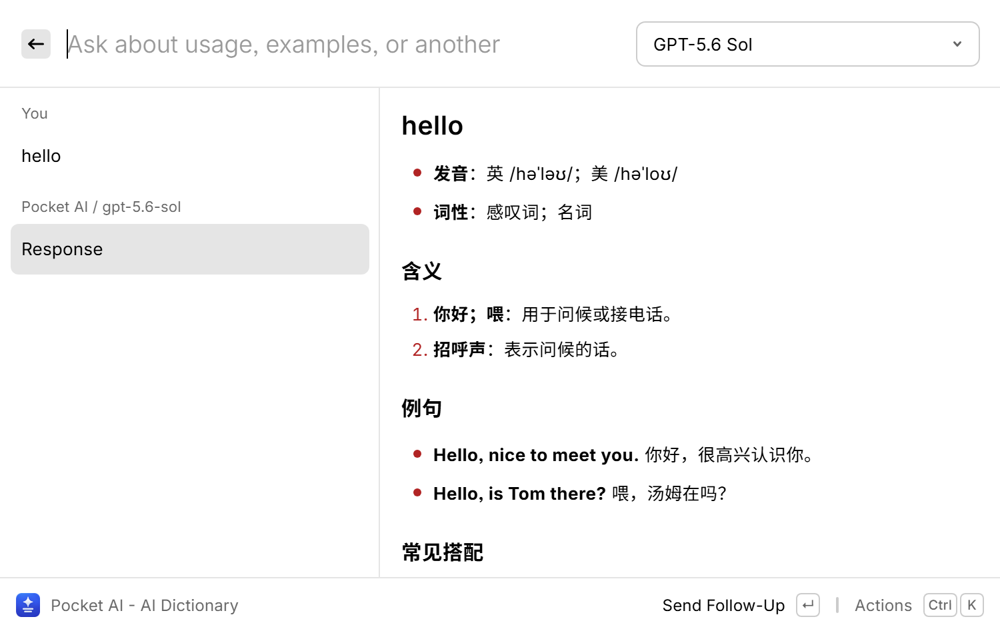
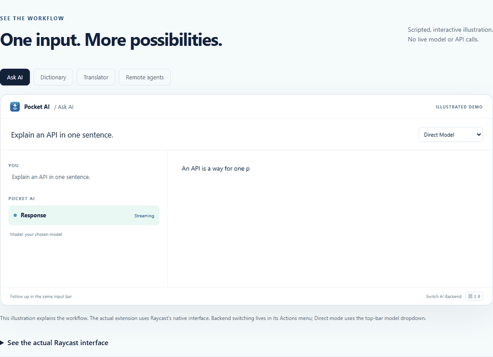

# Pocket AI

Bring your own models or remote agents to Raycast. Stream rich answers, define words, translate, polish writing, and ask follow-up questions in the top input bar.

Pocket AI is free and MIT-licensed. It does not use Raycast's paid AI API or unlock Raycast Pro. Model-provider usage, subscriptions, and remote hosting are separate.

## Set up your provider

1. Open **Pocket AI Settings > AI Provider**, or use Raycast's native extension preferences.
2. Set **API Endpoint** to your OpenAI-compatible base URL, such as `https://api.example.com/v1`, or a full `/chat/completions` URL.
3. Enter **API Key** in the native password field. Leave it empty only if your provider requires no authentication. Do not include `Bearer`.
4. Open **Ask AI**, choose a model from the dropdown, type a question in the top bar, and press Enter. That same bar accepts follow-up questions.

Model discovery uses the provider's `/models` endpoint. The default localhost URL expects a separately configured VS Code Copilot bridge; Pocket AI does not bundle a bridge or supply Copilot access. `127.0.0.1` refers to the computer running Raycast. Configure another accessible provider if you do not have that bridge.

## Commands

| Command               | Purpose                                              |
| --------------------- | ---------------------------------------------------- |
| Ask AI                | Streaming chat with direct models or remote agents   |
| AI Dictionary         | Definitions, pronunciation, examples, and follow-ups |
| AI Translator         | Translate into an explicitly chosen target language  |
| AI Polish Text        | Improve grammar, clarity, and tone                   |
| Remote Agents         | Shared backend/server settings                       |
| Configure AI Provider | Open native provider preferences                     |
| Add New Command       | Save a template-based custom tool                    |
| Pocket AI Settings    | Edit prompts, placeholders, models, and commands     |
| Run Custom AI Tool    | Launch a saved command or its Quicklink              |

Assign launch aliases/hotkeys in Raycast Settings. For example, assign `df` to Dictionary, then enter `df`, Space, a word, and Enter. Translator has no default target language; choose one in that command.

## Connect Hermes or OpenClaw

Only built-in Ask AI routes to remote agents. Dictionary, translation, polishing, and custom tools remain direct-provider tools.

1. Run your own compatible Hermes API server or OpenClaw gateway with a trusted connection.
2. Open **Remote Agents**, choose a backend, enter its server URL, and save.
3. Use **Set Hermes API Key** or **Set OpenClaw Gateway Token / Password** in Actions to open the corresponding native password preference. OpenClaw may require device pairing on your gateway.
4. Reopen Ask AI and choose an advertised agent/profile.

Inside Ask AI, use **Actions > Switch AI Backend**, **Command+Shift+B** on Mac, or **Ctrl+Shift+B** on Windows. Direct shows a model dropdown; remote modes show server-advertised profiles. Settings stay synchronized, and unsent input remains an unsent draft.

The harness owns models, memory, web tools, and execution. Leaving its view detaches without cancelling accepted work. Contexts are separate: returning to Direct starts fresh, while remote sessions restore from their server. No transcript is automatically forwarded between backends.

See the [complete remote-agent setup and protocol guide](https://github.com/edliuustc/pocket-ai-raycast/blob/main/REMOTE-AGENTS.md).

## Preview and customization

Rich Markdown, links, code blocks, and reachable image URLs render in Raycast's native preview. This is not image generation or binary-file upload. Use **Actions > Use Full-Width Text** for automatic row following. Long rich previews use native/manual scrolling; Raycast V1 exposes no internal Markdown-pane force-scroll API.

Use **Customize This Tool** to change prompts and input/follow-up placeholders. Add custom tools from templates and create Quicklinks with their own aliases/hotkeys.

_Genuine Windows Raycast capture with the sample query "hello". macOS uses its own native Raycast appearance. The project owner reported successful Mac Raycast V1 verification through v1.3.0._

_30-second scripted website illustration, not a native Raycast recording._

## Data and access

Requests go to the provider or server you configure. Credentials stay in native password preferences. Direct conversations live in invocation memory; remote transcripts live on the harness. Pocket AI remembers scoped session/run identifiers and encrypted OpenClaw device material, not a local conversation archive. Provider and harness data-handling terms still apply.

Pocket AI adds no analytics service. A different-origin command override never inherits the default provider API key.

## Help

[Website and interactive demo](https://edliuustc.github.io/pocket-ai-raycast/) · [Setup guides](https://edliuustc.github.io/pocket-ai-raycast/guides.html) · [Source and issues](https://github.com/edliuustc/pocket-ai-raycast) · [Discussions](https://github.com/edliuustc/pocket-ai-raycast/discussions)

Independent project; not an official product of Raycast, GitHub Copilot, Hermes, or OpenClaw. The internal `mae-ai` ID is retained for compatibility with existing shortcuts and storage.
