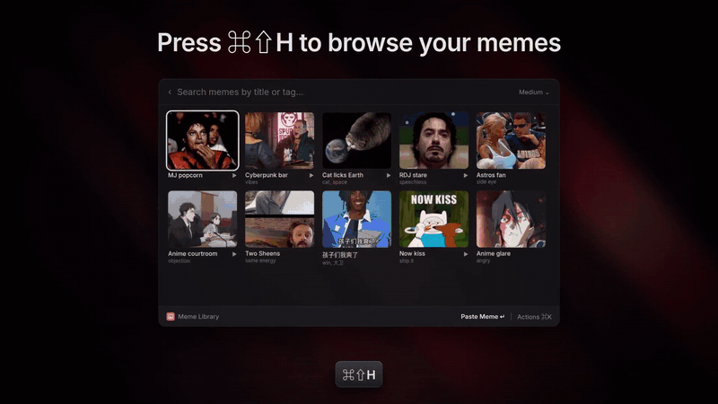
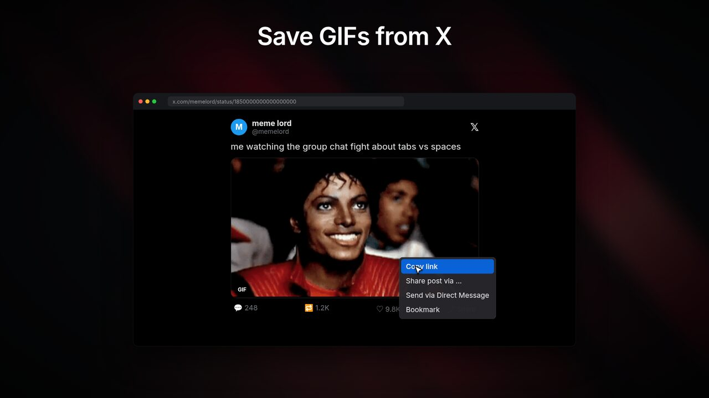
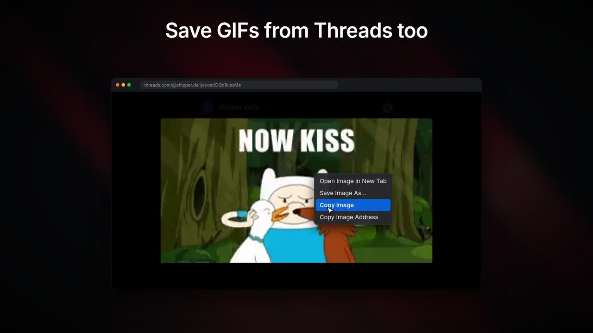
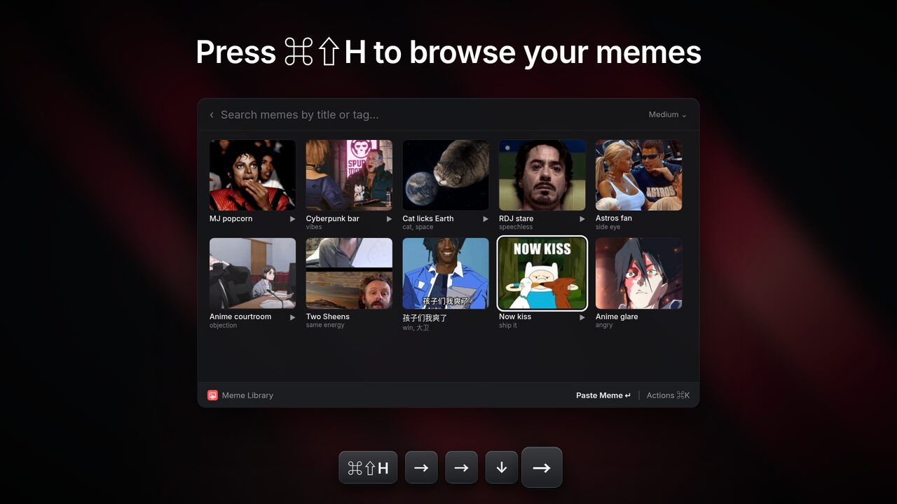
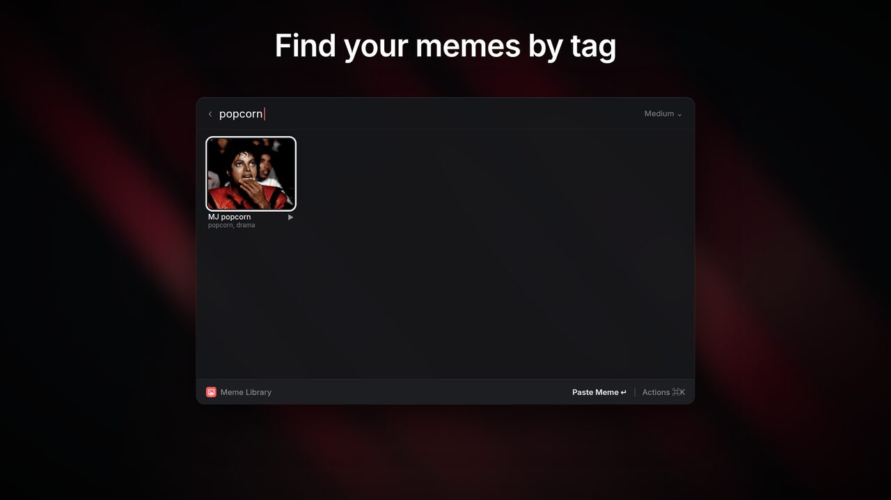
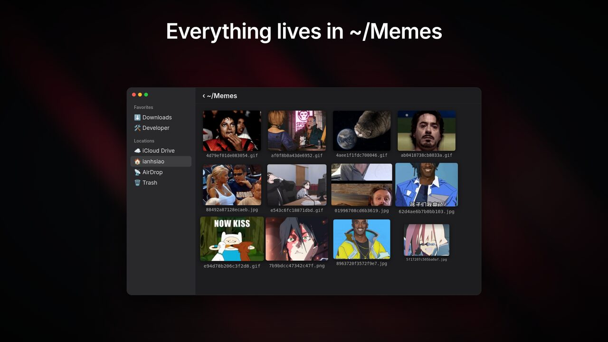

# Meme Library

**English** | [繁體中文](README.zh-TW.md)

A Raycast extension for your own meme library. Save the GIFs and images that you find on X, Threads, and other sites. Then find them again in a grid and paste them with the arrow keys and Enter. You do not have to remember keywords.



▶️ **[Watch the 28-second demo (MP4, with sound)](media/demo-en.mp4)**

## Requirements

- macOS with Raycast 2.
- Node.js 22 or later (only to install from source).
- [ffmpeg](https://ffmpeg.org) to save GIFs from X and other MP4 videos: `brew install ffmpeg`. Other memes do not need it.

## Install

The extension is not in the Raycast Store yet. Install it from source:

```bash
git clone https://github.com/madeyexz/raycast-meme-library.git
cd raycast-meme-library
npm install
npm run build   # installs the extension in Raycast
```

Then set hotkeys in Raycast Settings → Extensions → Meme Library.

## Commands

| Command | Suggested hotkey | What it does |
| --- | --- | --- |
| **Save Meme** | ⌥⌘S | Saves what you copied to the library. It shows a HUD and does not open a window. |
| **Meme Library** | ⌘⇧H | Opens a grid of your memes. Use the arrow keys to select one. Press Enter to paste it. |

Note: ⌘⇧H replaces the Finder shortcut "Go to Home".

## Save a meme

| Save a GIF from X | Save a GIF from Threads |
| --- | --- |
|  |  |

1. Copy the meme (see the table below).
2. Run **Save Meme**. The HUD shows "Saved GIF", "Saved image", or "Already in your meme library".

| Where | What to copy |
| --- | --- |
| A web page | Right-click the image → **Copy Image** (or **Copy Image Address**). |
| X | On the post, **Share → Copy link**. Or right-click the GIF → **Copy Gif Address**. Save Meme downloads the MP4 and converts it to a GIF. |
| Threads | Click the GIF to open it, then right-click → **Copy Image**. A post link alone does not work, because Threads needs a login. |
| Finder | Select image files and press ⌘C. Or select the files and run Save Meme while Finder is the frontmost app. |
| A screenshot or another app | Copy the image (for example ⌃⇧⌘4). It is saved as a PNG. |
| Earlier clipboard entries | Open Meme Library and press ⌘N. Select one of your last 6 clipboard entries. |

You can also put image files directly into the library folder.

### How Save Meme keeps GIFs animated

- When you copy an image in a browser, macOS puts a **static** bitmap on the clipboard. Save Meme first reads the `` URL that the browser also puts on the clipboard, and downloads the original file. If there is no URL, it uses the copied file. If there is no file either, it uses the static bitmap.
- Giphy preview URLs (for example `200.gif`) are changed to the full-size `giphy.gif`.
- MP4 videos are converted to looping GIFs with ffmpeg (15 fps, up to 480 px wide).
- Animated WebP files are saved as `.webp`, because ffmpeg cannot read them. Some apps paste a WebP as one still frame.
- A download stops after 30 seconds.

## Use a meme



In Meme Library, the most recently used memes come first. GIFs have a play badge.

| Key | Action |
| --- | --- |
| Enter | Paste the meme into the frontmost app. GIFs stay animated. |
| ⌥⇧⌘C | Copy the meme to the clipboard. |
| ⌘E | Edit the title and tags. Search finds memes by title and tag. |
| ⇧⌘F | Show the file in Finder. |
| ⌃X | Move the meme to the Trash. |
| ⌘N | Save from clipboard history. |
| ⌘O | Open the library folder. |
| ⌘R | Reload the library. |

In the preferences, you can change Enter to copy instead of paste.



## Library folder

Memes are normal files in `~/Memes`. You can change the folder in the preferences.



- File names are content hashes, so the same meme is not saved two times.
- `.meme-library.json` keeps the titles, tags, and usage data. If this file is damaged, the extension keeps it as `.meme-library.damaged-<time>.json` and does not overwrite it.
- `.thumbnails/` keeps small static thumbnails for the grid. Paste and copy always use the original file. If you delete this folder, the grid makes the thumbnails again the next time you open it.
- `.meme-library.lock` exists only while the index is being written.

## Development

```bash
npm install
npm run dev     # runs the extension in Raycast and reloads on changes
npm test        # library tests in plain Node (the video test needs ffmpeg)
npm run lint
npm run build
```
