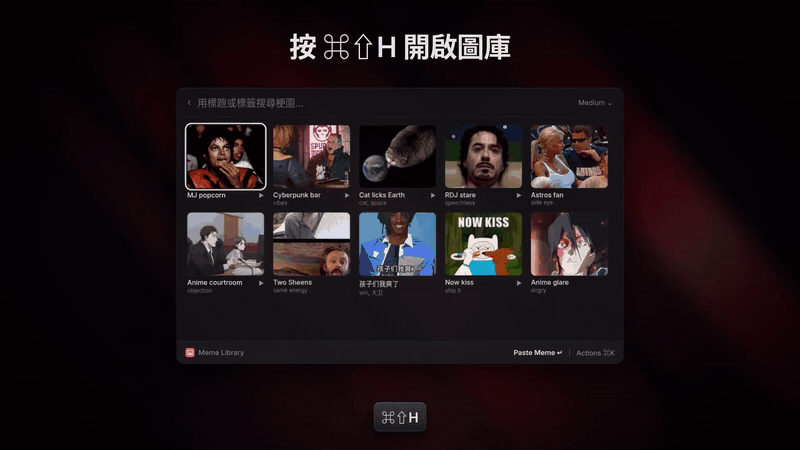
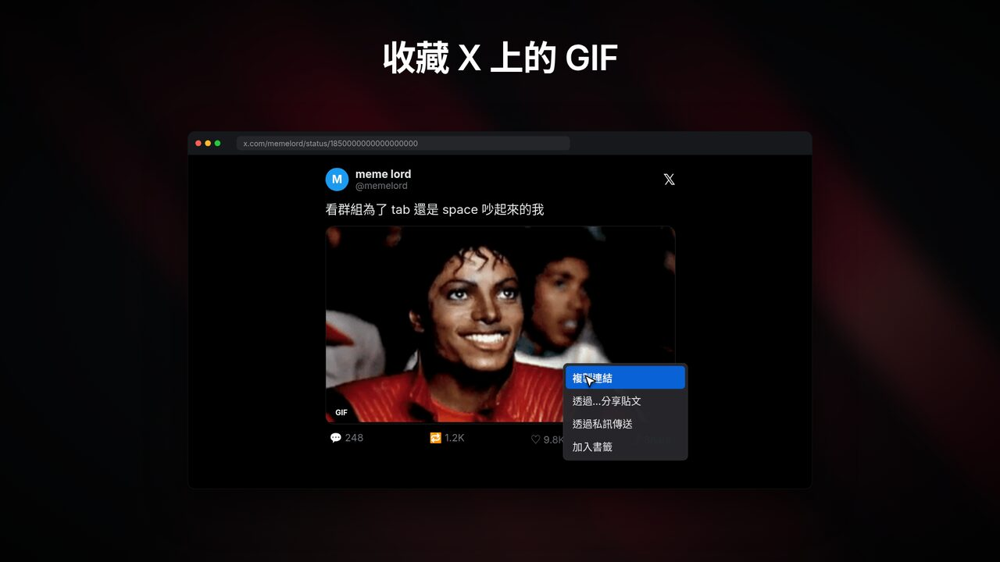
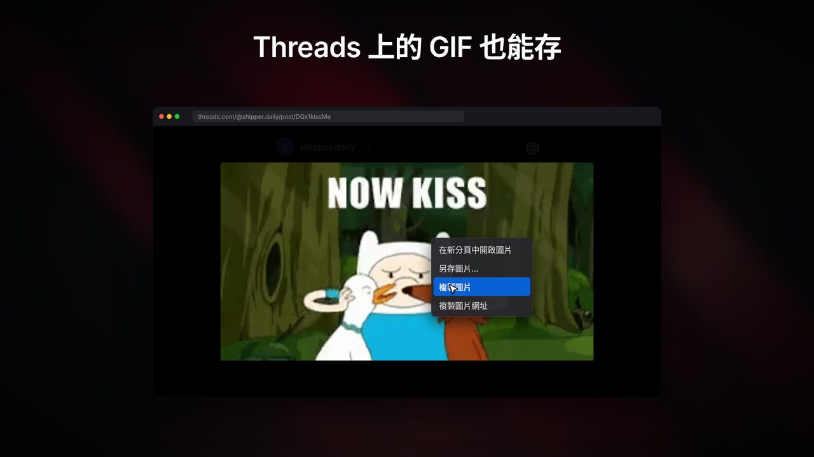
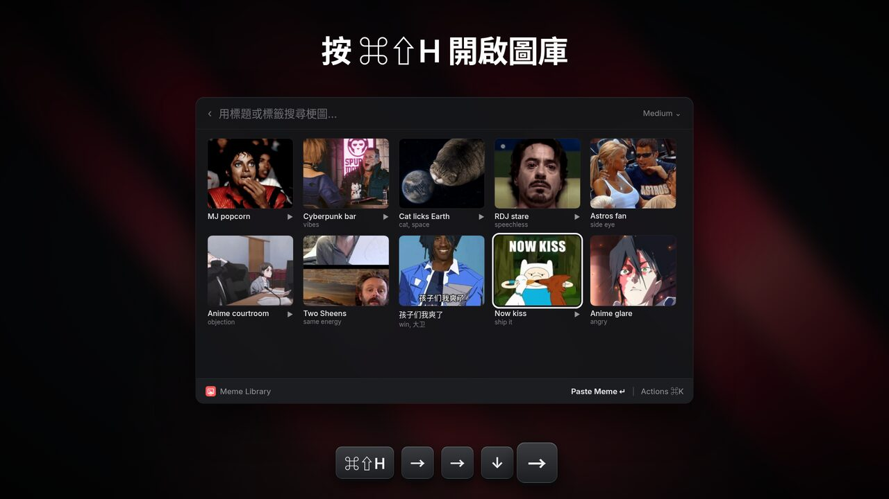
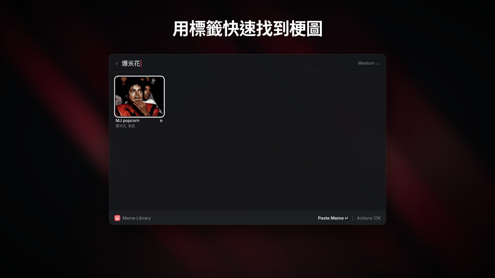
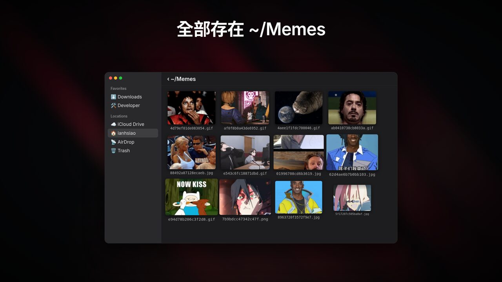

# Meme Library

[English](README.md) | **繁體中文**

一個 Raycast 擴充功能，讓你建立自己的梗圖庫。在 X、Threads 或其他網站看到喜歡的 GIF 和圖片，先存起來。要用的時候，在格狀清單裡用方向鍵選好，按 Enter 就能貼上，不用記關鍵字。



▶️ **[觀看 28 秒示範影片（MP4，有聲音）](media/demo-zh.mp4)**

## 需求

- 安裝了 Raycast 2 的 macOS。
- Node.js 22 以上（只有從原始碼安裝時需要）。
- [ffmpeg](https://ffmpeg.org)：從 X 或其他 MP4 影片存 GIF 時需要，用 `brew install ffmpeg` 安裝。其他梗圖不需要。

## 安裝

這個擴充功能還沒上架 Raycast Store。請從原始碼安裝：

```bash
git clone https://github.com/madeyexz/raycast-meme-library.git
cd raycast-meme-library
npm install
npm run build   # 把擴充功能安裝到 Raycast
```

接著到 Raycast 設定 → Extensions → Meme Library 設定快捷鍵。

## 指令

| 指令 | 建議快捷鍵 | 功能 |
| --- | --- | --- |
| **Save Meme** | ⌥⌘S | 把你複製的東西存進梗圖庫。只顯示 HUD 提示，不會開視窗。 |
| **Meme Library** | ⌘⇧H | 開啟梗圖格狀清單。用方向鍵選，按 Enter 貼上。 |

注意：⌘⇧H 會取代 Finder 的「前往個人專屬資料夾」快捷鍵。

## 存梗圖

| 存 X 上的 GIF | 存 Threads 上的 GIF |
| --- | --- |
|  |  |

1. 複製梗圖（方法見下表）。
2. 執行 **Save Meme**。HUD 會顯示「Saved GIF」、「Saved image」或「Already in your meme library」。

| 來源 | 要複製什麼 |
| --- | --- |
| 一般網頁 | 在圖片上按右鍵 → **複製圖片**（或 **複製圖片網址**）。 |
| X | 在貼文上按 **分享 → 複製連結**。或在 GIF 上按右鍵 → **Copy Gif Address**。Save Meme 會下載 MP4 並轉成 GIF。 |
| Threads | 先點 GIF 把它打開，再按右鍵 → **複製圖片**。只複製貼文連結沒有用，因為 Threads 要登入才看得到。 |
| Finder | 選好圖片檔，按 ⌘C。或選好檔案後，在 Finder 位於最前面時執行 Save Meme。 |
| 截圖或其他 App | 複製圖片（例如 ⌃⇧⌘4）。會存成 PNG。 |
| 之前複製過的東西 | 開啟 Meme Library，按 ⌘N，從最近 6 筆剪貼簿紀錄中選一筆。 |

你也可以直接把圖片檔放進梗圖庫資料夾。

### Save Meme 怎麼讓 GIF 保持會動

- 在瀏覽器複製圖片時，macOS 放進剪貼簿的是一張**靜態**點陣圖。Save Meme 會先讀取瀏覽器一起放進剪貼簿的 `` 網址，下載原始檔案。沒有網址時，改用複製的檔案。連檔案都沒有時，才用靜態點陣圖。
- Giphy 的預覽網址（例如 `200.gif`）和頁面連結（`giphy.com/gifs/…`）會換成原尺寸的 `giphy.gif`。
- MP4 影片會用 ffmpeg 轉成循環播放的 GIF（15 fps，寬度最多 480 px）。
- 動態 WebP 會存成 `.webp`，因為 ffmpeg 讀不了。有些 App 貼上 WebP 時只會顯示一張靜態畫面。
- 下載超過 30 秒會停止。

## 用梗圖



在 Meme Library 裡，最近用過的梗圖排在最前面。GIF 會有播放標記。

| 按鍵 | 動作 |
| --- | --- |
| Enter | 把梗圖貼到最前面的 App。GIF 一樣會動。 |
| ⌥⇧⌘C | 把梗圖複製到剪貼簿。 |
| ⌘E | 編輯標題和標籤。搜尋會比對標題和標籤。 |
| ⇧⌘F | 在 Finder 中顯示檔案。 |
| ⌃X | 把梗圖丟到垃圾桶。 |
| ⌘N | 從剪貼簿紀錄存梗圖。 |
| ⌘O | 開啟梗圖庫資料夾。 |
| ⌘R | 重新載入梗圖庫。 |

你可以在偏好設定把 Enter 改成「複製」而不是「貼上」。



## 梗圖庫資料夾

梗圖就是 `~/Memes` 裡的一般檔案。你可以在偏好設定換資料夾。



- 檔名是內容的雜湊值，所以同一張梗圖不會存兩次。
- `.meme-library.json` 存標題、標籤和使用紀錄。這個檔案損壞時，擴充功能會把它保留成 `.meme-library.damaged-<時間>.json`，不會覆蓋它。
- `.thumbnails/` 存格狀清單用的小型靜態縮圖。貼上和複製一律使用原始檔案。刪掉這個資料夾的話，下次開啟時會重新產生縮圖。
- `.meme-library.lock` 只在寫入索引時存在。

## 開發

```bash
npm install
npm run dev     # 在 Raycast 執行擴充功能，修改後自動重新載入
npm test        # 用一般 Node 跑梗圖庫測試（影片測試需要 ffmpeg）
npm run lint
npm run build
```
