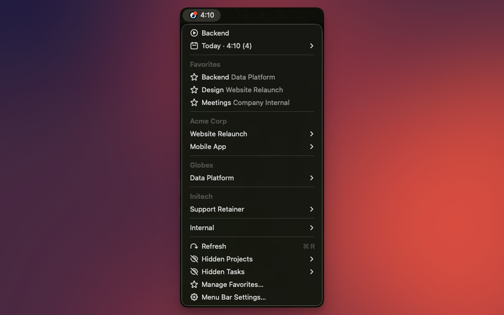
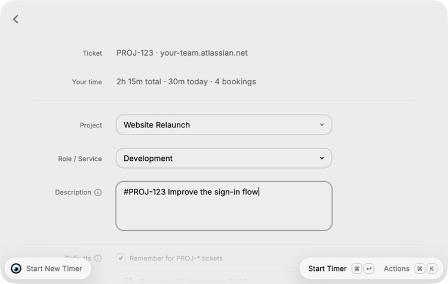
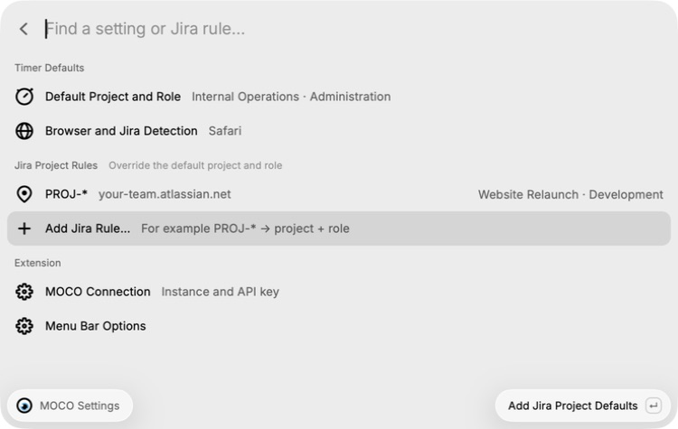

# MOCO

## Prerequisites

### URL Prefix

The prefix denoting your company in the MOCO URL (eg.: `yourcompany` if the url is `yourcompany.mocoapp.com`)

### MOCO API Key

Your personal API key. It can be retrieved at the following address: [https://yourcompany.mocoapp.com/profile/integrations](https://yourcompany.mocoapp.com/profile/integrations)

## Menu Bar

Today's timer, favorites and projects, right in the menu bar.

## Timer Defaults

Run **MOCO Settings → Default Project and Role** to choose the project and service to preselect in **Start New Timer**. The form calls MOCO's project task a **Role / Service**.

You can also choose them in the timer form and leave **Remember for plain timers** checked. **⌘⇧S — Save Project and Role Defaults** saves the selection without creating a booking. Uncheck **Remember…** for a one-off override. Opening the form does not start a timer; submit **Start Timer**, or enter a **Duration** and submit **Log Work** to record completed work.

## Optional Jira Detection

Browser detection is **off by default**. To enable it, open **MOCO Settings → Browser and Jira Detection** and turn on automatic detection. Then **Start New Timer** can prefill `#PROJ-123 Summary` and attach MOCO's native Jira ticket link.

- **Active browser** uses the app you were in before opening Raycast. It reads only that browser's current tab in its frontmost window. It does not search background browsers, other tabs or all Profiles.
- Choose a fixed browser, such as **Safari**, to read that browser's current tab even when starting a timer from another app.
- Supported browsers: Safari, Safari Technology Preview, Arc, Chrome, Brave, Edge, Vivaldi and Chromium. Firefox detection is not implemented; plain timers still work.
- Allow **Raycast → browser** under **macOS System Settings → Privacy & Security → Automation** when prompted. Webpage JavaScript, Accessibility and Full Disk Access are not required.
- Leave **Jira Domains** empty to accept Jira Cloud sites (`*.atlassian.net`), or enter allowed hostnames such as `your-team.atlassian.net, jira.example.com`. Self-hosted Jira requires an explicit hostname.

Direct `/browse/PROJ-123` tickets, boards with `selectedIssue=PROJ-123`, and issue navigators with `issueKey=PROJ-123` are supported. A summary is taken from the browser tab title only when it reliably identifies the same ticket. If no summary is available, add one in the form. No Jira API token is needed. A browser read failure leaves the plain timer available.

Use **⌘O — Open Jira Ticket** to open the linked issue, or **Use without Jira Ticket** in the action menu to open a fresh plain timer.

### Jira Project Rules

In **MOCO Settings**, add a rule such as `PROJ-* → Client Project + Development` for a specific Jira hostname. A matching rule overrides the general default project/service. Rules and defaults are isolated by MOCO instance and use project/service IDs, so renaming or reordering them does not change the selection.

If a saved project/service is no longer available, the form asks for a replacement instead of silently choosing another. With a Jira ticket attached, **Remember for PROJ-\* tickets** saves to that Jira rule. For a one-off override, uncheck it. Settings changes apply when the next timer form opens.

### Recorded Ticket Time

For a detected Jira ticket, **Your time** shows **your recorded MOCO time** across all dates and projects, for example `2h 15m total · 30m today · 4 bookings`. **⌘R — Refresh Jira Ticket Time** updates it without clearing the form. Running status is displayed separately; elapsed time is not added a second time to the API values.

Entries must link to the exact Jira site and ticket. Native Jira links and full Jira URLs in older entry descriptions are supported. A ticket key alone is not sufficient because the same key can exist on multiple Jira sites. The lookup reads all result pages and checks the current user's ID; failed or incomplete history is shown as unavailable rather than zero. Loading it does not block the timer form.

The total uses `worked_seconds`, falling back to `seconds` or decimal `hours` for older responses. It includes billed entries and is not restricted to today's project or service.

## Settings

**MOCO Settings** also links to the built-in connection preferences for the MOCO instance/API key and to **Menu Bar Options** for customer layout and today's time total.

