

  

  <h1>monobank</h1>

View currency rates, all your accounts and their transactions in monobank, set monthly budgets per category, see your subscriptions, keep a rate, a jar or your next subscription charge in the menu bar, and ask AI about them.

  

    
    
    
  

> This is an unofficial, personal project built on the [monobank open API](https://api.monobank.ua/docs/). It is not affiliated with, endorsed by or supported by mono. For help with your monobank account, contact monobank directly.

## Setup

The access token is required for the "Show Accounts", "Show Statement", "Show Budgets", "Show Subscriptions", "Sync Statements", "Jar Progress Menu Bar" and "Subscriptions Menu Bar" commands and for AI questions about your accounts, transactions, budgets and subscriptions. "Show Currency Rates" and currency questions work without it. To create an access token:

1. Visit https://api.monobank.ua/
2. Authenticate with your account
3. Click "Activate"
4. Copy generated access token and paste it into extension preferences

## Show Accounts

See all your cards, FOP accounts and jars with their balances, and the total of all of them in UAH at monobank's rates. Filter by type in the search bar, or search by name, currency, card number or IBAN.

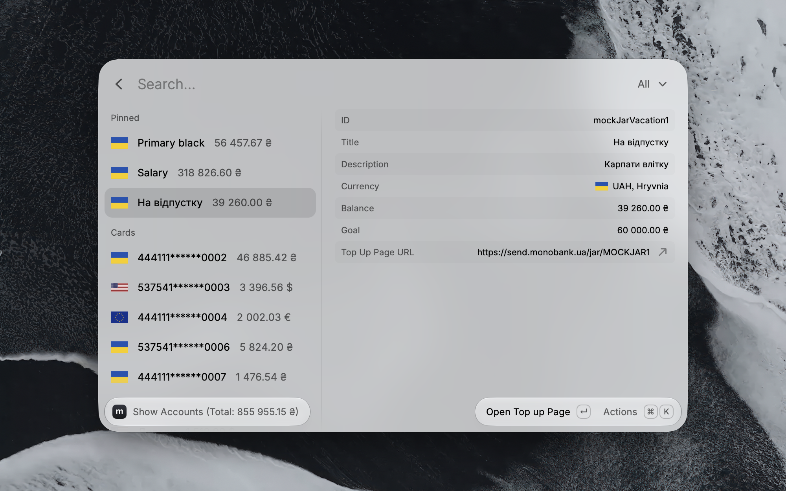

- Pin the accounts and jars you use most (`⌘ .`) to keep them on top, and reorder them.
- Give an account your own name with "Edit Account" (`⌘ E`). AI finds the account by it too.
- Toggle details (`⌘ ⇧ D`) to see an account's IBAN, credit limit and cashback type, or a jar's goal and top-up link.
- Copy the balance (`⌘ ⇧ B`), the total (`⌘ ⇧ T`), the IBAN (`⌘ ⇧ C`) or a jar's goal (`⌘ ⇧ G`), open the top-up page, or see the statement with "View Statement" (`⌘ ⇧ S`).

"Copy Requisites" (`⌘ ⇧ R`) copies an account's payment details for an invoice or a transfer: the recipient, IBAN, tax ID, bank name, bank EDRPOU and MFO. "Copy Requisites in English" transliterates the name and adds the bank's SWIFT. Two optional preferences fill them in:

- **Full Name for Requisites**: your full name with the patronymic. Without it, the name from monobank is used, which has no patronymic.
- **Tax ID (РНОКПП)**: left out of the requisites when empty.

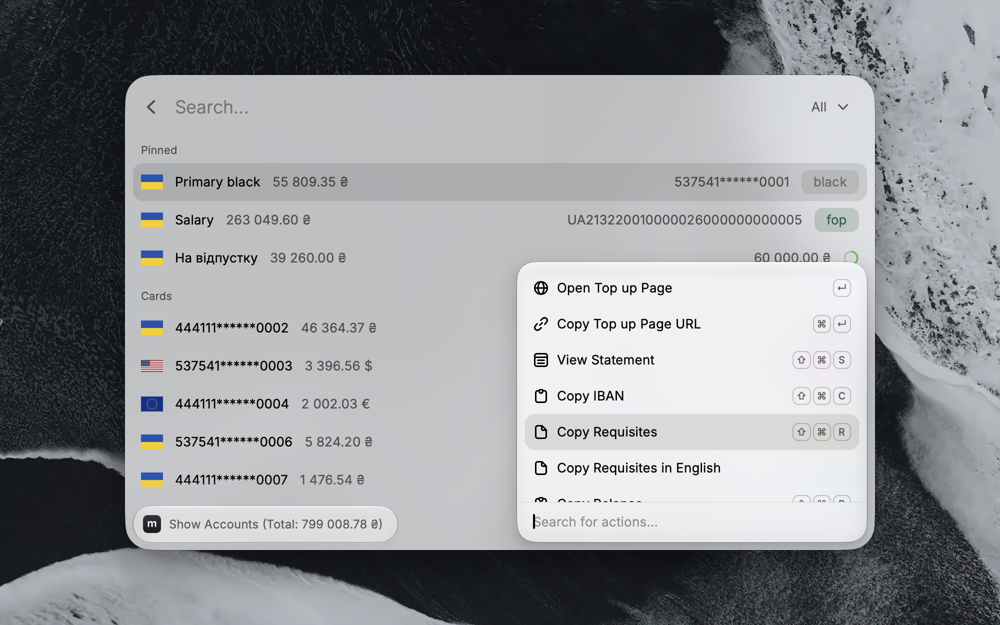

## Show Currency Rates

Browse monobank's currency rates. Enter copies the rate.

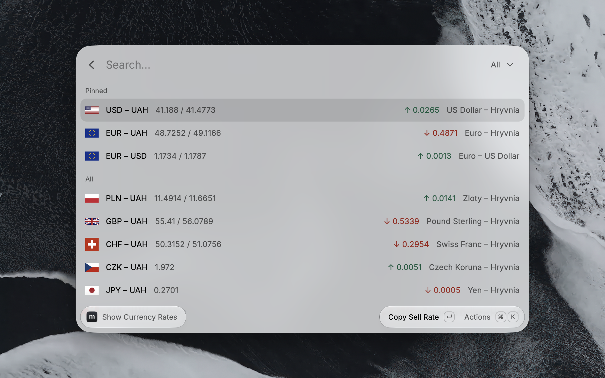

Use "Convert Currency" (`⌘ O`) on a rate and type an amount to see it converted both ways. For a pair like USD – UAH:

- UAH → USD uses the sell rate (the bank sells you dollars): `amount / sell`.
- USD → UAH uses the buy rate (the bank buys your dollars): `amount × buy`.
- Pairs with only a cross rate use it in both directions.

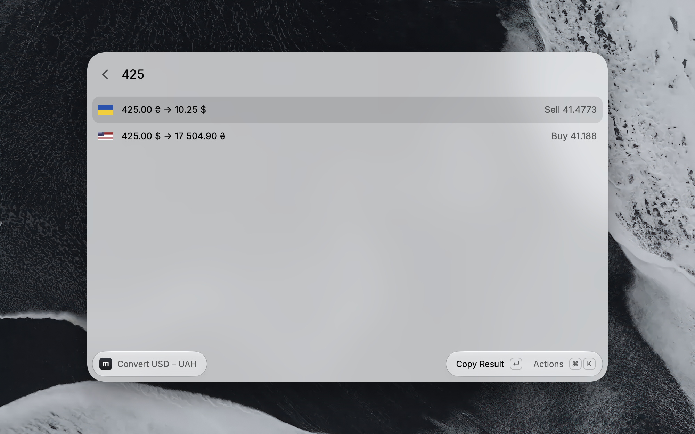

Next to each rate, an arrow shows how much it changed since the previous day, e.g. `↑ 0.12` (the sell rate, or the cross rate). Hover over it to see the old and new rates. monobank has no rate history, so the extension saves the last rates it loads each day. The first change appears the day after you first open the rates or run the menu bar.

## Convert Currency

Type `Convert` in Raycast, then an amount and the currencies, to see the result right away:

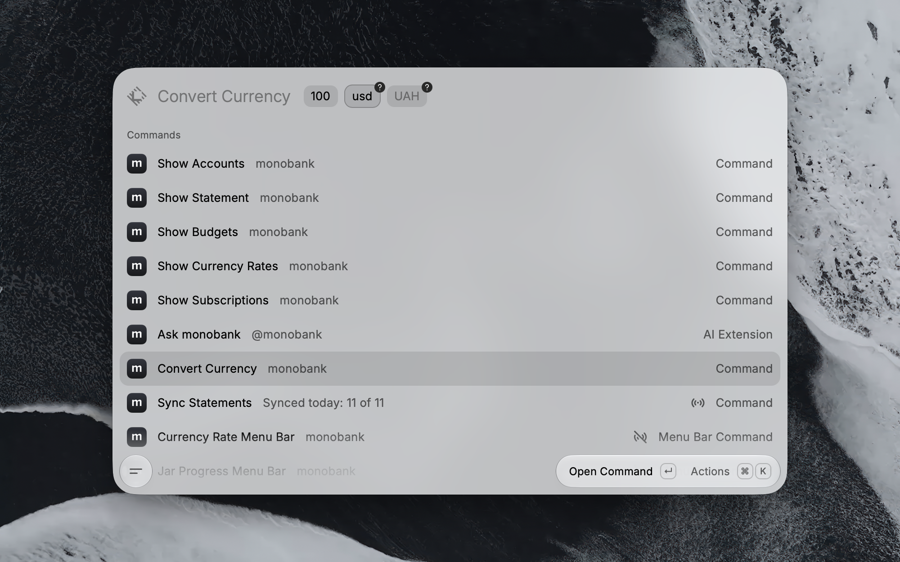

- `100 usd`: 100 USD sold for UAH and every other currency, and what 100 USD costs in UAH.
- `250 eur pln`: 250 EUR in PLN.
- `1000 грн`: 1000 UAH in USD, EUR and every other currency, starting with your pinned rates.

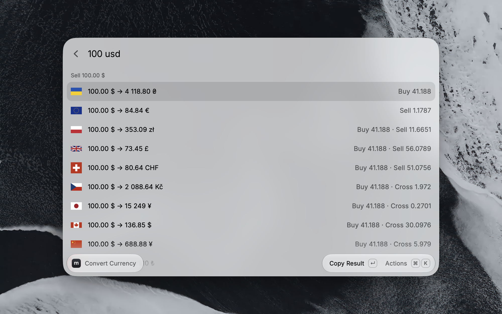

The currency to convert from defaults to USD. Codes are case-insensitive, and symbols and names work too: `$`, `€`, `₴`, `zł`, `£`, `грн`, `доларів`, `євро`. Edit the search text to convert something else, e.g. `$100`, `100 usd to eur` or `1 000,50 грн`. Enter copies the result, and `⌘ ↵` pastes it. Pairs without a direct rate are converted through UAH.

## Currency Rate Menu Bar

Keeps one currency rate in the macOS menu bar, next to its flag. Click it to copy the rate, or to see your pinned rates and all other rates.

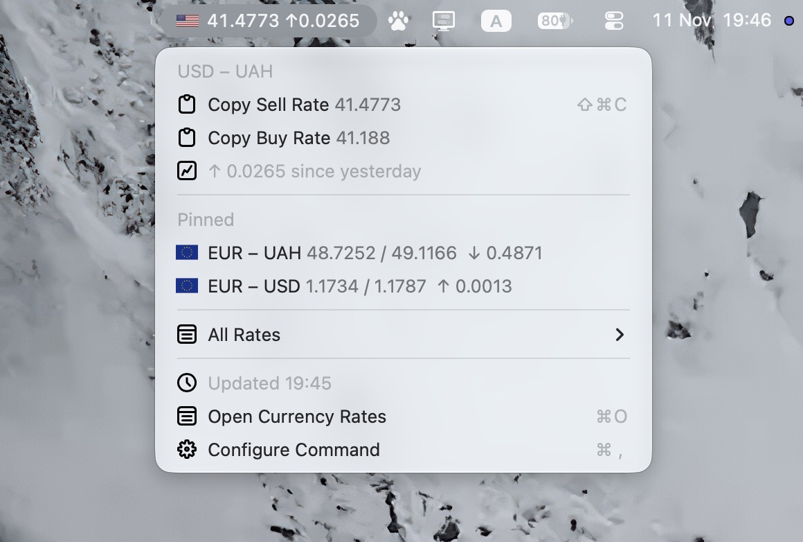

- Choose the rate in the title by clicking another rate in the menu, or with "Show in Menu Bar" (`⌘ ⇧ M`) on a rate in "Show Currency Rates". Until you choose one, it shows your first pinned rate, or USD – UAH.
- The "Menu Bar Title" preference sets what's shown: the sell rate (default), the buy rate, both, or only the flag. Pairs with only a cross rate always show it.
- The menu shows how much each rate changed since the previous day (see "Show Currency Rates"). Turn on the "Change in Title" preference to also show it in the title, e.g. `41.32 ↑0.12`.

## Jar Progress Menu Bar

Keeps one jar in the macOS menu bar with a progress ring and how much of its goal is collected. Click it to copy the balance, goal or amount left, open its top-up page, or see your other jars with their progress or balance: jars with a goal not reached yet first, then the ones with a reached goal, then jars without a goal, each with your pinned jars on top.

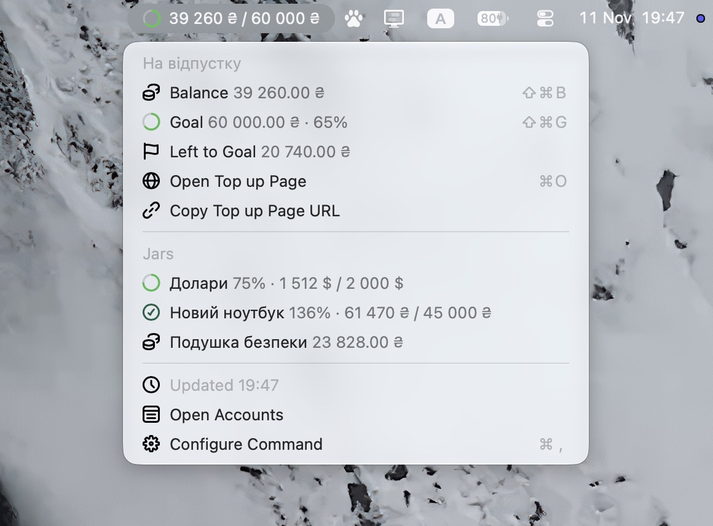

Choose the jar in the title by clicking another jar in the menu, or with "Show in Menu Bar" (`⌘ ⇧ M`) on a jar in "Show Accounts". Hold `⌥` in the menu to open a jar's top-up page instead. Until you choose one, it shows your first pinned jar, else the first jar with a goal that isn't reached yet.

The "Menu Bar Title" preference sets what's shown next to the icon: the percentage (default), the balance, the balance and goal, or nothing. Jars without a goal show their balance.

## Subscriptions Menu Bar

Keeps your next subscription charge in the macOS menu bar, e.g. `Netflix · tomorrow`. Click it to see the monthly total and all your subscriptions, grouped like in "Show Subscriptions": Upcoming, Active and Possibly Cancelled, each with its amount and next expected date. Click a subscription to open it in "Show Subscriptions", or hold `⌥` to copy its amount.

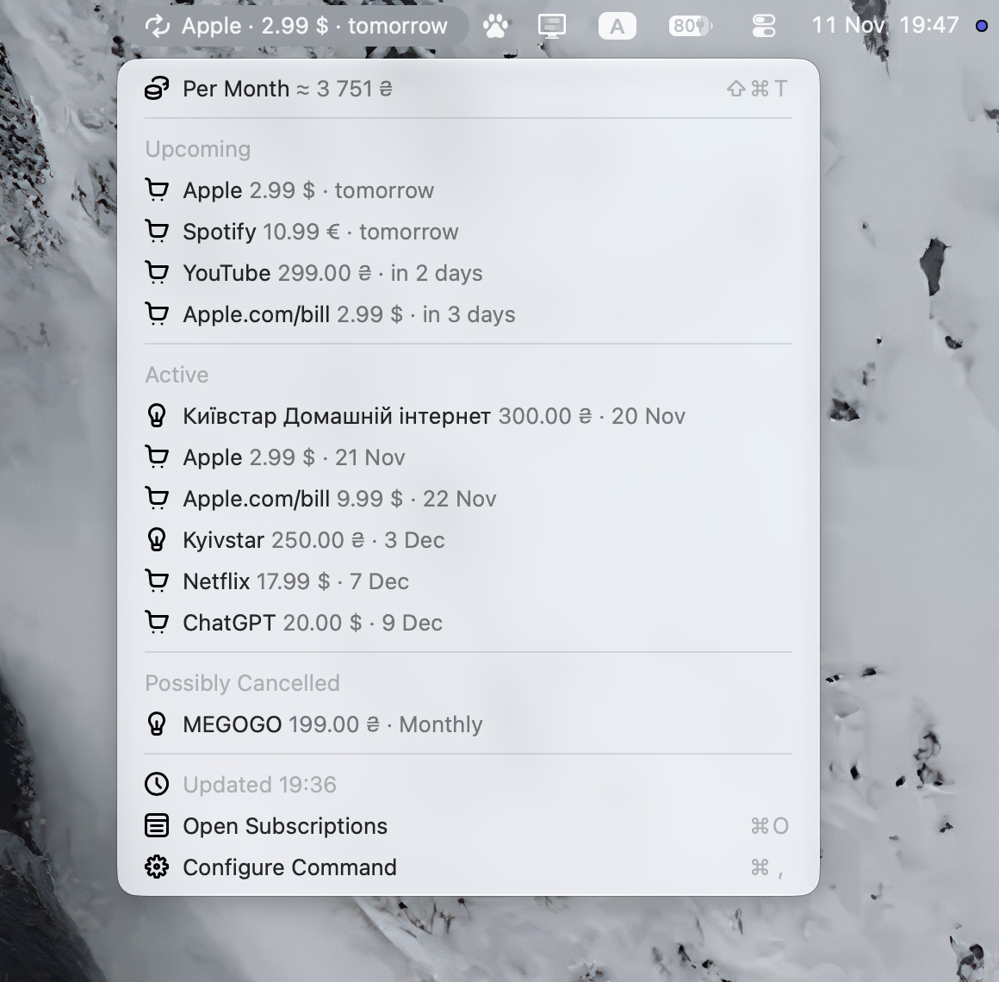

The "Menu Bar Title" preference sets what's shown next to the icon: the next charge (default), the next charge with its price (e.g. `Netflix · 349 ₴ · tomorrow`), the monthly total in UAH, how many charges are due in the next 7 days, or nothing. It reads the history "Sync Statements" stores, so it makes no statement requests, and renaming or hiding a subscription updates it right away.

The menu bar commands are macOS only. The rate refreshes every 2 hours, and when you open its menu if the rates are older than 30 minutes. The jar refreshes every 10 minutes, and the subscriptions every hour. When monobank can't be reached, they keep showing the last loaded data and say when it was loaded.

## Show Statement

Browse the transactions of a card, FOP account or jar. Pick the account in the search bar, or use "View Statement" (`⌘ ⇧ S`) on an account in "Show Accounts".

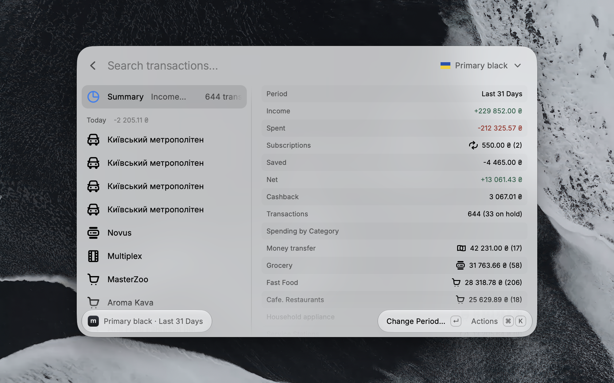

- Choose a period with "Change Period…" (`⌘ ⇧ P`): today, the last 7 days, this or last month, the last 31 days, or a custom range. A custom range can be longer than 31 days within the stored history (see "Keep Statements For"); before it, it can be up to 31 days, the most monobank returns at once.

  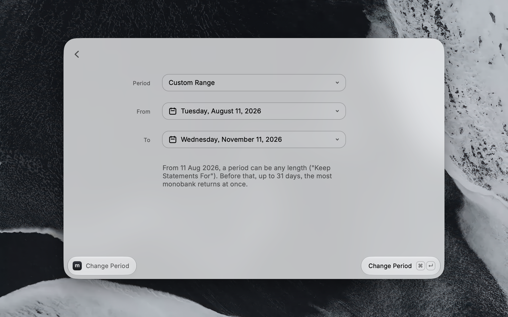

- The first item summarizes the period: income, spending and how much of it went to subscriptions, cashback, your budgets (see "Budgets") and spending by category.
- Toggle details (`⌘ ⇧ D`) to see a transaction's category, cashback, balance after it, comment, receipt number and counterparty.

  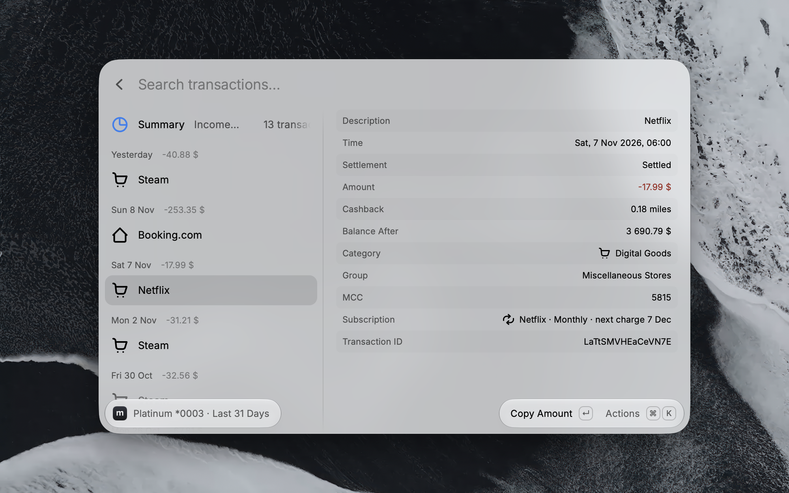

- Search by description, comment, counterparty, category (in English or Ukrainian), MCC or amount. Type "subscription" to see only the charges of subscriptions.
- Charges of a subscription (see "Show Subscriptions") have a "Subscription" tag, with its cadence and next charge in the details. Their actions show it in "Show Subscriptions", or mark it with "Not a Subscription" (`⌃ X`) if it isn't one.
- Export the statement to CSV in your Downloads folder, or copy it as CSV.

monobank allows one statement request per 60 seconds. Statements are cached, and when a request has to wait, a countdown shows until it's sent. One request returns up to 500 transactions; use "Load Older Transactions" to get more.

Statements are stored on your device for as long as the "Keep Statements For" preference says: 1 month, 3 months (the default), 6 months, 1 year or unlimited. With "Sync Statements" on, the history is loaded in the background back to this length (a year for Unlimited). Unlimited never deletes transactions, so it uses more disk space over time. Raising the setting makes "Sync Statements" load the extra months again.

## Budgets

Set a monthly limit for one or more spending categories, e.g. "Cafes & Restaurants: 5 000 ₴", and see how much of it you've spent.

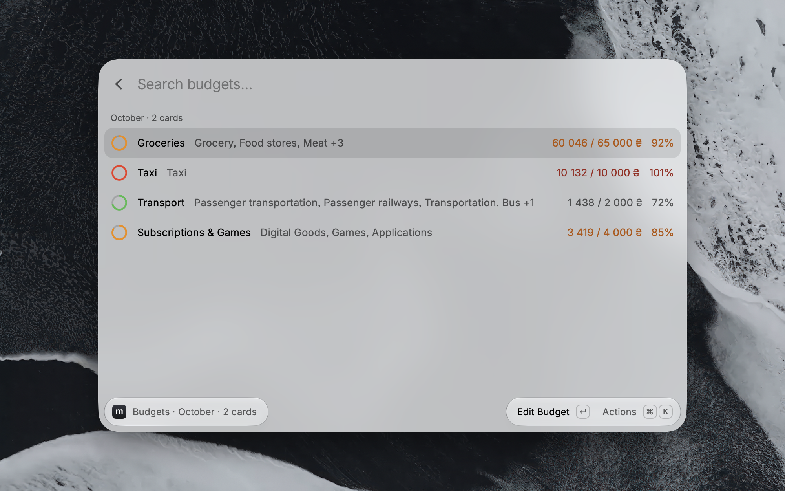

- **What counts**: spending in the budget's categories in the calendar month, across your budget accounts: all your personal UAH cards by default (not FOP or eAid accounts). Choose them with "Choose Accounts…" (`⌘ ⇧ O`) in "Show Budgets". USD and EUR cards and jars aren't counted. Transactions on hold count, and money coming back in a budget's categories, such as refunds, is subtracted.
- **Where**: the Summary in "Show Statement" shows your budgets for "This Month" and "Last Month" on your budget accounts, totaled across all of them, with a ring, spent of the limit, what's left and, for this month, how much you can spend per day. An orange or red mark on the Summary means a budget is near (80%) or over its limit. While searching, budgets still cover the whole month.

  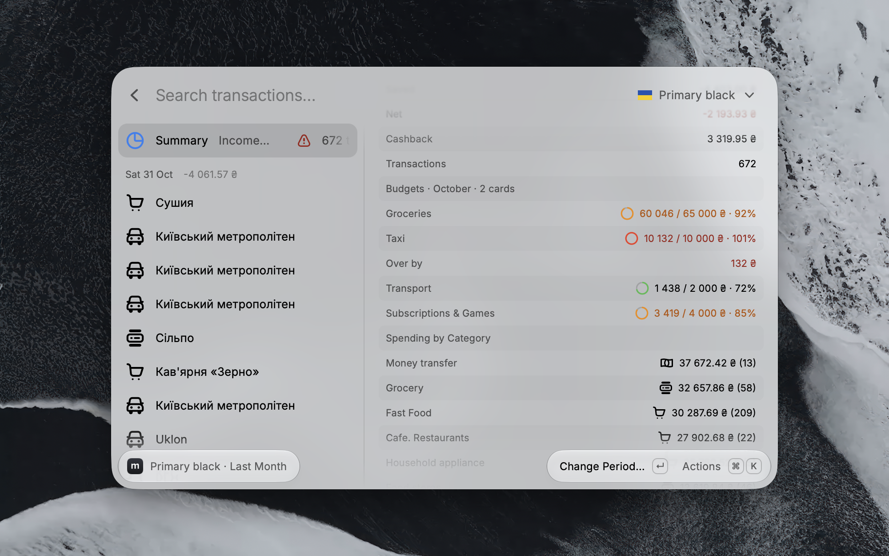

- **Manage**: use "Manage Budgets…" (`⌘ ⇧ U`) in "Show Statement", or the "Show Budgets" command. It shows saved spending right away, then updates the budget accounts not updated in the last 5 minutes, one request a minute. Switch between this and last month with `⌘ ⇧ P`, and see each budget's spending per card in the details. Create a budget from scratch or from a preset (Cafes & Restaurants, Groceries, Taxi, Transport, Car, Health, Clothes & Shoes, Subscriptions & Games, Entertainment, Beauty, Pets), then edit, reorder or delete it.

  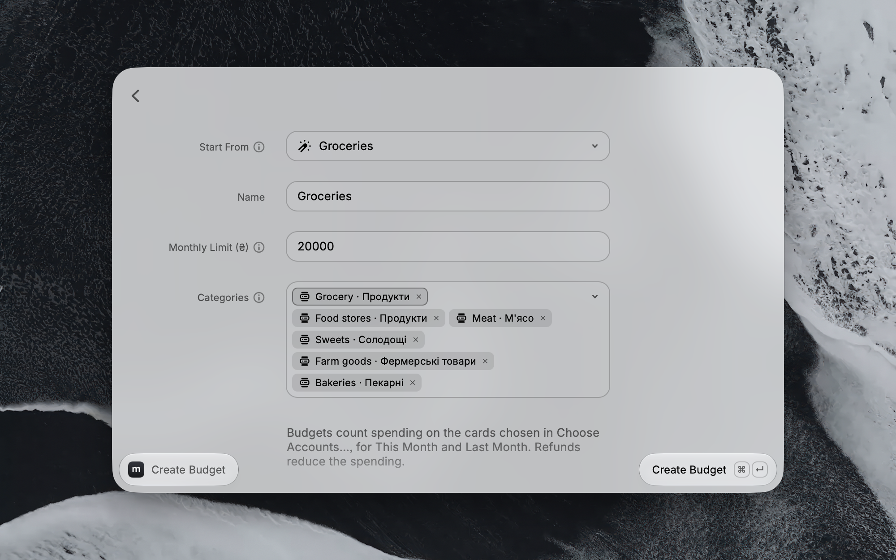

- **Categories** are merchant category names, searchable in English or Ukrainian. Categories you spent on recently are listed first.

## Show Subscriptions

See your recurring charges, such as Netflix, Spotify, ChatGPT or your mobile plan, with the amount and when the next one is due, without tracking them by hand.

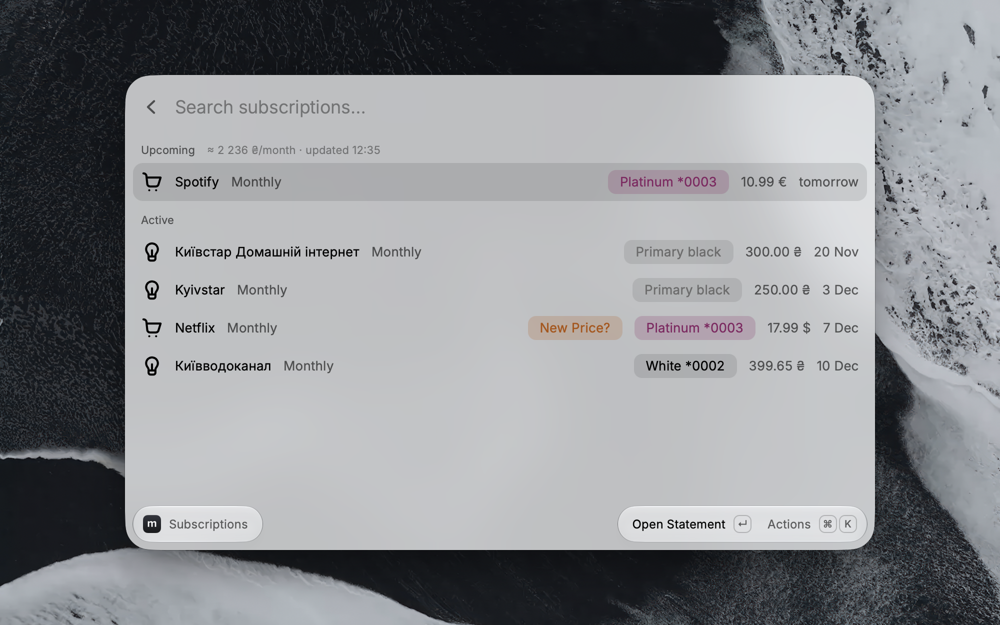

- **How they're found**: from the transactions stored on your device, across all your cards and FOP accounts. A subscription is a merchant charging about the same amount (within 10%) every week, month or quarter. Three charges confirm it; two are enough for typical subscription merchants (streaming, apps, mobile), marked "Likely". Subscriptions billed through one merchant at the same price, e.g. iCloud and Telegram at $2.99 through Apple, are told apart by the day of the month they're charged on; rename them to tell which is which. Charges that change every time, such as utility bills, aren't subscriptions, and neither are transfers, cash, taxes or top-ups of your jars. Yearly subscriptions aren't detected.
- **Amounts** are in the charge's own currency, e.g. $20 for ChatGPT on a UAH card, so they don't change with the exchange rate. A price change, e.g. Netflix going from $15.49 to $17.99, keeps the subscription and shows the old price in the details. When a subscription is charged on time at another price only once so far, it shows the new price with a "New Price?" tag: confirm it with "Confirm New Price", or choose "Not a Price Change" to keep the old price (the subscription then shows as possibly cancelled). Undo it from the toast, or later with "It Was a Price Change". A second charge at the new price confirms it on its own. The first section shows the approximate total per month in UAH.
- **Sections**: Upcoming (the next 7 days), Active, and Possibly Cancelled for subscriptions whose expected charge didn't come.
- **History**: the command makes no requests when it opens. "Sync Statements" loads the history in the background, back to the "Keep Statements For" preference (3 months by default), and subscriptions show once a merchant has charged at least twice. Use Refresh (`⌘ R`) to update the last 31 days.
- **Corrections**: rename a subscription with "Rename…" (`⌘ E`), or hide something that isn't one with "Not a Subscription" (`⌃ X`), here or on one of its charges in "Show Statement". Undo it from the toast, or later with "Show Hidden Subscriptions" (`⌘ ⇧ H`) and "Unhide".
- Toggle details to see the monthly and yearly cost, the card, the category and every charge, or open the card's statement.

  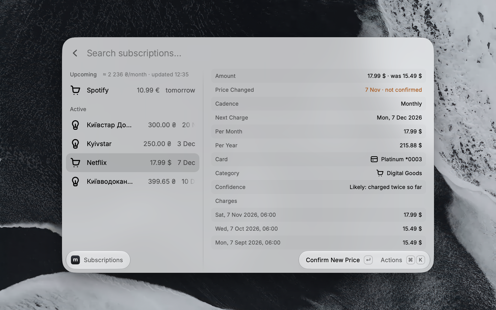

## Sync Statements

Keeps the statements of all your cards, FOP accounts and jars up to date in the background, so "Show Statement" and AI answers have today's transactions right away, even for accounts you rarely open.

monobank allows one statement request per 60 seconds, so the command runs every 2 minutes and makes one request per run:

- First, it syncs the last 31 days of each account not synced today, starting with the account "Show Statement" opens by default. Accounts already synced today, by this command, "Show Statement" or AI, are skipped.
- Once all are synced today, it loads older history, 31 days per run, back to the "Keep Statements For" preference (a year for Unlimited), so past periods open without waiting.
- Once all of it is loaded, runs make no requests until the next day.

The command's subtitle in Raycast shows the progress, e.g. "Synced today: 4 of 6 · History: 2 of 6".

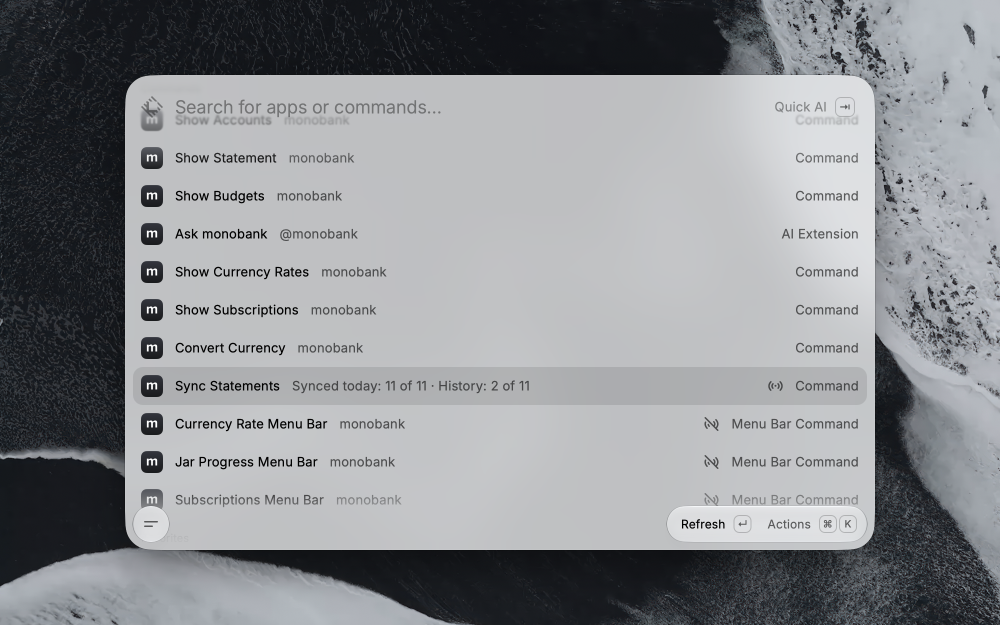

Background refresh is off until you open the command once or turn it on in its preferences. Opening it syncs the next account right away.

## AI

Mention `@monobank` in Raycast AI Chat or Quick AI and ask in English or Ukrainian. For example:

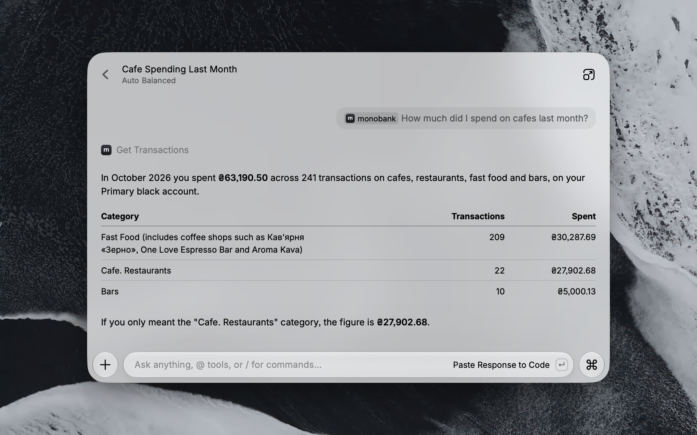

- Скільки 500 гривень в доларах?
- 15 dollars in euro.
- How much is left to reach the "New Car" jar goal?
- Дай посилання для поповнення мого основного рахунку
- Скільки грошей я витратив в категорії кафе та ресторани за останній тиждень?
- How much money has been deposited into my account in total this month?
- Які у мене зараз є активні збори?
- Do I have enough money in my accounts to reach the goal in jar "A"? If not, how much more do I need?
- Скільки ще можу витратити на кафе цього місяця?
- Am I over budget anywhere?
- Встанови бюджет 5000 грн на таксі
- Скільки я отримав переказів минулого місяця?
- What subscriptions do I have?
- Коли наступне списання за Netflix?

AI finds accounts and jars by their names, including the custom names you give accounts in "Show Accounts", even when you ask in another language (e.g. "основний рахунок" for an account named "Primary"). When you don't name an account, it uses the default one (the first pinned account, or the first UAH card) and tells you which.

AI can also create, change and delete budgets; Raycast asks you to confirm before anything is saved.

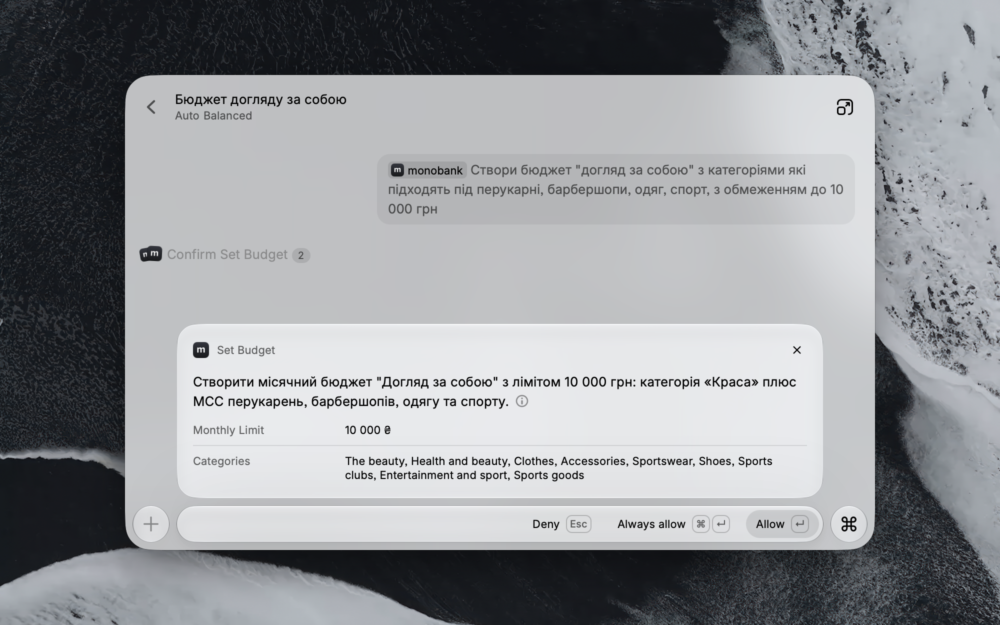

Conversions use monobank's current rates, the same way as "Convert Currency". Questions about transactions can be about any past period. Stored history (see "Keep Statements For") answers a period of any length, e.g. the last 3 months. monobank returns at most 31 days at once, so for a longer period before the stored history, AI offers the longest one that fits and asks before loading it. Questions share the statement cache and the 60-second rate limit with "Show Statement", so an answer can take up to a minute.

## Credits

Merchant categories come from the [Merchant Category Codes](https://github.com/Oleksios/Merchant-Category-Codes) dataset by Oleksios, licensed under MIT.
