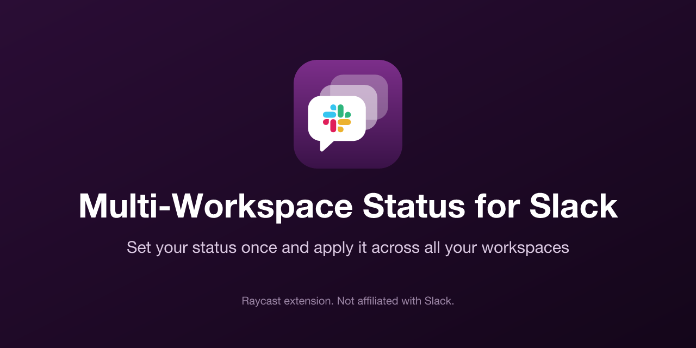

<div align="center">



# Multi-Workspace Status for Slack

**Set your status once and apply it across all your selected Slack workspaces**

[](https://github.com/marcusthiele/Multi-Workspace-Status-for-Slack/releases)
[](https://www.raycast.com)
[](#-setup)
[](https://github.com/marcusthiele/Multi-Workspace-Status-for-Slack/blob/main/.github/LICENSE)

[](https://github.com/marcusthiele/Multi-Workspace-Status-for-Slack)
[](https://github.com/marcusthiele/Multi-Workspace-Status-for-Slack/issues)

</div>

## 🚀 What it does

If you are a member of several Slack workspaces, updating your status means switching between them
and repeating the same steps. This Raycast extension lets you set the status once and applies it to
every workspace you select.

## ✨ Features

- Set the same emoji, text, and expiration in all selected workspaces at once
- Choose the target workspaces each time. Your last selection is remembered
- Clear your status with one command or from the form
- See exactly which workspace failed and why. The remaining workspaces are still updated

## 🧭 Commands

| Command        | What it does                                                                   |
| -------------- | ------------------------------------------------------------------------------ |
| `Set Status`   | Choose workspaces, emoji, text, and expiration                                 |
| `Clear Status` | Clears your status in the workspaces you selected last, without opening a form |

Shortcuts in `Set Status`:

| Shortcut | Action            |
| -------- | ----------------- |
| `⌘↩`     | Set Status        |
| `⌘⇧⌫`    | Clear Status      |
| `⌘⇧↩`    | Manage Workspaces |

## 🔥 Setup

The extension connects to each workspace with a Slack user token that you create yourself. You need
to do this once per workspace.

1. Open `Set Status` and run **Manage Workspaces** (`⌘↩` before your first workspace, `⌘⇧↩` after
   that), then choose **Add Workspace**
2. Run the **Copy Manifest and Open Slack** action (`⌘⇧↩`). This copies the app manifest below and
   opens the Slack app page
3. In Slack, select **From a manifest**, choose your workspace, and click **Next**
4. Switch to **JSON**, replace the content with the copied manifest, click **Next**, then **Create**
5. Open **OAuth & Permissions**, click **Install to Workspace**, and then **Allow**
6. Copy the **User OAuth Token** (it starts with `xoxp-`), paste it into Raycast, and submit the form

```json
{
  "display_information": {
    "name": "Raycast Multi-Workspace Status",
    "description": "Sets my Slack status from Raycast."
  },
  "oauth_config": {
    "scopes": {
      "user": ["users.profile:write"]
    }
  },
  "settings": {
    "org_deploy_enabled": false,
    "socket_mode_enabled": false,
    "token_rotation_enabled": false
  }
}
```

> [!IMPORTANT]
> Some workspaces only allow approved apps. If Slack shows **Request to Install** instead of
> **Install to Workspace**, a workspace admin has to approve your app first.

## ⚙️ How it works

- Adding a workspace checks the token with Slack's `auth.test` method and confirms that it has the
  `users.profile:write` scope
- Setting or clearing a status calls `users.profile.set` once per selected workspace, in parallel,
  with that workspace's token
- A failure in one workspace doesn't stop the others. The toast lists what failed

## 🔒 Privacy

Tokens are stored in Raycast's encrypted local storage and are sent only to `slack.com`. The
extension includes no analytics.

Slack doesn't offer a narrower scope than `users.profile:write`, so a token could also change other
profile fields. The extension only changes your status.

To disconnect a workspace, remove it in **Manage Workspaces** and then delete the app under
[Your Apps](https://api.slack.com/apps).

## 🛠️ Troubleshooting

| Message                                 | What to do                                                                         |
| --------------------------------------- | ---------------------------------------------------------------------------------- |
| `Use a User OAuth Token (xoxp-…)`       | You pasted a different token type. Copy the **User OAuth Token** from Slack        |
| `Missing the users.profile:write scope` | Add the scope under **OAuth & Permissions**, reinstall the app, and copy the token |
| `Emoji doesn't exist in this workspace` | Custom emoji must exist in every selected workspace. Pick a standard emoji instead |
| `Token was revoked` or `Token expired`  | Remove the workspace and add it again with a new token                             |

## ⚠️ Limitations

- You need to create one Slack app per workspace
- Custom emoji only work in workspaces where they exist
- The status only goes from Raycast to Slack. Changes you make in Slack aren't copied to your other
  workspaces
- `Clear Status` uses the workspaces from your last `Set Status`. Without one, it clears all
  connected workspaces
- The extension is only available on macOS

## ℹ️ Disclaimer

This extension is not created by, affiliated with, or supported by Slack Technologies, LLC.

## ⭐ License

This project is licensed under the terms of the [MIT license](https://github.com/marcusthiele/Multi-Workspace-Status-for-Slack/blob/main/.github/LICENSE)
