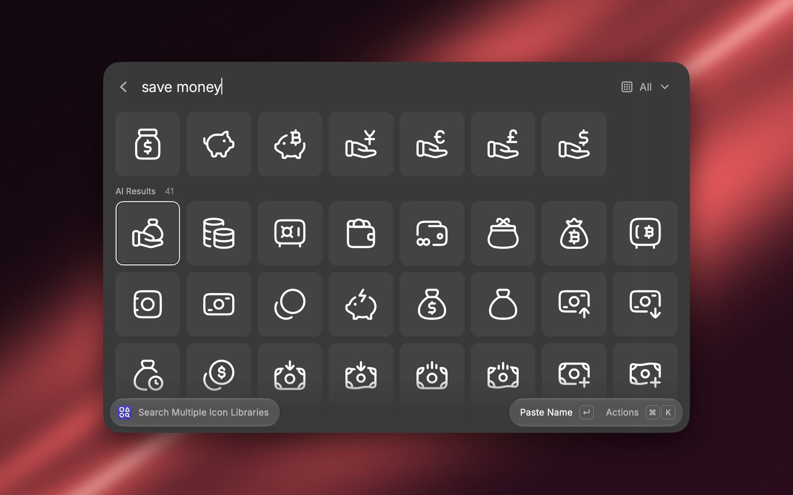
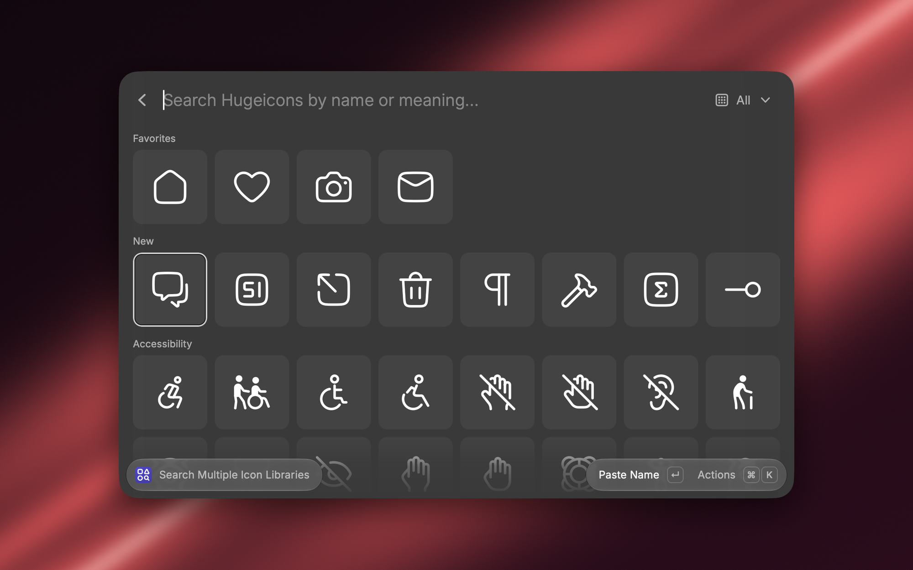
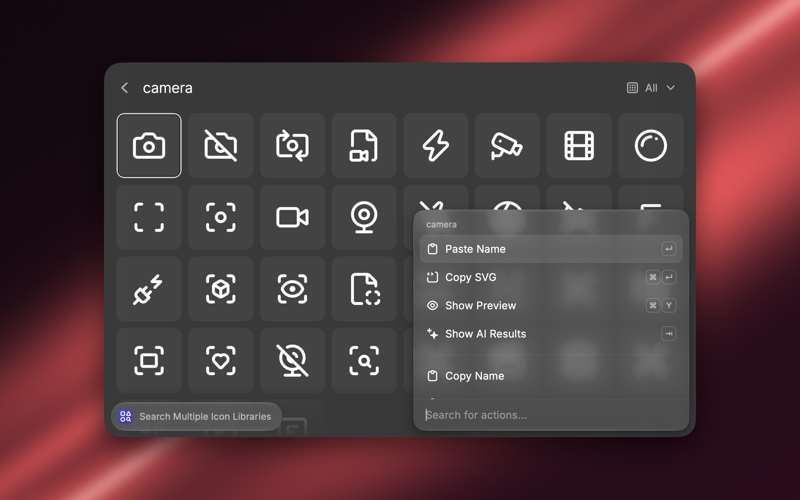
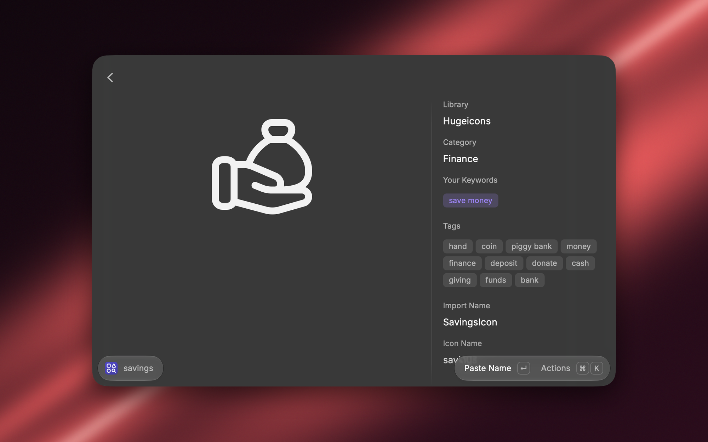

# Multiple Icon Libraries Search

Search the Lucide and Hugeicons icon libraries from one command, by name or by what you mean. Paste or copy any icon's name, SVG, or React code.

## What sets it apart

- **Two libraries, one command.** Lucide and the free Hugeicons set (Stroke Rounded). ⌘L switches between them.
- **Search by meaning.** Type "happy face" and you get smiley icons, even when no icon is tagged that way. When a search finds less than one row, Raycast AI suggests more words and the matches appear under AI Results. Press Tab to ask at any time.
- **It learns your words.** Use an icon from AI Results and your search words are saved to it, so the same search finds it next time without AI. Edit Keywords adds your own.
- **Opens on what you use.** Before you type: your favorites, your most used icons, a row of new icons, then every icon by category.
- **Works offline.** Icons are saved on your Mac after the first download and refresh once a day in the background.

## Everything else it does

- **Actions:** Paste Name, Copy Name, Paste SVG, Copy SVG, and Copy React Code. The Enter Action setting picks which one Enter runs. ⌘K also has Show Preview (⌘Y), Save SVG to Downloads, Add to Favorites (⌘⇧F), Open on the library's site, and Edit Keywords.
- **Ask Raycast AI:** mention the extension in AI Chat or Quick AI, for example "@multiple-icon-libraries-search an icon for deleting a file". Its Find Icons tool searches both libraries and returns each icon's name, React code, and SVG.

## Settings

- **Libraries:** turn Lucide or Hugeicons off.
- **Default Library:** open on the last one used, or always on one.
- **Enter Action**, **Name Format** (`Ticket01Icon` or `ticket-01`), **Library Name** (paste "Lucide Ticket"), and **Stroke Width** (applies to SVG and React code).
- **Favorites:** show your favorites before you search. They always come first among matching results.
- **Automatic AI**, **AI Model**, and **Remember AI Picks:** how AI search runs. AI search needs Raycast Pro; everything else works without it.

## How AI search works

1. Your search words go to Raycast AI, and nothing else does: not the icon list, not your keywords.
2. The AI replies with about 15 words an icon for that idea is likely tagged with, such as "smile, grin, laugh, emoji" for "happy face".
3. The extension matches those words against icon names and tags on your Mac. Icons that answer more of the words, and the AI's first picks, rank higher. Icons far behind the best match are left out.
4. Pick one and your search words are saved to it, so next time a plain search finds it.

The AI Model setting picks the model: DeepSeek V4.1 Flash (the default, lowest cost), GPT-5.4 mini (fastest), or Raycast's default, GPT-6 Luna. They find about the same icons. Each AI search uses one call from your Raycast AI allowance.

## Where the icons and tags come from

- **Lucide:** names, tags, categories, and drawings from lucide.dev.
- **Hugeicons:** drawings from the `@hugeicons/core-free-icons` package on npm, checked against npm's checksum. Hugeicons keeps its own search tags private, so this extension ships its own. Claude Sonnet 5.5 wrote them by looking at each icon's picture and name, and picked one of Lucide's categories for each. In our test, searches found the right icon more often with these tags than with Hugeicons' own. The extension never asks hugeicons.com for anything. Icons Hugeicons adds after this release show up right away and can be found by name until the next update brings their tags.
- **New icons:** compared with each library's release from about 90 days ago (npm and jsDelivr).

Your favorites, saved keywords, and usage counts stay on your Mac.

## Credits

- [Lucide](https://lucide.dev): ISC License, Lucide Contributors.
- [Hugeicons](https://hugeicons.com) free icons: MIT License.
