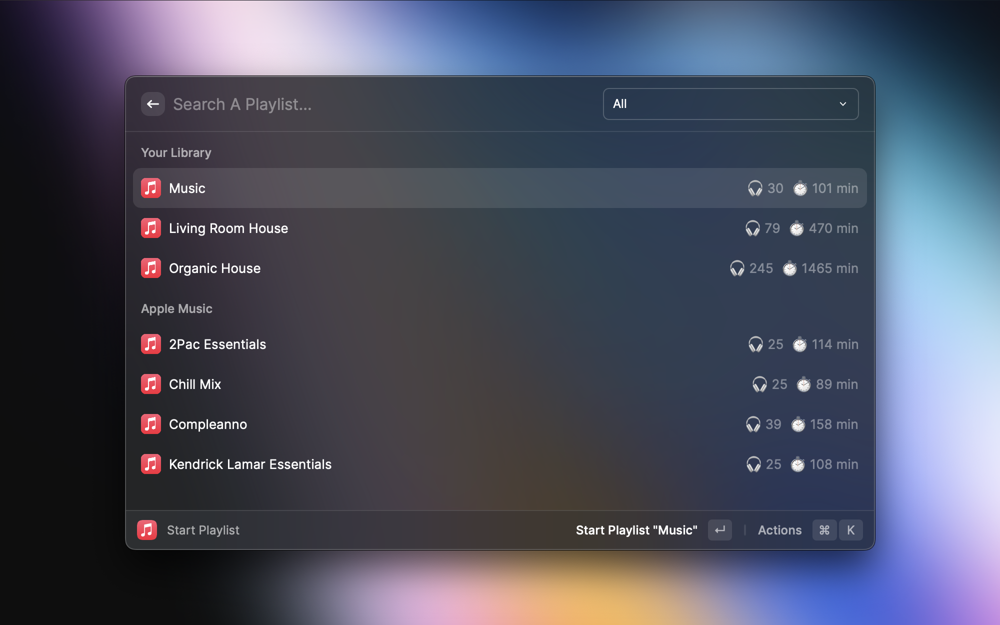
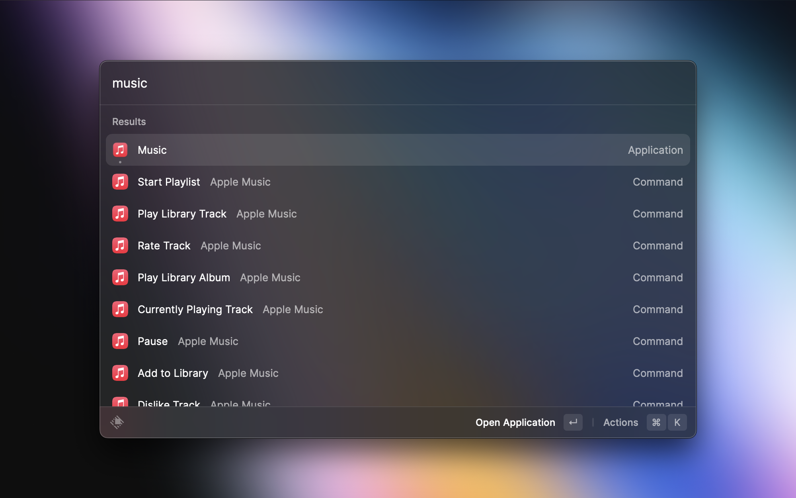

	

# Music

> Apple music extension

## Catalog playback

**Search Apple Music** offers **Play in Music** for catalog songs, including songs
not in your library. **Just Play** still searches the library first; when there
are no results it signs in to Apple Music and plays the first playable catalog
result. Use Search Apple Music to choose a specific edition or recording.

AI can use **Search Apple Music Catalog**, then **Play Catalog Song** with a
returned song ID. Its confirmation identifies the song and explains that playback
replaces the current queue. AI playback leaves the conversation open rather than
closing Raycast and potentially reactivating Music. Playback never adds the song to your library.

Catalog playback requires an Apple Music subscription, Music signed in, Raycast's
**Automation** permission to verify playback, and **Media & Apple Music** permission
for the bundled **Raycast Music Player** helper. The first use can display a normal
macOS consent dialog. Denied access is reported without falling back to another song.

The helper sends the exact catalog song ID to Music's system player. It does not
open a Music URL, select UI elements, simulate keys, add a library item, or manipulate
Music's windows. The current queue is replaced with the selected song; volume and
shuffle are not modified. A minimized Music window stays minimized in the tested
configuration.

Playback is reported as successful only after Music confirms the requested song
and playback progress. If verification fails, check Music before retrying. The
extension reports the error without pausing or stopping Music, so it does not
interrupt a newer song you may have selected. Simultaneous catalog playback
requests are rejected; wait for the first request to finish before retrying.

The extension does not send an additional catalog playback notification.
Music's own track-change alerts and their settings are left untouched.
**Open in Music** remains a separate, explicit action. Albums, playlists and
library playback retain their existing behavior.

### Compatibility limitation

This is a local experimental integration: the MediaPlayer system-player methods
are present at runtime but are **not public macOS SDK APIs**. Real playback with a
minimized Music window was tested on macOS 27 / Apple silicon. Intel is compiled,
not hardware-tested. Other macOS versions and future updates are not guaranteed.
Unsupported APIs fail explicitly; there is no hidden URL/UI fallback.

The bundled helper is ad-hoc signed for local use, not Developer ID signed or
notarized. Updating it can require granting Music access again.

## Troubleshooting

- Enable **Start Playlist** in Raycast Settings → Extensions → Music. It is disabled by default.
- **Add to Playlist** favorites the current track when you choose Music's smart Favorite Songs or Favourite Songs playlist. **Favorite Track** does the same directly.
- Music may not expose a station's current track to AppleScript. If Add to Playlist cannot access it, add the song in Music first.
- If **Add to Library** creates an entry with an incorrect date or does not sync it to your cloud library, use **Search Apple Music** and its **Add to Library** action. That command uses the Apple Music API and requires sign-in. The current-track shortcut still uses Music's AppleScript duplication command.
- If Music stops responding after sleep, reopen Music and retry. Script timeouts prevent indefinite waits but cannot repair Music's internal state.
