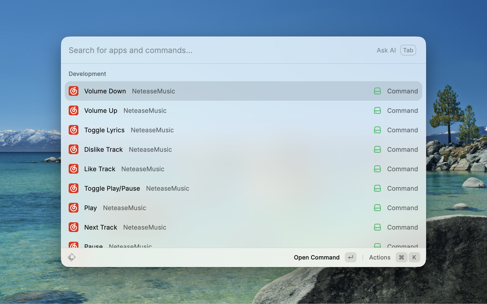

# Netease-Music

This extension controls the installed macOS NeteaseMusic app from Raycast. Commands launch the app when it is closed, wait for its controls, and then perform the requested action. They also work while the app is already running. The extension supports English and Chinese control menus.

Each success message names the command that completed, such as "Play command completed." or "Next Track command completed."

Raycast needs Accessibility permission and Automation access to System Events. If macOS requests permission, allow access in System Settings > Privacy & Security, then run the command again. Playback requires a selected track or queue in NeteaseMusic.

## Local testing

Run these commands from the `extensions/netease-music` directory after installing dependencies with `npm ci`.

```sh
npm test
npm run lint
npm run build
npm run dev
```

The development command imports the local extension into Raycast and watches for changes. Use its development commands for the following checks.

1. Quit NeteaseMusic completely, run Play, and confirm that the app launches and plays the selected track.
2. Quit NeteaseMusic again, run Next Track, and confirm that the app launches and advances the queue.
3. Keep NeteaseMusic running in the background and check Play, Pause, Toggle Play/Pause, Next Track, and Previous Track.
4. Run Play twice and confirm that playback continues. Run Pause twice and confirm that playback stays paused.
5. Check the volume, lyrics, and track preference commands with the app running.
6. Run Dislike Track & Next Track and confirm that it performs both actions and shows one completion message.

The automated tests cover command execution and error handling. Actual app startup, menu availability, playback, and macOS permissions require these manual checks.

Local manual testing confirmed that commands automatically open NeteaseMusic when it is closed.


