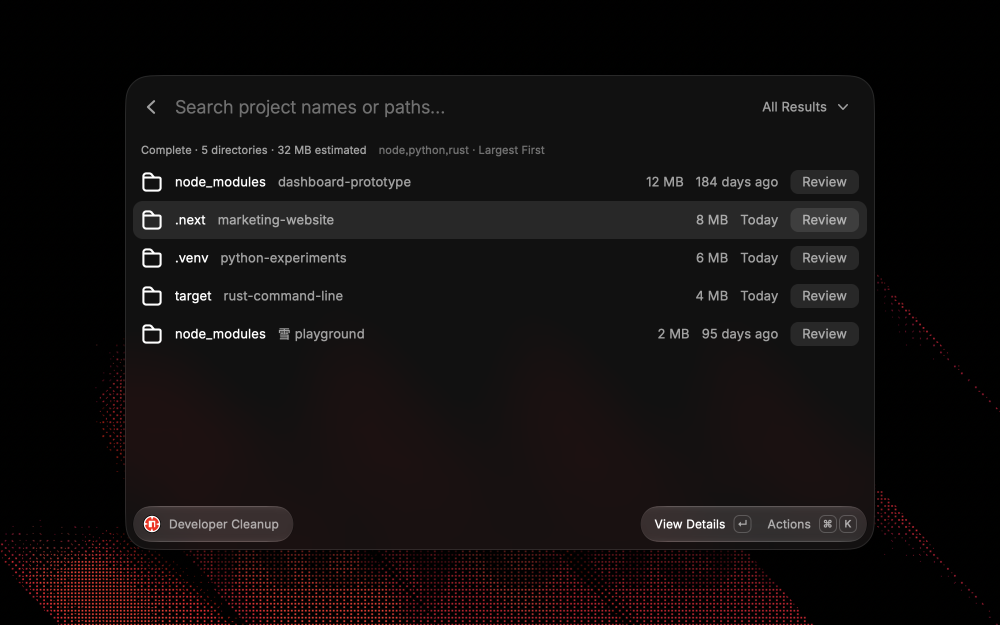
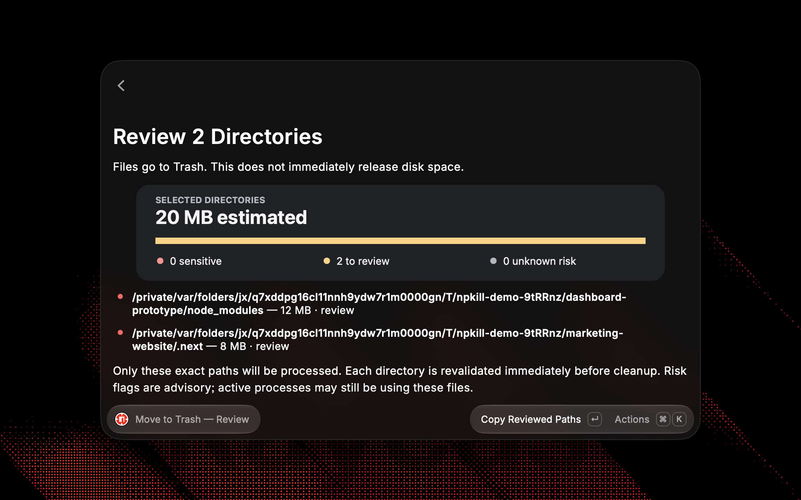
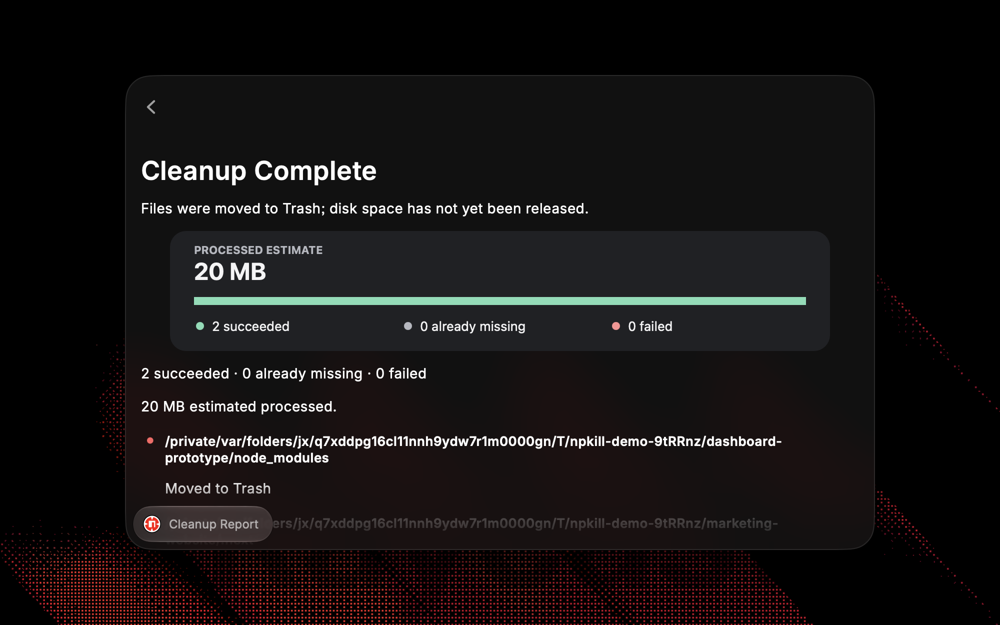

<div align="center">
    <br/>
    <br/>
    
    <h3>npkill</h3>
    <p>Find and clean development dependencies, build artifacts, and caches</p>
    <br/>
    <br/>
</div>

npkill is a Raycast extension that helps you find development dependencies, build artifacts, and caches. Review estimated sizes, project activity, and risk warnings with visual summaries, then clean the directories you choose.

This is an **unofficial npkill integration** for **macOS**. Scanning runs locally through the installed npkill CLI. No account, API key, background schedule, or filesystem analytics service is required.



## Requirements

- Raycast for macOS.
- Node.js **20.19.0 or later**, available to the npkill executable.
- **npkill 1.x** with output schema version 1.

Install the CLI yourself in a terminal:

```sh
npm install -g npkill@1
npkill --version
node --version
```

The extension uses the copy of npkill you install. It does not download or install packages.

## First scan

1. Run **Scan Development Artifacts** in Raycast.
2. Enter a project directory, such as `~/Developer`, or use **Choose Directory**. The filesystem root is rejected.
3. Keep the default `node` profile, or enter comma-separated profile names such as `node,python,rust`.
4. If detection fails, set **npkill Executable** to the absolute path printed by `command -v npkill` in your terminal.
5. Choose **Save and Scan**. Later launches scan the saved root; scans never run on a background timer.

Paths support spaces, Unicode, and `~` expansion. Setup is stored locally. **Configure Scan** changes the root, profiles, exclusions, executable, and custom configuration. **Default Sort Order** is an extension preference.

The executable's directory, Raycast's inherited PATH, Homebrew locations, `~/.volta/bin`, and `~/.local/bin` are searched for Node. With nvm, asdf, mise, or another version manager, use the installed executable's full path and make its Node runtime available on PATH. No login shell or user-supplied shell command is executed.

## Reviewing results

- Results arrive incrementally as npkill finishes their size and project activity calculations.
- Search matches a contiguous part of the full path, including project names. The list shows paths relative to the selected root; full paths are available in details, tooltips, Finder, and Copy Path.
- Filter by size, inactivity, or risk without rescanning. Sort by size, project activity, or path.
- **Unknown** activity stays unknown and does not match inactivity filters. Unknown sizes sort last.
- **Review** means npkill returned no specific sensitive-folder warning. It is not a safety guarantee. **Unknown** risk means upstream did not provide analysis.
- Sensitive results are hidden unless you explicitly enable them, even when `.npkillrc` enables them. Cleaning them requires a second confirmation.
- **Stop Scan** (`⌘⌥S`) preserves partial results. **Refresh Scan** starts a new scan and clears selection.
- Enter opens details. Destructive actions are never the default Enter action.

Project activity is npkill's `projectModificationTime`: the newest eligible file it found in the parent project. The extension does not substitute directory modification time or infer activity independently. Sizes are estimates, not guaranteed recoverable disk space.

Artifact details include an SVG storage-share chart, a project-activity timeline, and a risk summary. Storage share compares the directory with measured results in the current scan, not your disk capacity; unknown sizes are excluded and partial scans are labeled. Cleanup reviews and reports show risk and outcome breakdowns. All graphics adapt to light and dark appearance, with the same information available as text.

## Profiles and configuration

All target definitions, project marker rules, default ignores, and risk analysis come from npkill. The extension does not maintain its own target catalog or filesystem scanner.

The CLI runs with the scan root as its working directory. npkill checks that directory for `.npkillrc`, then the home directory, unless **Custom Configuration** specifies a file. The selected root and profiles are passed explicitly and take precedence over config defaults. Custom profiles declared in `.npkillrc` can be entered by name.

Extra exclusions are comma-separated or newline-separated and are merged with config exclusions by npkill. Supported examples include `work-in-progress`, `./apps/active-project`, absolute directory paths, and `**/packages/keep`. General glob patterns such as `**/keep/**` are unsupported by npkill 1.0.0 and produce a scan notice.

Upstream streaming output does not identify which profile matched a result. To change the ecosystem scope, use **Configure Scan** and change the profile names; the extension does not guess a result's profile from a common directory name.

See upstream's [profile definitions](https://github.com/voidcosmos/npkill/blob/v1.0.0/src/core/constants/profiles.constants.ts) and [configuration documentation](https://npkill.js.org/docs/npkillrc).

## Cleanup

Review the exact paths, estimated sizes, and risk information before confirming **Move to Trash**. You can restore directories from Finder’s Trash until you empty it.



- Use **Select Directory** (`⌘↵`) to mark results, or deselect with the same action.
- **Review Selected for Trash** (`⌘⇧T`) includes only selected results visible under the current search and filter. The header shows visible and total selected counts. **Clear Selection** removes all selections.
- Scanning stops before cleanup starts. Each directory is revalidated immediately before the filesystem operation.
- The extension rejects the scan root, filesystem root, home directory, out-of-root paths, symlinks in the candidate's ancestor chain, overlapping selections, and changed directory identities.
- Failures are handled per directory. Successful or already-missing candidates leave the list; failed candidates remain available for review.
- **Moving to Trash does not immediately release disk space.** No estimated byte count is presented as guaranteed freed space.



Some development artifacts contain local state that cannot be rebuilt. Stop processes using a directory and inspect it first. Identity checks detect changes observed between discovery and cleanup, but path-based Node and Raycast APIs cannot atomically lock an entire directory tree against a concurrent rename or write. This is not a security boundary against another process deliberately racing filesystem changes.

## Raycast AI

Mention **@npkill** in Raycast AI Chat, or open **Ask Npkill**. Example prompts:

- “Find the 5 largest development artifacts in my saved scan location.”
- “Find Node and Python artifacts larger than 1 GB and inactive more than 90 days in ~/Developer.”
- “Check whether npkill is installed and my scan is configured.”

**Search Development Artifacts** runs a fresh read-only scan using the same CLI adapter, saved root, profiles, exclusions, and sensitive-results setting as the native command. An explicitly supplied directory or profile list overrides those two settings for that search only. Executable paths, config files, and sensitive-result inclusion cannot be changed by the AI.

Search supports path text, minimum estimated size, minimum project inactivity, risk, sorting, and up to 100 returned results (30 by default). Scans stop after 20 seconds or 20,000 discovered candidates, then wait for the CLI to terminate. Reports distinguish incomplete discovery from a truncated result list and preserve unknown sizes, activity, and risk. They are snapshots, not a live monitor of a scan running in another view.

**Check Npkill Setup** checks CLI/Node compatibility and saved settings without scanning. When no directory has been saved or supplied, the search tool asks for one instead of assuming a root. Custom profiles and config contents are validated by npkill when scanning.

**Open Cleanup Command** opens **Scan Development Artifacts** with its saved settings when you ask AI to clean artifacts. It does not select, move, or delete files; review fresh results and confirm the exact paths in the native command. If your AI search used different settings, select that directory and those profiles in Configure Scan. AI-returned estimates are never guaranteed reclaimed space.

Scanning itself remains local. **When you invoke an AI tool, its returned paths, metadata, settings, and diagnostic messages are provided to your selected Raycast AI model.** File contents are not returned. Use the native command if you want to keep those results outside AI conversations.

## Troubleshooting

| Problem                               | What to do                                                                                                                                                                      |
| ------------------------------------- | ------------------------------------------------------------------------------------------------------------------------------------------------------------------------------- |
| CLI or Node not found                 | Install the requirements and set the full npkill executable path. Confirm that its Node runtime is available.                                                                   |
| Unsupported version or output schema  | Use a stable npkill 1.x release with schema 1. The adapter stops on malformed or incompatible stdout.                                                                           |
| Profile or configuration error        | Open **View Scan Notices** and correct the upstream configuration.                                                                                                              |
| Permission denied                     | Review the affected path and macOS permissions. The extension never requests administrator privileges.                                                                          |
| No results                            | Check the root, profiles, exclusions, and upstream marker rules. A `.venv` must contain `pyvenv.cfg`; an arbitrary directory named `target` is not necessarily a Rust artifact. |
| Directory changed or became a symlink | Refresh and review it again. The old discovery identity cannot authorize cleanup.                                                                                               |
| Move to Trash fails                   | Read the per-path cleanup report. The result is retained unless validation established it was already missing.                                                                  |
| Scan canceled                         | Partial results remain. Refresh to start over.                                                                                                                                  |
