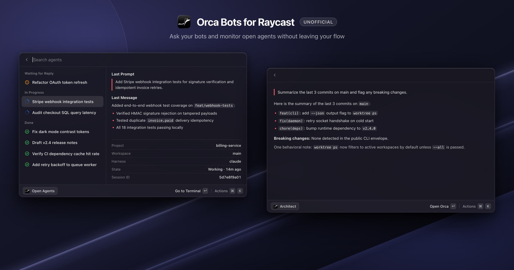

# Orca Bots for Raycast

Control Orca from Raycast without leaving what you are doing. The extension calls the `orca` CLI so Orca stays in the background, except when you trigger **Go to Terminal**, **Open Orca**, or **Launch Orca**.

> **Unofficial and community-maintained. Not affiliated with, endorsed by or supported by Stably, the makers of Orca.**

## Requirements

- macOS with [Raycast](https://www.raycast.com/) and [Orca](https://orca.dev/) (>= 1.4.269) installed.

## Commands

- **Ask Bot**: Pick an Orca bot, write a prompt, and read its reply directly in Raycast. Each question starts a new bot chat.
- **Ask Default Bot**: Type your question straight in the Raycast bar and view your default bot's reply. If no default bot is configured, you pick a bot and the question is sent right away.
- **Open Agents**: Lists your Orca agents grouped into **Waiting for Reply**, **In Progress**, and **Done**, refreshed every 5 seconds. You can read an agent's conversation, jump to its terminal, or copy its session ID.

## Preferences

- **Orca CLI Path**: Leave empty to use the bundled CLI (`/Applications/Orca.app/Contents/Resources/bin/orca`). Set this only if your CLI is located elsewhere.
- **Default Bot**: Path to a bot folder inside `~/.orca/bots` (for example `~/.orca/bots/leglaude`). The extension reads its `bot.json` (`id`, `name`, `agent`). This bot appears at the top with a **Default** tag. A paused bot is not detected before sending; Orca rejects the request on launch.

## Known Limitations

- Bot chats cannot be focused directly in Orca from the CLI: **Go to Terminal** only applies to terminal-based agents. For chats, the extension offers to read the conversation or open Orca.
- Each question sent to a bot starts a new chat; follow-up replies in the same thread are not supported yet.
