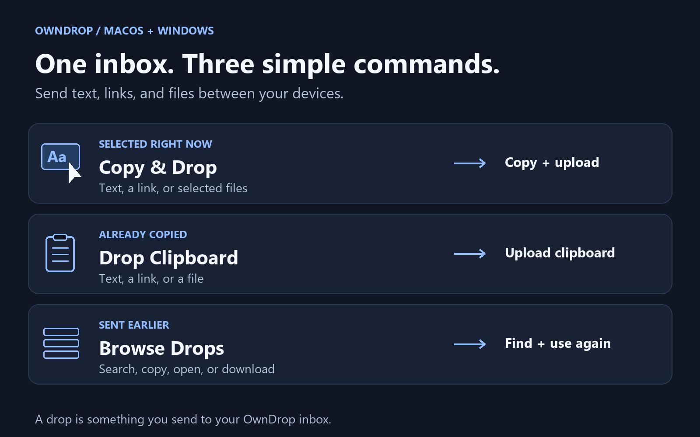
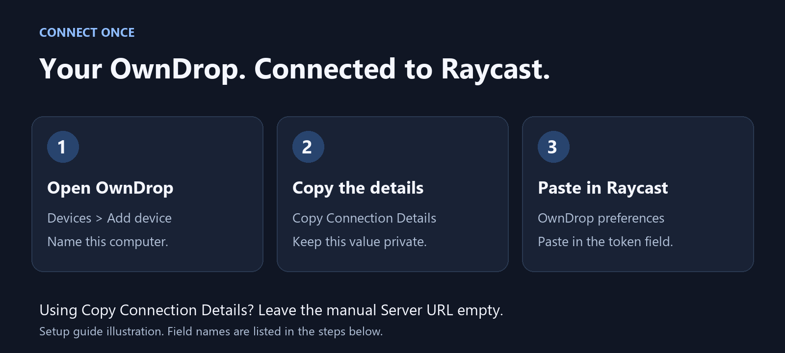

# OwnDrop

Send text, links, and files between your devices with your own OwnDrop inbox. Works on macOS and Windows.

**You need an OwnDrop server first.** [Set up OwnDrop](https://github.com/iml885203/owndrop#-quick-start-pick-one), or ask your server administrator for access.

## Which command should I use?

A **drop** is something you send to your OwnDrop inbox.

| I want to... | Run this |
| --- | --- |
| Copy selected text, a link, or files and send them | **Copy & Drop** |
| Send something I already copied | **Drop Clipboard** |
| Find, copy, open, or download an earlier drop | **Browse Drops** |

## Connect in three steps

1. In OwnDrop, open **Devices** and add this computer.
2. Click **Copy Connection Details**.
3. Open any OwnDrop command in Raycast. Paste into **Connection Details or Device API Token**, then save. Leave **Server URL (Manual Setup)** empty.

Repeat on each computer you want to connect.

## Try your first drop

1. Assign a hotkey to **Copy & Drop** in **Raycast Settings > Extensions > OwnDrop**.
2. Select some text or files, then press your hotkey. A progress message confirms the command is working.
3. On your other connected device, open **Browse Drops** or the OwnDrop web app to find it.

## Suggested hotkeys

Set these in **Raycast Settings > Extensions > OwnDrop**. These optional examples avoid the standard copy/paste and Finder combinations; they are not automatic bindings.

| Command | Windows | macOS |
| --- | --- | --- |
| **Copy & Drop** | Ctrl+Alt+C | Ctrl+Option+Cmd+C |
| **Browse Drops** | Ctrl+Alt+V | Ctrl+Option+Cmd+V |

Run **Drop Clipboard** from Raycast when needed. Keep Ctrl+C / Cmd+C for regular local copying. If you use VoiceOver, AltGr, or an app that already uses these keys, choose another hotkey or a Raycast alias instead.

Checked against [Windows shortcuts](https://support.microsoft.com/en-gb/accessibility/windows/keyboard-shortcuts-in-windows) and [Mac shortcuts](https://support.apple.com/en-us/102650). No global hotkey is guaranteed to be free on every computer.

Your selection stays copied for normal paste, even if the upload fails. For files, use Finder on macOS or the active File Explorer tab on Windows. Multiple files are supported.

**Regular copy stays local.** OwnDrop sends content only when you run a drop command.

Already have a device token? Enter it in the token field and fill in your server's HTTPS URL separately.
