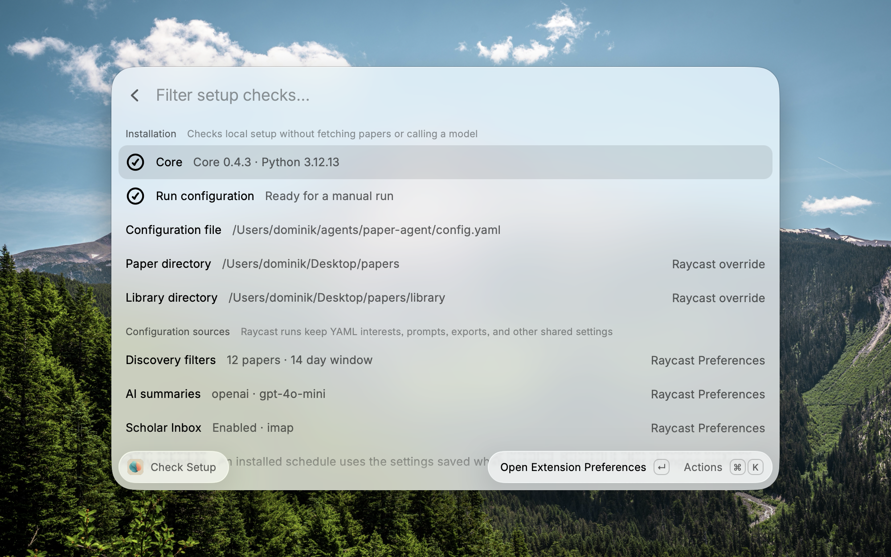

# Paper Agent for Raycast

Discover papers, search your local research library, and manage a reading queue from Raycast. Paper Agent saves notes and digests as local files; AI summaries are optional.

## Set up

Requires macOS, Raycast, Git, and Python 3.11 or later.

1. Install the [Paper Agent core](https://github.com/galleonli/paper-agent#quick-start), then edit its `config.yaml` for your research interests and output directory.
2. Install [Paper Agent from the Raycast Store](https://raycast.com/marvel940804836/paper-agent).
3. Open **Check Setup**, choose **Open Extension Preferences**, and set **Config File Path** to the full path of `config.yaml`.
4. Refresh **Check Setup** and resolve any reported configuration issues. Leave AI summaries and Scholar Inbox disabled until their provider settings are ready.
5. Choose **Run Paper Pipeline**, then use **Check Run Status** to see its result. Browse papers after the first successful run.

**Paper Directory** is optional: leave it empty to use the directories in YAML, including a custom `delivery.library_dir`. **Python Executable** is also optional; it defaults to `.venv/bin/python3` beside `config.yaml`.

Check Setup only inspects the local installation and configuration. It does not fetch papers, contact a model, or install a schedule. Its actions include installation instructions and a repair command for an existing core checkout.

## Which settings apply?

| Setting | Source for Raycast runs |
| --- | --- |
| Paper and library directories | YAML by default. **Paper Directory** overrides both, using `<paper directory>/library` for the library. |
| Discovery limits, keywords, categories, policy | Raycast Preferences, including their defaults. |
| AI summaries and Scholar Inbox | Raycast Preferences, including their enable switches and provider settings. |
| Research interests, prompts, exports, other shared settings | `config.yaml`. |
| Daily schedule | Snapshot saved when **Install Daily Schedule** was last selected. |

Raycast prepares a separate runtime configuration and preserves your original YAML. Command-line runs use the YAML you pass to the core. Relative output directories resolve from the core checkout. **Check Setup** shows the active directory paths and configuration sources; credentials are omitted.

## Commands

| Command | Purpose |
| --- | --- |
| **Check Setup** | Check the installation, paths, and run configuration. |
| **Browse Today's Papers**, **Browse Recent Papers** | Read paper details, open notes and links, mark papers read, and manage favorites or the reading queue. Recent Papers uses a count limit. |
| **Search Papers** | Search titles, authors, abstracts, and other library metadata. |
| **Browse Favorite Papers**, **Browse Reading Queue** | Revisit locally saved papers. |
| **Run Paper Pipeline** | Start a background run; the run continues after closing Raycast. |
| **Check Run Status** | View versions, schedule state, the last result, logs, and an on-demand core update check. |
| **Install Daily Schedule**, **Remove Daily Schedule** | Manage the optional macOS daily job. Removing it preserves logs and history. |
| **Open Paper Directory**, **Open Config Directory** | Open the corresponding folder in Finder. |

## Updates and repair

- **Core:** from a clean checkout on `main`, run `git pull --ff-only` followed by `./scripts/bootstrap.sh`. Bootstrap preserves configuration and data. Core 0.4.3 or later also backs up and replaces an environment whose Python executable is missing or unsupported.
- **Store extension:** Raycast manages updates separately from the Python core.

Use **Check Run Status → Check Core Update** to contact GitHub for the latest core release. It reports availability without installing anything. If Git reports local changes or diverging history, preserve and reconcile those changes before updating.

## Troubleshooting

- **Missing Python or core:** open **Check Setup**. For an existing checkout, copy its repair command and run it in Terminal. An explicit **Python Executable** override must point to a working interpreter; leave it empty to use the repaired `.venv`.
- **Configuration mismatch:** review the table above. A blank **Paper Directory** preserves YAML paths. Reinstall a daily schedule after changing the settings it should use.
- **Empty library:** run the pipeline once and inspect **Check Run Status**. A failed query is shown as an error rather than an empty result. Core checks time out after 10 seconds and library queries after 30 seconds.
- **Scholar Inbox:** fill in the provider, IMAP host, user, and password settings. Password preferences are passed to the core environment. Environment-only credentials must be available to the process that starts the run.
- **Daily schedule:** the optional LaunchAgent targets 04:00 local time and checks for catch-up when loaded at login or installation. Sleep, logout, and unavailable disks can delay execution. Opening Raycast does not load or install the job. Check status and logs to confirm actual runs.
- **Unavailable core directory:** the scheduled wrapper waits up to two minutes for its path. Keep the checkout on an available local volume; use a manual run after recovering a missing drive.

For source configuration, CLI diagnostics, exports, and other core behavior, see the [core usage guide](https://github.com/galleonli/paper-agent/blob/main/docs/usage.md).

## License

[MIT](LICENSE).
