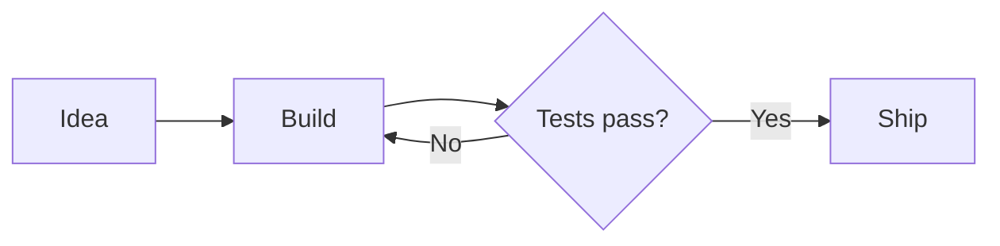
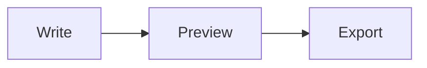
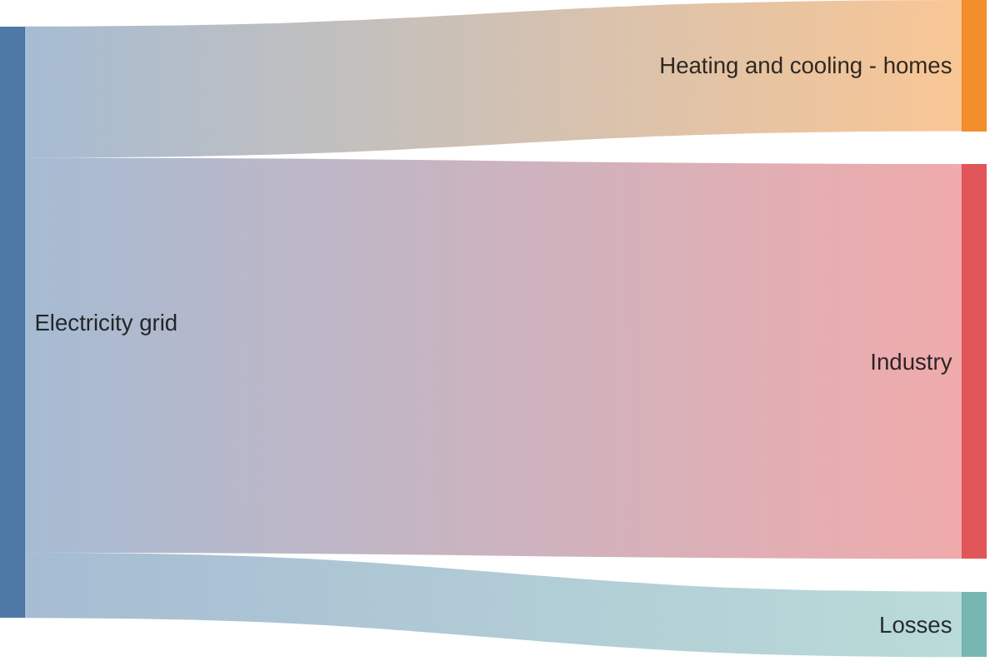

<div align="center">
    <br/>
    <br/>
    
    <h3>Pele</h3>
    <p>Create Mermaid diagrams from Raycast</p>
    <br/>
    <br/>
</div>

Pele is a Raycast extension that turns Mermaid code into diagrams you can preview, copy, and export as PNG or SVG. It uses the [Pele renderer](https://pele.run/) locally on macOS and Windows, with bundled fonts and no API key, browser download, or Mermaid CLI setup.

Start with selected text, your clipboard, or a built-in example. Edit the source, choose a theme, and export an image for a document, presentation, or conversation. You can also ask Raycast AI to generate and save a diagram from a description.

## Create a diagram

1. Select Mermaid code in another app, or copy it to your clipboard.
2. Run **Create Diagram** in Raycast.
3. Recognized Mermaid code opens directly in the preview. Otherwise, the editor opens with your text so you can edit it or choose **Load Example** from the Actions menu.
4. In the editor, choose a theme, PNG resolution, and background, then run **Preview Diagram**.
5. Use **Copy Image** to paste the result into another app, or **Save PNG** or **Save SVG** to keep a file.

To try a small diagram, paste this into the editor:



Use **Edit Diagram** from the preview to return to the source and adjust the diagram or its appearance. Rendering errors appear in the editor, where you can correct the code and try again.

### Input handling

Selected text takes priority over the clipboard. If the current app does not expose its selection, or the selection is empty, the command reads the clipboard. Use **Use Clipboard** in the editor to replace the current source with clipboard text.

You can paste plain Mermaid code or a Markdown document containing one fenced Mermaid block:

````markdown

````

If a document contains several Mermaid blocks, select or copy just one. YAML frontmatter inside a Mermaid block stays with the source when you edit or copy it.

### Built-in examples

Open **Actions → Load Example** in the editor to replace the current source with an example. Theme, resolution, and background settings stay as they are.

| Example             | Content                                              |
| ------------------- | ---------------------------------------------------- |
| Flowchart           | A build and test workflow with a decision            |
| Sequence Diagram    | Requests between a user, app, and API                |
| Class Diagram       | Projects, tasks, properties, and methods             |
| State Diagram       | A draft, review, and publishing workflow             |
| Entity Relationship | Customers, orders, and items                         |
| Pie Chart           | Time spent building, planning, and reviewing         |
| Sankey with Config  | Electricity flows with custom node width and spacing |
| Mindmap             | A launch plan grouped by team                        |
| Gantt Chart         | Design, build, and test tasks                        |

The extension also accepts the other diagram types supported by its bundled Pele version. See [Pele's examples](https://pele.run/examples) for more syntax and layouts.

## Diagram config

Include YAML frontmatter at the start of your Mermaid code to configure individual diagrams. Config works with selected text, clipboard input, Markdown fences, the editor, and Raycast AI.

The **Sankey with Config** example uses:



| Setting             | Effect in this example                       |
| ------------------- | -------------------------------------------- |
| `showValues: false` | Hides numeric values beside node labels      |
| `nodeWidth: 15`     | Sets each node's width to 15px               |
| `nodePadding: 20`   | Leaves 20px between nodes in the same column |

Place the frontmatter before the diagram keyword and preserve its indentation. The config applies to both PNG and SVG exports and remains in **Copy Mermaid Code**.

Mermaid init directives also work. This is equivalent to the config above:

```text
%%{init: {"sankey":{"showValues":false,"nodeWidth":15,"nodePadding":20}}}%%
```

Place the directive before `sankey` and its data. [Configuration support varies by diagram type](https://pele.run/compatibility). Pele uses its own layout and themes, so Mermaid `theme` and `themeVariables` colors do not apply. Choose colors with the extension's Theme selector.

## Preview and export

The preview shows the diagram type, theme, and actual PNG dimensions. Open the Actions menu for the following options:

| Action             | Result                                                            |
| ------------------ | ----------------------------------------------------------------- |
| Copy Image         | Copies PNG image data for pasting into an app that accepts images |
| Edit Diagram       | Returns to the source, theme, resolution, and background controls |
| Save PNG           | Saves a raster image to your Save Folder                          |
| Save SVG           | Saves a scalable vector image to your Save Folder                 |
| Open Full Size     | Opens the preview PNG in its default application                  |
| Open SVG           | Opens the preview SVG in its default application                  |
| Copy SVG Code      | Copies the exported SVG markup as text                            |
| Copy Mermaid Code  | Copies the editable Mermaid source, including its config          |
| Pele Documentation | Opens the renderer's documentation                                |

Use PNG for apps that accept pasted images. Use SVG when you need to resize a diagram without losing detail. SVG text is converted to vector paths, so the image keeps its typography on machines without the bundled fonts. Keep a copy of the Mermaid source if you want to edit labels or structure later.

Saved files use the diagram type and a unique identifier in their filename. Each save creates a new file. The save notification includes the destination and an **Open File** action.

### Resolution and transparency

PNG resolution supports 1×, 2×, 3×, and 4×. For example, a diagram measuring 600 × 400 at its natural size produces a 1200 × 800 PNG at 2×. The preview uses the natural size independently of the export resolution.

PNG output is limited to 8,192 pixels per side and 16 megapixels. Larger images are scaled down to fit both limits. The preview metadata shows the resulting dimensions. SVG output retains the diagram's natural dimensions and scales without losing detail.

**Transparent Background** removes the canvas background. Node fills, labels, and lines retain their theme colors. Choose a theme that stays readable against the background where you plan to use the image.

## Preferences

Set defaults in the extension's Raycast preferences. You can override the theme, resolution, and transparency in the editor for the current diagram.

| Preference             | Default            | Options                                                 |
| ---------------------- | ------------------ | ------------------------------------------------------- |
| Default Theme          | Match Raycast      | Match Raycast, Light, Dark, Flexoki Light, Flexoki Dark |
| PNG Resolution         | 2×                 | 1×, 2×, 3×, 4×                                          |
| Transparent Background | Off                | Use a transparent canvas background                     |
| Save Folder            | `~/Downloads/Pele` | Choose a folder for exported diagrams                   |

**Match Raycast** resolves to Light or Dark when you launch the command. The default save folder is `Downloads/Pele` inside your home directory on either platform. The extension creates the destination folder when needed.

## Raycast AI

Mention `@pele` in Raycast AI and describe the diagram you want. For example:

- "Create a flowchart for user login and save it as a PNG."
- "Draw a sequence diagram of a browser requesting data from an API. Save a dark SVG with a transparent background."
- "Create a Sankey diagram from this data. Hide values, use 15px nodes and 20px spacing, and save it as a PNG."
- "Save this Mermaid diagram as an SVG, preserving its frontmatter config."

The **Generate Diagram** tool accepts complete Mermaid code, an optional theme, an export format, and a transparency setting. PNG is the default format. Omitted theme and transparency settings use your preferences, and PNG resolution uses your preferred value.

The tool renders the diagram locally and saves it in your Save Folder. The AI response includes an **Open Pele PNG** or **Open Pele SVG** link to the actual rendered image. The tool also returns the file path, URL, format, diagram type, theme, and dimensions.

Raycast AI Chat cannot embed local PNG or SVG files. Its inline Mermaid blocks redraw the source with a different renderer, which can change the layout, colors, and config. The tool returns a file link instead so you view the exact Pele output. Use **Create Diagram** for an image preview inside Raycast.

Generating a diagram does not copy it to your clipboard or open another app. Raycast AI's normal processing applies to the prompt and tool input.

## Fonts and compatibility

Diagrams use bundled Inter and IBM Plex Mono from [Pele's example-site font stacks](https://pele.run/examples). Base labels are 16px, with regular, bold, and italic styles. Bundled Noto Emoji supplies monochrome emoji, including joined sequences and flags, in both PNG and SVG. The renderer measures text using the same fonts it uses for export, keeping node sizing and wrapping consistent with the output.

Pele has its own layout engine and visual style. Positions and spacing can differ from Mermaid's renderer. Explicit source styles are preserved where Pele supports them.

Characters outside the bundled fonts' coverage, such as CJK scripts and emoji newer than the bundled Noto release, may not render correctly. External images, clickable links, and custom icon resolvers are disabled. Source input is limited to 50,000 characters; Pele also enforces its own edge and SVG output limits. See [Pele compatibility](https://pele.run/compatibility) for renderer details.

## Local files and privacy

Rendering and image export run locally. The extension does not send diagram source to an image-rendering service. Raycast AI requests use Raycast AI's normal processing before the local rendering step.

Each preview creates PNG and SVG files in the extension's support storage. Preview folders older than seven days are removed on a subsequent command launch. **Open Full Size** and **Open SVG** open these temporary files. Use **Save PNG** or **Save SVG** to keep an exported copy.

The extension retains exported files until you remove them. Preview storage is temporary and has no history browser, so keep Mermaid source separately for future edits.

## Troubleshooting

| Issue                                       | What to try                                                                                                                                |
| ------------------------------------------- | ------------------------------------------------------------------------------------------------------------------------------------------ |
| The wrong code opens                        | Clear the selection in the active app, or use **Use Clipboard** in the editor. Selected text takes priority.                               |
| A Markdown document is rejected             | Copy one Mermaid block. Documents containing multiple Mermaid blocks need a single selection.                                              |
| The diagram fails to render                 | Check the error in the editor, correct the Mermaid syntax, and verify frontmatter indentation. Use a built-in example as a starting point. |
| Config does not change the colors           | Choose a theme in the editor. Mermaid themes and `themeVariables` colors do not apply to Pele.                                             |
| The PNG is smaller than the requested scale | Check the dimensions in the preview. The image may have reached the pixel limits. Save an SVG for scalable output.                         |
| Pasting an image does not work              | Paste into an app that accepts image data, or save the PNG and insert the file. Use **Copy SVG Code** when you need text markup.           |
| Saving fails                                | Choose a writable Save Folder in the extension preferences, then save again.                                                               |
| Labels contain missing glyphs               | Use characters covered by the bundled fonts. CJK scripts and emoji newer than the bundled Noto release are unavailable.                    |

## Development

From the extension directory, install dependencies and start Raycast development mode:

```sh
npm install
npm run dev
```

Run the checks with:

```sh
npm test
npm run typecheck
npm run lint
npm run build
npx ray evals
```

Tests exercise the real Pele and WebAssembly renderers, including fallback font metrics and emoji outlines, SVG theming, PNG pixels, all bundled examples, frontmatter and init config, source selection, image limits, exports, and preview cleanup. AI evals use synthetic mocks and require Raycast authentication.

For manual checks on macOS and Windows, render selected and clipboard code, load an example, edit its config, change theme and transparency, paste a copied image into an image-aware app, and save and open both formats. Verify that malformed input remains editable. Windows image copying uses the built-in Windows PowerShell and .NET clipboard APIs.

The pinned `@resvg/resvg-wasm` package must match `assets/resvg.wasm`. When updating it, copy `node_modules/@resvg/resvg-wasm/index_bg.wasm` to that asset and run the rendering tests.

## Credits

- [Pele](https://github.com/obsidianmd/pele) by Obsidian, licensed under MIT.
- [resvg-js](https://github.com/yisibl/resvg-js/tree/v2.6.2), licensed under MPL-2.0. Its unmodified WebAssembly renderer is bundled; corresponding source is available at the linked version.
- [Inter 4.1](https://github.com/rsms/inter/releases/tag/v4.1) and [IBM Plex Mono](https://github.com/IBM/plex/tree/71f558992315a12ca1f06a2215d57962a1992162), licensed under the SIL Open Font License. Bundled font and renderer license notices are in `assets/licenses`.
- [Noto Emoji](https://github.com/google/fonts/tree/8b0a1d0f5983c89bc2b93f1b5fb55f9e252744b5/ofl/notoemoji), licensed under the SIL Open Font License. Its license is bundled in `assets/licenses/NotoEmoji-OFL.txt`.
- Inspired by the workflow of [Mermaid to Image](https://www.raycast.com/chihkang/mermaid-to-image) by ChihKang Lin.

This is an independent Raycast extension, not an official Obsidian product.
