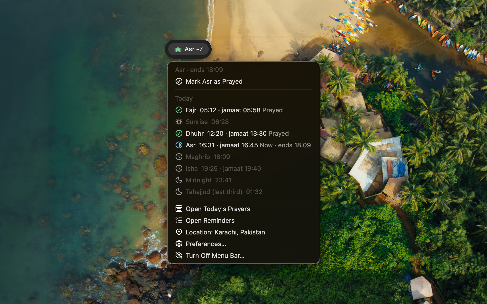

# Prayer Times

Raycast extension that shows the next prayer in the menu bar and root search, keeps timed prayer
reminders in Apple Reminders, and tracks which prayers were prayed on time.

## Features

- **Menu bar countdown**: the masjid on a disc colored by where the prayer's time stands, the prayer, and
  what comes next: `Dhuhr Starts 15m`, `Dhuhr Jamaat 30m`, `Dhuhr Pref. ends 8m`, `Dhuhr Ending soon 16m`,
  `Dhuhr Ends 16m`; it clears once the prayer's time ends. Grey before the start, dark green from
  the start, light green from **Before Preferred End** minutes before the preferred end, yellow after it,
  red from **Ending Soon** minutes before the end (when the preferred end comes later, it stays yellow to the end). The dropdown names the current period in words, lists every
  prayer plus sunrise, midnight and tahajjud, color-coded as with jamaat, on time, late,
  made up (qaza), current or missed, with each prayer's preferred time. Click a prayer to mark it; hold ⌥
  to mark a late one (or one recorded late) as prayed on time.
- **Jamaat formulas**: besides the short rules (`13:30`, `+10`, `floor5+15`, `end-30`), a Jamaat setting can
  hold a formula in the phone app's small Python-like language, e.g. `ceil(start, 15) + 15` (round the start up
  to 15 minutes, add 15) or `at(13, 30) if is_friday else ceil(start, 15) + 15`. **Jamaat Formula Guide**
  lists the names and functions and shows each prayer's jamaat today, or why its formula gives none.
- **Next Prayer** command: live root-search subtitle. Add it to Favorites to keep it on top.
- **Today's Prayers**: mark as prayed (the clock decides on time, late, or made up once its time has ended), or as prayed with
  jamaat, on time, late (still within its time), or made up (qaza, after its time ended); change or unmark it later, and see the last
  7 days with jamaat and made-up counts. With Apple Reminders on, the status is kept in the reminder's
  notes as a `prayer-status: jamaat|ontime|late|missed|madeup` line above the `prayer-times://` key, so
  other tools that sync these reminders can read and keep it.
- **Prayer Calendar**: the month's days on the left; on the right, without scrolling, the whole month
  with each day's cell colored by how many prayers were marked (the selected day outlined, today
  underlined) and the selected day's prayers with their status. Mark prayers from ⌘K, or open a day to
  step day by day and expand a prayer (⌘D) for its times.
- **Apple Reminders**: one timed reminder per prayer, kept 14 days ahead, with heads-up, start,
  jamaat and ending alarms, so alerts fire even when Raycast isn't running.
- **Jamaat rules** per prayer: `13:30`, `+10`, `floor5+15`, `ceil5+10`, `end-30`, plus a Jumu'ah rule.
  Asr can follow Dhuhr's jamaat (`dhuhr+10`) and Isha Maghrib's (`maghrib+5`), as most Shia mosques pray
  them together; with the Ja'fari school that prayer's time then starts at its jamaat.
- **Schools of fiqh**: Hanafi, Shafi'i, Maliki, Hanbali or Ja'fari (Shia) decides when each prayer starts, when it ends, and when delaying it becomes disliked. See [Prayer times by school](#prayer-times-by-school).
- **Location**: pick a country and city, or use your approximate current location, refreshed 30
  minutes before each prayer.

## Setup

1. Run **Set Prayer Location**.
2. Run **Prayer Menu Bar** once to show it in the menu bar.
3. Allow Reminders access when asked (or turn Apple Reminders off in preferences).

### Current location

macOS only asks for location on behalf of an app, so the first time you choose **Use Current
Location** the extension builds a small helper app, **Prayer Times Location**, in its own support
folder from the extension's Swift code and asks macOS for permission. Allow it when prompted; you
can change this later in System Settings → Privacy & Security → Location Services.

It asks macOS for an approximate location only (a few kilometers, enough for prayer times, which
move by seconds over that distance) and keeps coordinates rounded to about 1 km. Nothing is
downloaded and no other app is needed.

## Prayer times by school

Each prayer has a **valid end** (after it the prayer is late) and, depending on the school, an earlier
**preferred end** (after it the prayer is less preferred, for some prayers disliked, makruh). A prayer with no
earlier preferred end, like Fajr, is preferred until its end. The menu bar turns light green shortly before the preferred end and yellow after it. **Counts as Late After** picks which end the ending reminder, the red countdown and on-time history use.

|                         | Hanafi                 | Shafi'i     | Maliki                 | Hanbali     | Ja'fari (Shia)       |
| ----------------------- | ---------------------- | ----------- | ---------------------- | ----------- | -------------------- |
| Asr starts              | 2 shadow lengths       | 1           | 1                      | 1           | 1                    |
| Asr preferred until     | sun turns yellow       | 2 shadows   | sun turns yellow       | 2 shadows   | –                    |
| Dhuhr preferred until   | 1 shadow (Shafi'i Asr) | –           | –                      | –           | Asr                  |
| Dhuhr ends              | Asr (2 shadows)        | Asr         | Asr                    | Asr         | sunset               |
| Maghrib starts          | sunset                 | sunset      | sunset                 | sunset      | eastern redness gone |
| Maghrib preferred until | stars appear (~35 min) | –           | short window (~25 min) | –           | Isha                 |
| Maghrib ends            | Isha                   | Isha        | Isha                   | Isha        | midnight             |
| Isha preferred until    | midnight               | first third | first third            | first third | first third          |
| Isha ends               | Fajr                   | Fajr        | Fajr                   | Fajr        | midnight             |

Shadow lengths include the noon shadow. Midnight and the first third are measured from sunset to the next
Fajr. The sun is taken to turn yellow 20 minutes before sunset. Every rule can be overridden in preferences,
including Maghrib ending at the red twilight (15°, or 12° as a precaution). The Ja'fari (Leva Institute,
Qom) method uses Fajr 16°, Maghrib 4° and Isha 14°.

Sources: Sahih Muslim 612 (Asr lasts until the sun turns pale); the hadith of Jibril (Abu Dawud 393,
Tirmidhi 149) for one and two shadow lengths; Hanafi fatwas on the red and white twilight; Ja'fari rulings
on the eastern redness and the shared times of Dhuhr and Asr, and of Maghrib and Isha.

## Credits

- Prayer time calculation: [adhan-js](https://github.com/batoulapps/adhan-js) (MIT)
- City list: [GeoNames](https://www.geonames.org/) cities with 5,000+ people (CC BY 4.0)
- Icon: "Shah Faisal Masjid" by kreatikar on [Pixabay](https://pixabay.com/vectors/shah-faisal-masjid-islamabad-3337226/) (Pixabay Content License)
