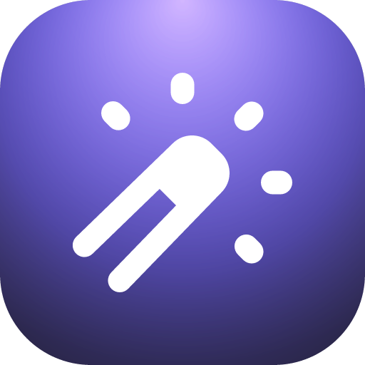

     
     
    
    <h3>Ray Icon</h3>
    
Create extension and app icons from Raycast

     
     

Ray Icon creates icons in the style of ray.so/icon using the Raycast icon set or your own SVG.

## Create and customize

- Open **Create Icon** to browse and search the Raycast icon set, then choose a glyph to edit.
- Choose a background preset or adjust colors, gradients, corner radius, border, glare, and noise. Change the glyph color, size, and position with a live preview.
- Use **Create Icon from SVG** to paste SVG code, read it from the clipboard, or select an SVG file. Use `fill="currentColor"` or `stroke="currentColor"` so the glyph follows the icon color setting.

## Export and reuse

- Save PNG or SVG files, copy a PNG or SVG code to the clipboard, or export a PNG at another size. Set **Export Folder** in extension preferences to change the save location from Downloads.
- Open built-in glyph designs in ray.so for further editing, or copy their editing links.
- Reopen your latest 100 designs from **Icon History**, keep designs in **Favorite Icons**, and save reusable styles in **Icon Templates**.

## Create with AI

Ask Raycast AI to create an icon, such as "Create a weather icon with a blue gradient" or "Make light and dark versions of a rocket icon." AI can search glyphs, export PNG and SVG files, reuse saved designs, and save requested favorites or templates. Generated designs also appear in Icon History.
