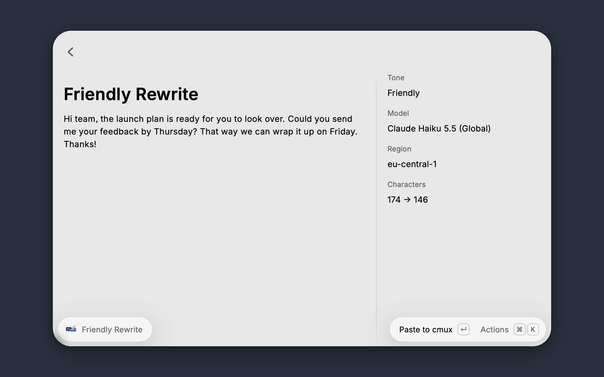

# Recast

Rewrite, polish, and translate text with Claude on Amazon Bedrock, using your own AWS account. Select text in any app, choose a tone or instruction in Raycast, and review the rewrite before pasting it back.



## What you can do

- **Rewrite Selected Text** with your default tone.
- **Rewrite with Tone** using Friendly, Professional, Concise, Polished, or Neutral.
- **Rewrite with Custom Instruction** to shorten, restructure, or translate text. Supply the optional argument for a quick rewrite, or use the instruction form.
- Watch the rewrite arrive, compare it with the original, and generate another version.
- Enter text manually when the source app does not expose a selection.

Recast preserves the original language unless you ask for a translation. Copy and paste actions use the exact output text. The preview displays text literally, including Markdown syntax.

## Setup

You need an AWS account with Amazon Bedrock model access. **AWS usage charges apply. A Raycast AI subscription is not required.**

### 1. Configure AWS credentials

For most users, choose **Named Profile** in Recast’s extension preferences and enter an existing AWS CLI profile name. Recast supports shared credentials, IAM Identity Center (SSO), `credential_process`, and role-based profiles through the AWS SDK.

For IAM Identity Center, configure and sign in from your terminal:

```sh
aws configure sso --profile my-profile
aws sso login --profile my-profile
```

Then set **AWS Profile** to `my-profile` in Raycast Settings → Extensions → Recast. If your organization uses another credential helper, follow its sign-in procedure instead. Recast does not create accounts, log you into AWS, or modify your AWS configuration.

Other credential methods:

| Method                | Behavior                                                                                                             |
| --------------------- | -------------------------------------------------------------------------------------------------------------------- |
| Default Chain         | Use the AWS SDK provider chain, including environment variables, shared profiles, SSO, and workload roles.           |
| Named Profile         | Resolve the specified profile, including SSO, `credential_process`, and role assumption.                             |
| Environment Variables | Use `AWS_ACCESS_KEY_ID`, `AWS_SECRET_ACCESS_KEY`, and optional `AWS_SESSION_TOKEN` inherited by the Raycast process. |

**Raycast is a desktop app:** variables exported in a terminal or `.zshrc` are usually not inherited by it. Prefer a named profile. Credential helpers installed in `~/.local/bin`, `/opt/homebrew/bin`, and `/usr/local/bin` are supported; use an absolute executable path in `credential_process` for other locations. The AWS CLI is only needed if your chosen sign-in method requires it.

### 2. Enable model access and permissions

Open the [Amazon Bedrock console](https://console.aws.amazon.com/bedrock/) in your source Region and confirm that your account can use Claude. Anthropic models can require a one-time use case submission and AWS Marketplace prerequisites. See [Bedrock model access](https://docs.aws.amazon.com/bedrock/latest/userguide/model-access.html).

Recast uses `ConverseStream`, which requires **`bedrock:InvokeModelWithResponseStream`** on the selected model and, when applicable, inference profile. Cross-Region inference also requires access to the destination foundation models. Have your AWS administrator scope access to your selected model/profile and permitted Regions. See [Converse permissions](https://docs.aws.amazon.com/bedrock/latest/APIReference/API_runtime_ConverseStream.html) and [cross-Region prerequisites](https://docs.aws.amazon.com/bedrock/latest/userguide/cross-region-inference.html). Recast does not change IAM policies.

### 3. Choose your model and routing

Defaults are **Claude Haiku 5.5**, **us-east-1**, and **Global** routing. The base model ID is `anthropic.claude-haiku-5-5`; Recast invokes `global.anthropic.claude-haiku-5-5` with these defaults.

**Global routing can process text outside your configured AWS Region.** Choose a geography such as EU or US if required by your data-handling policy. Both the model and your source Region must support that profile. Choosing EU does not make an unsupported source Region work. **None** invokes a model directly in the source Region and is not supported by Haiku 5.5. An inference profile ARN in Model ID is used unchanged and controls its own routing.

Check the current [Haiku 5.5 model details](https://docs.aws.amazon.com/bedrock/latest/userguide/model-card-claude-haiku-5-5.html) and [supported inference profiles](https://docs.aws.amazon.com/bedrock/latest/userguide/inference-profiles-support.html) before changing routing.

## Preferences

Open Raycast Settings → Extensions → Recast.

| Setting           | Default                      | Purpose                                                                                               |
| ----------------- | ---------------------------- | ----------------------------------------------------------------------------------------------------- |
| Credential Method | Default Chain                | Choose how the AWS SDK obtains credentials.                                                           |
| AWS Profile       | Empty                        | Required when using Named Profile.                                                                    |
| AWS Region        | `us-east-1`                  | Source Region for the Bedrock runtime.                                                                |
| Model ID          | `anthropic.claude-haiku-5-5` | Base model ID or inference profile ARN.                                                               |
| Inference Profile | Global                       | Global, US, EU, APAC, Australia, Japan, Canada, or None. Availability varies by model and Region.     |
| Max Tokens        | `2048`                       | Output budget, from 1 to 65536. Your model may impose a lower limit.                                  |
| Temperature       | Empty                        | Optional value from 0 to 1. Leave empty for Haiku 5.5 and models with restricted sampling parameters. |
| Default Tone      | Friendly                     | Tone for Rewrite Selected Text. A custom instruction takes precedence.                                |

Other models must support the Bedrock Converse streaming API and the configured request parameters. Recast only overrides thinking for the default Haiku 5.5 model; other models use their own defaults, which can consume part of the output budget.

## Everyday use

1. Select text in the source app and open a Recast command in Raycast.
2. Choose a tone or enter an instruction if needed. Without selected text, paste or type text into the form.
3. Review the streaming preview. Your source text stays unchanged until you choose Paste.
4. Press **Enter** to paste the completed rewrite into the active app, or **⌘C** to copy it.

Use **⌘O** to switch between the original and rewrite and **⌘R** to request another version. The Actions menu also has Cancel Rewrite, Copy Original, extension preferences, and the setup guide. Going back from a rewrite cancels the pending request. Each retry or new version is a separate Bedrock request and may incur usage charges.

Recast keeps the last completed rewrite if a later attempt fails. Partial, filtered, and truncated responses are never offered as completed rewrites. Review generated text before replacing the original, especially names, figures, and translations.

## Troubleshooting

| Problem                                  | What to do                                                                                                                                                                       |
| ---------------------------------------- | -------------------------------------------------------------------------------------------------------------------------------------------------------------------------------- |
| No selected text                         | Use the text form, or grant Raycast Accessibility access in macOS System Settings if selection and pasting fail in otherwise supported apps. Some apps do not expose selections. |
| Missing or expired credentials           | Sign in again with the configured profile’s login command, then use Retry Rewrite. Check the profile name and credential method.                                                 |
| Access denied                            | Check model access, `bedrock:InvokeModelWithResponseStream`, inference profile resources, and organizational restrictions on destination Regions.                                |
| Invalid model or configuration           | Confirm the exact model ID, source Region, and routing support. Leave Temperature empty for newer Claude models.                                                                 |
| Token limit reached                      | Increase Max Tokens or rewrite a smaller selection. A short budget may be consumed by model reasoning.                                                                           |
| Rate limit or timeout                    | Wait and retry. Lower Max Tokens for throttling, or select less text for long requests. Requests have a 60-second deadline.                                                      |
| Paste does not replace the intended text | Copy the result, restore the selection in your source app, and paste manually.                                                                                                   |

## Privacy

Recast sends the selected or entered text, rewrite instruction, and built-in writing guidance directly to Amazon Bedrock over the AWS SDK. Requests use your AWS credentials and account. There is no Recast server or external analytics, and Recast does not persist a rewrite history or log prompts, responses, or credentials.

Your AWS account’s logging configuration and service terms still apply: if Bedrock model invocation logging is enabled, prompts and responses may be recorded in your AWS logging destinations. Copy and paste actions place text on the system clipboard, where Raycast Clipboard History or other clipboard managers may retain it. The preview renders text literally so embedded Markdown images do not trigger third-party requests.

## License

[MIT](https://github.com/raycast/extensions/blob/main/LICENSE). Recast is independent and is not affiliated with or endorsed by Amazon Web Services or Anthropic.
