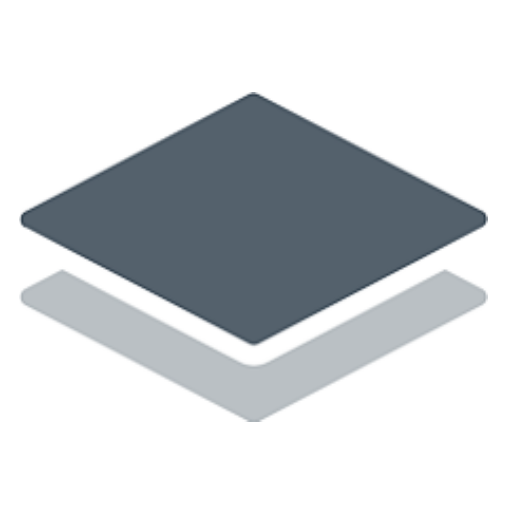

<h1>
    Remove Background
</h1>

Raycast extension to remove the background from an image using the Leonardo.Ai API (formerly the remove.bg API)

    
    
    

## Features

- Remove the background from an image using the Leonardo.Ai API

## How to get the API key for Leonardo.Ai

Starting December 1, 2026, the remove.bg API moves to Leonardo.Ai ([migration guide](https://docs.leonardo.ai/docs/migrate-from-the-removebg-api-to-leonardoai)). remove.bg keys don't carry over, so you need a Leonardo.Ai API key:

- Navigate to https://app.leonardo.ai
- Sign in
- Open the API Access page and buy API credit (API access is separate from the free Leonardo.Ai web app)
- Click "Create New Key" and copy the key
- Paste it into the extension preferences

Leonardo.Ai bills every background removal, about $0.10 per image at the time of writing ([pricing calculator](https://app.leonardo.ai/api-access/pricing-calculator)).

## How to use

1. Open Raycast and start typing `remove background from image`
2. Select the extension and press enter
3. Open Finder and browse to the image you want the background removed from
4. Click your image and hold down the mouse button to start dragging
5. Press your keybinding to open Raycast
6. Drag the image to the input field labeled `Select image`
7. Optionally change the options
8. Submit the form

If everything went well, a toast will appear with the name of the output image. Your output image will be saved to the same directory as your input image, as a PNG named `removed-<name>.png`.

## Options

- **Output image resolution**: Preview returns a small image (about 0.25 megapixels). Full and Auto return up to 10 megapixels, the maximum for PNG.
- **Crop**: crops the result to the subject.
- **Object you want to extract**: a hint that helps Leonardo.Ai find the subject.

For direct Base64 input, Leonardo.Ai's migration checklist recommends images under about 7.5 MB. Use a smaller copy if the service rejects a large image.
