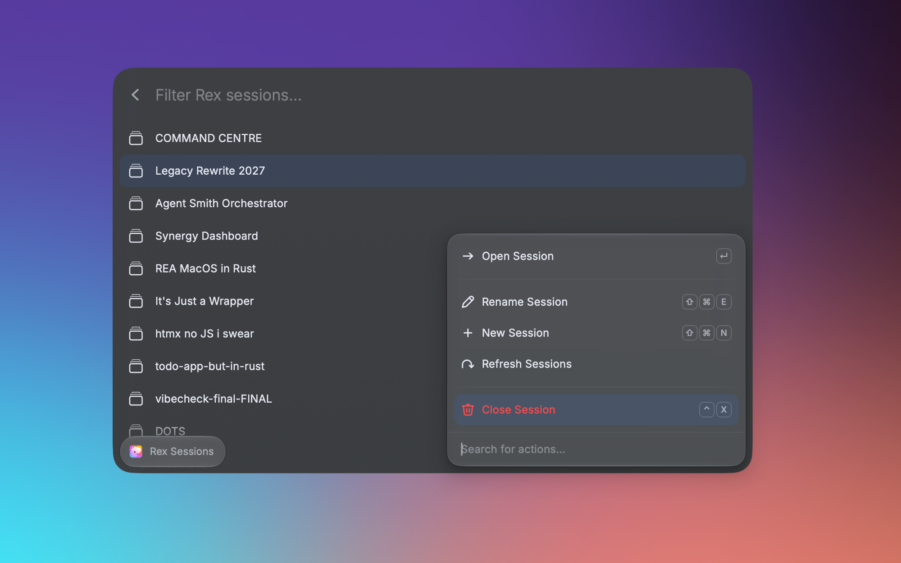
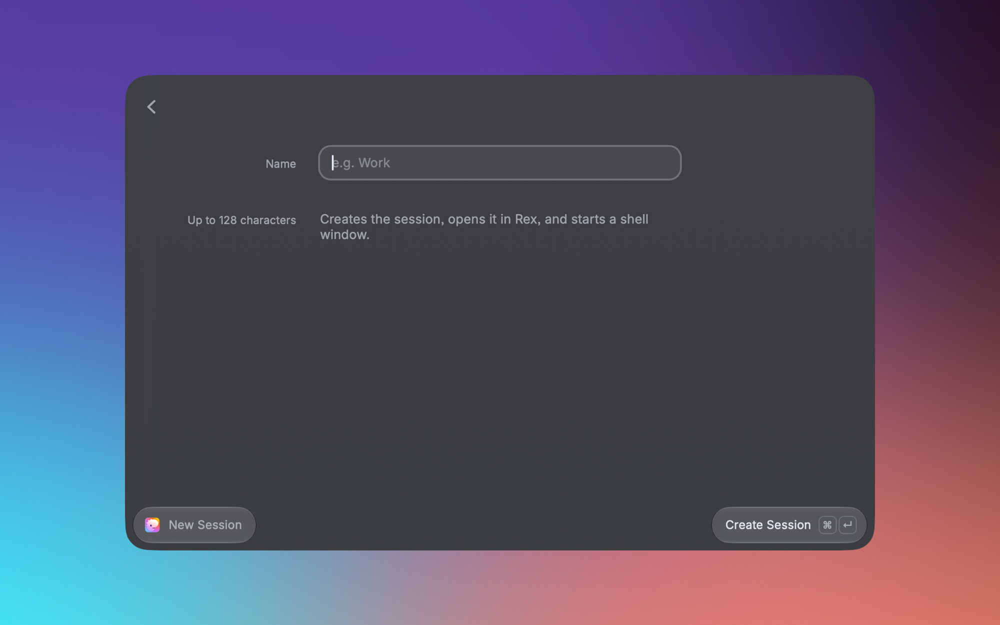
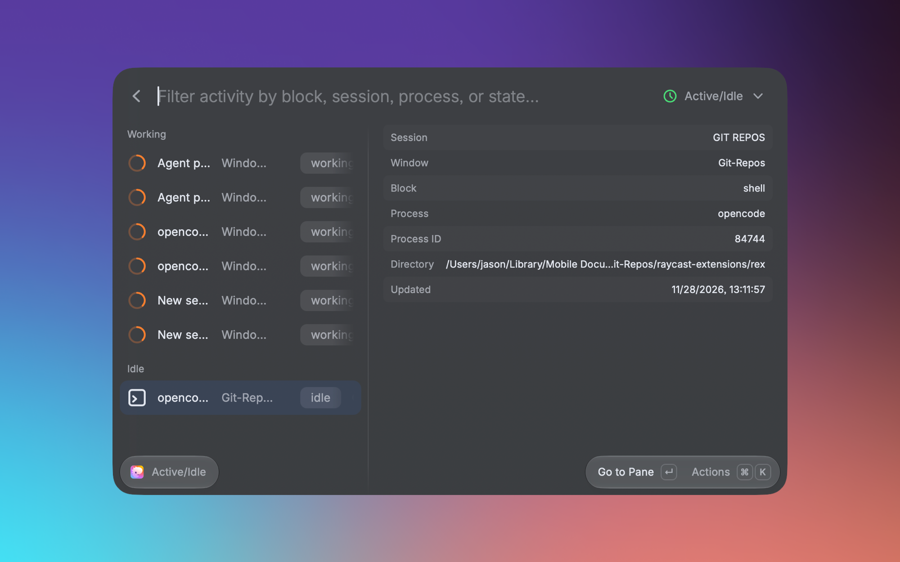
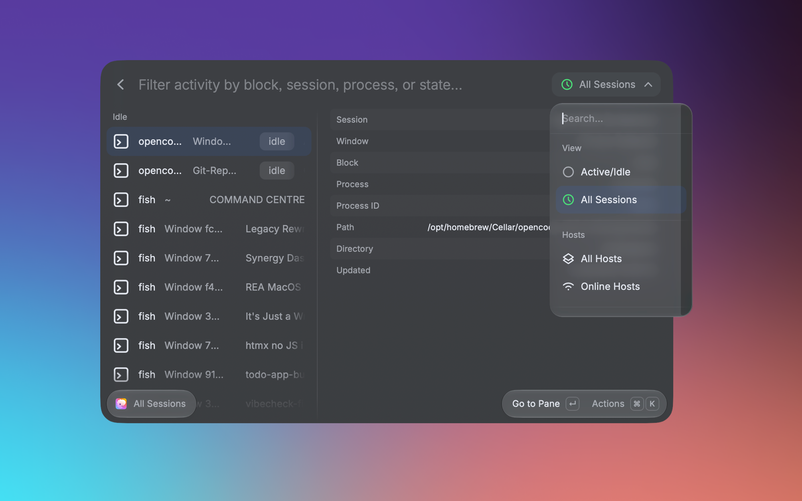

# Rex

Rex is a Raycast extension that provides _quick access to_ and _activity overview of_ Superlogical's Rex terminal/multiplexer.

Get to the right session or pane without the scenic route through windows and menus with **Rex Sessions**.

Glimpse a quick view of what is happening across your windows/panes and navigate directly to them if you need with **Rex Activity**.

## Requirements

- [Rex](https://www.superlogical.com/) installed and running.
- The `rex` CLI available on your `PATH`, or the CLI bundled with Rex installed in its default location.

If Raycast cannot find the Rex CLI, set the `REX_CLI` environment variable to the full path of the `rex` executable.

## Features

### Rex Sessions (Find and manage sessions)

Lists all open sessions so you can directly select or search and filter by name, then take one of the following actions:

- Open session (Enter/Return): Open the selected session in Rex.
- Rename session (⇧⌘E): Give the existing session a more useful name.
- Close session (⌃X): This destroys the session, closes its terminal blocks, and terminates programs running in them. Rex means business.
- New session (⇧⌘N): Enter a name and create a new session with a shell window.

### Rex Activity (See activity across panes)

Run Rex Activity to browse pane statuses and foreground processes, with details for the selected pane. Press Enter on an activity to focus that pane in Rex.

#### Views (⌘P)

- **Active/Idle** shows sessions with an Active or Idle status and their recognized activity. (This is the default view but can be toggled from the Actions menu).
- **All Sessions** shows all sessions, including those with other or unrecognized statuses.
  These can be additionally filtered by All Hosts(default), Online Hosts, or individual servers. Selecting Online Hosts runs a reachability check so it is not constantly polling.

- Activity is grouped by Status Priority by default. Toggle **Group by Session** instead from the Actions menu.
- Search to filter list by block, session, process, or state.
- **Refresh Activity** (⌘R) to force a refresh of the list.

## Screenshots

_Rex Sessions list, showing a name search and the session actions._

_New Session form with the session name field._

_Rex Activity list with status-priority sections and the selected pane’s details._

_Activity filter menu showing Active/Idle, All Sessions, host scopes, and server toggles._

## Beta disclaimer

Rex by Superlogical is currently in public beta(Mac), alpha(Windows), server-only(Linux). This independent extension is not affiliated with or endorsed by Superlogical. Installing it does not grant access to Rex or private beta rights. You must already have Rex installed. [Sign up by joining the Superlogical mailing list](https://www.superlogical.com/updates/public-testing-beginning).

Windows support (experimental): While everything has initially been done for Windows compatiblity, I don't have access to the Windows alpha. If you do please test and log any issues you encounter.

## Roadmap

> As Rex itself is in beta, it's own roadmap is subject to change. This extension will continue to evolve as the app does but maintaining a discrete goal of not replicating what could be done quicker and richer by necessity within Rex itself.

- Add more quick routes to Rex’s built-in and community actions and information.
- Interact more directly with running agents.
- Suggestions are welcome. The roadmap is more useful with your ideas in it!
