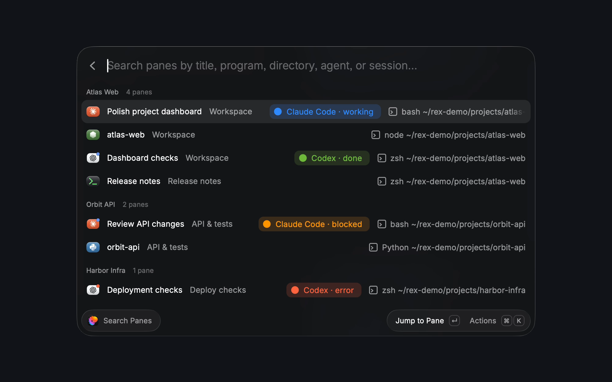
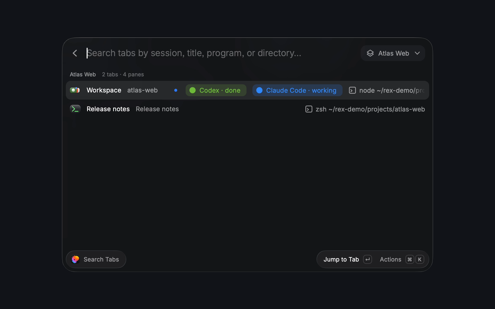
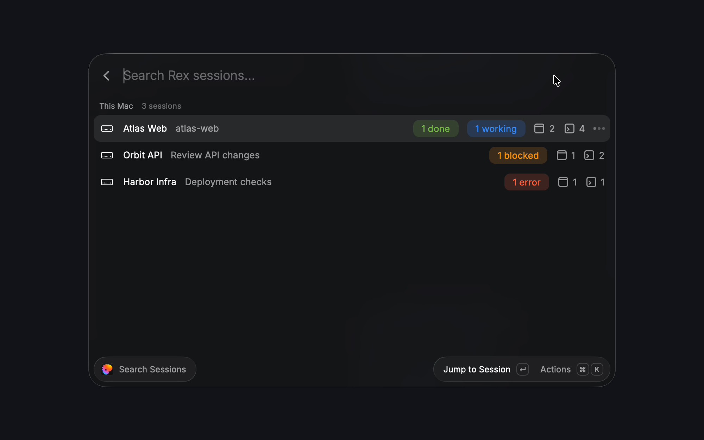

# Rex Sessions

Search [Rex](https://www.superlogical.com/rex) sessions, tabs, and panes from Raycast. Preview terminals and jump with Enter.

> [!WARNING]
> This is a fully working prototype, but the code is heavily vibe-coded. Next step is cleaning it up and making better use of Rex's APIs.

Requires access to the Rex private beta. Enable **Rex → Settings → Rex Server → Remote Control**.

```sh
npm ci
npm run dev
```

<p align="center"></p>
<p align="center"></p>
<p align="center"></p>
