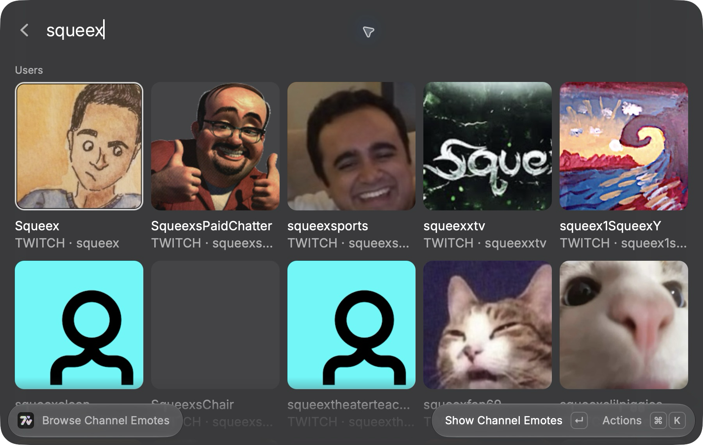
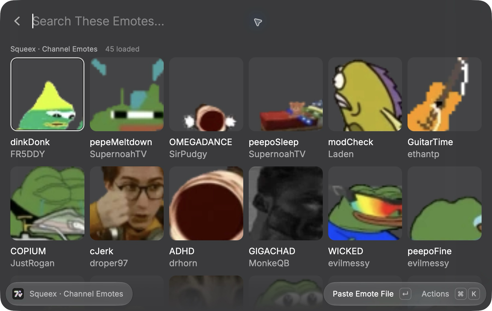

# 7TV Emotes Search

Search emotes from 7TV, BetterTTV, and FrankerFaceZ in Raycast. Copy or paste animated emotes as GIF files and static emotes as PNG files when available.

## Use

1. Open **Search Emotes**.
2. Choose a provider and sort order from the search dropdown.
3. Enter an emote name, or browse without a query.
4. Press Enter to paste the selected emote file into the active app.

The dropdown includes Popular and Recent for all providers, daily Trending for 7TV, weekly Trending for BetterTTV, and alphabetical sorting for FrankerFaceZ. BetterTTV text search uses its search ranking. Its browse sorts return when you clear the query. 7TV alphabetical sorting is hidden because its API currently fails for that mode.

Scroll to load more results. 7TV and FrankerFaceZ show the loaded count and the API's matching total. This total depends on the current query and sort. BetterTTV shows the loaded count because its API does not provide a matching total.

Use the action menu to:

- Show animated emotes only with `Cmd+Shift+A`.
- Switch between grid and list with `Cmd+Shift+V`.
- Star an emote with `Cmd+S`.
- Copy an image file, URL, Markdown image, or ID.
- Paste a URL when the target app does not accept image files.

Favorites and recently used emotes stay visible while you search. Names match without case sensitivity; results follow the selected provider and animation filter. Favorites appear before recent matches, and a favorite is not repeated in the recent section.

The command remembers your provider and sort order, grid/list view, and animated-only filter. Search text is not saved. These view preferences are separate from your emote-size preference and saved emotes.

Favorites and recent history remain in Raycast's local storage when this existing extension updates. Loading saved data does not rewrite it. Paste and favorite actions wait for that load before saving, so an early action cannot replace the old entries. Entries saved before provider support are treated as 7TV emotes. Each provider shows its own saved entries.

## Browse users

Open **Browse Channel Emotes** or **Browse Creator Emotes**. Search for a 7TV user, then select their avatar and press Enter. Channel browsing opens their active emote set and preserves channel aliases. Creator browsing shows their public uploads. Search within either collection, scroll for more results, and use the existing paste, size, and favorite actions.

Each command remembers the last 20 users you opened. Clear the search to see **Recent Users**. Use **Remove from Recent Users** or **Clear Recent Users** to remove entries. Channel and creator history are stored separately on this device. Typing a search alone does not save it.

These two commands currently support 7TV only. Private and unlisted emotes are excluded. Channel browsing shows a loaded count because the API total can include excluded entries. Creator browsing loads upload metadata once, then requests image details in small batches for each page. Use **Reload Results** to refresh the creator's upload list.

**View 7TV Usage Status** shows the API's personal-set approval status for these emotes. This status concerns adding emotes to personal sets on 7TV. It does not establish copyright or permission to reuse an image elsewhere. An emote without approval is not necessarily denied. The status does not block copying or pasting.

<details>
<summary>Screenshots</summary>




</details>

## Development

Install Node.js 22.13 or later and Raycast. This checkout was verified with Node.js 26.7 on macOS.

```bash
npm ci
npm test
npm run lint
npx tsc --noEmit
npm run build
npm run dev
```

Run `npm run test:live` to check provider searches, pagination, and GIF downloads against the current services. This requires network access.

Clipboard support depends on the destination app. GIF copy and manual paste were verified in TextEdit on macOS. The maintainer also tested GIF pasting in chat apps. Windows clipboard behavior still needs testing.

The API layer uses native provider files. It does not require FFmpeg, ImageMagick, or API keys.

## Credits

- [n4kama](https://github.com/n4kama) contributed the native GIF/PNG clipboard fix in [#32501](https://github.com/raycast/extensions/pull/32501) and the emote size controls in [#32566](https://github.com/raycast/extensions/pull/32566). The earlier fix was incorporated into the provider update without retaining its attribution; this credit corrects that omission.

- [Kan-A-Pesh](https://github.com/Kan-A-Pesh) built [Emotecast](https://github.com/raycast/extensions/pull/30619). Its provider adapters and unified-provider workflow informed this expansion. This extension uses a separately implemented API layer and provider-native files rather than Emotecast's conversion pipeline.

The Raycast extensions repository and both contributions declare the MIT license.
