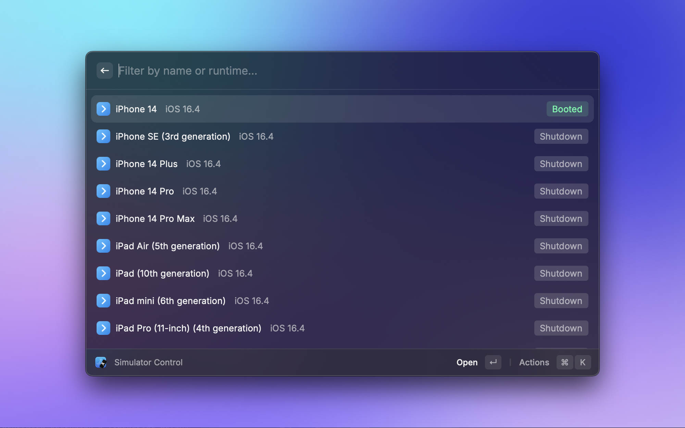

# Simulator Control

Extension to control your Apple platform simulators.

## Showcases

- Boot and shutdown simulators
- Open data and logs directory

## Requirement

Xcode with simulator runtimes installed. Supports Device Hub in Xcode 27 and Simulator in earlier Xcode versions.

The extension uses the Xcode selected by `xcode-select -p` (or `DEVELOPER_DIR` when set). If no devices appear, check
`xcrun simctl list devices available` and make sure the selected Xcode has a simulator runtime installed.
