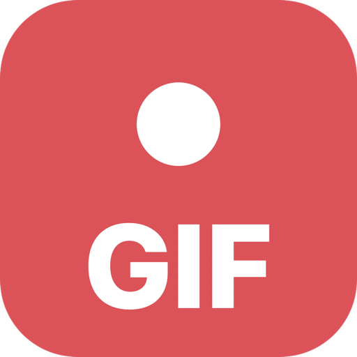
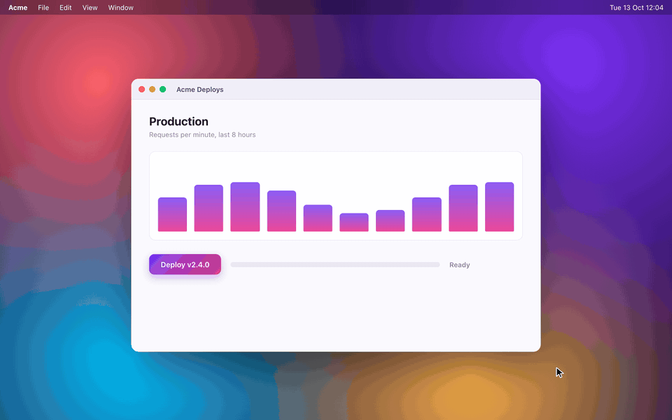

<p align="center">
  
</p>

<h1 align="center">Simple GIF Cap</h1>

<p align="center">
  <b>Hotkey. Drag. Paste.</b><br />
  Record any part of your screen straight to a GIF on your clipboard, from Raycast.
</p>

<p align="center">
  
  
  
  
  
  <a href="https://codeberg.org/justsamuel/raycast-simple-gif-cap/actions"></a>
</p>

<p align="center">
  
</p>

<p align="center"><sub>Yes, that is a GIF of a GIF.</sub></p>

## Why

You want to show a teammate what you are seeing: a bug, a flow, a glitch. A screenshot misses the motion, a screen recording is too heavy for chat, and [gifcap.dev](https://gifcap.dev) lives in a browser tab. Simple GIF Cap is one hotkey away: pick an area, record, stop, and the GIF is already on your clipboard.

## Features

- **Pick anything.** Drag a region and fine-tune it with handles, or hover and click a window. Space flips between the two.
- **Out of your way.** A 3-2-1 countdown, a dashed frame and a tiny floating Stop pill, none of which end up in the GIF.
- **One hotkey.** Run a record command again to stop.
- **Clipboard first.** The GIF is encoded, copied and previewed the moment you stop.
- **Trim and tune.** Cut the start or end, change frame rate or width, right from the preview.
- **Slack-sized.** Fit under 10 MB with one shortcut.
- **History.** Recent GIFs in a grid, ready to copy again.
- **Crisp output.** Uses [gifski](https://gif.ski) when installed, ffmpeg otherwise.

## Commands

| Command              | What it does                                                       |
| -------------------- | ------------------------------------------------------------------ |
| Record GIF of Region | Drag a region, or press Space to pick a window. Run again to stop. |
| Record GIF of Window | Hover and click the window to record. Run again to stop.           |
| Record GIF of Screen | Record the display under the mouse. Run again to stop.             |
| Stop GIF Recording   | Stop the running recording and open the preview.                   |
| Show Last GIF        | Preview, trim, shrink and copy the latest GIF.                     |
| Recent GIFs          | Browse, copy and edit your recent GIFs.                            |

Assign a hotkey to one of the record commands in Raycast settings and use it to both start and stop.

### Picker shortcuts

| Key                                | Action                                                                  |
| ---------------------------------- | ----------------------------------------------------------------------- |
| Drag                               | Draw a region; drag inside it to move, drag an edge or corner to resize |
| Click                              | Select the whole display (region mode) or the window (window mode)      |
| Space                              | Switch between region and window mode                                   |
| Enter, double click, Record button | Start recording                                                         |
| Esc                                | Cancel                                                                  |

### Preview shortcuts

| Shortcut                  | Action                        |
| ------------------------- | ----------------------------- |
| Enter                     | Copy GIF                      |
| Cmd+Shift+V               | Paste GIF to the active app   |
| Cmd+T                     | Trim and adjust               |
| Cmd+F                     | Fit under 10 MB               |
| Cmd+Shift+R / Cmd+Shift+W | Change frame rate / max width |
| Cmd+O / Cmd+Shift+F       | Open GIF / show in Finder     |
| Ctrl+X                    | Delete                        |

## Installation

**Raycast Store**: coming soon.

**From source**:

```bash
git clone https://codeberg.org/justsamuel/raycast-simple-gif-cap.git
cd raycast-simple-gif-cap
npm install && npm run dev
```

`npm run dev` compiles the Swift part and imports the extension into Raycast. It stays installed after you stop it.

### Requirements

- macOS 13 or newer and [Raycast](https://raycast.com)
- Nothing else to use it. GIFs are encoded with macOS's own frameworks.
- Optional: `brew install ffmpeg` for smaller files, plus `brew install gifski` for sharper colors. Simple GIF Cap picks them up automatically.
- To build from source: [Node.js](https://nodejs.org) 22+ and Xcode 16.3+. If `xcode-select -p` points at the Command Line Tools, prefix the npm commands with `DEVELOPER_DIR=/Applications/Xcode.app/Contents/Developer`.

## Configuration

Open Raycast Settings, go to Extensions and select Simple GIF Cap.

| Preference                      | Default        | Notes                                 |
| ------------------------------- | -------------- | ------------------------------------- |
| Save GIFs To                    | `~/Downloads`  | Folder for finished GIFs              |
| Frames per Second               | 15             | Higher is smoother but bigger         |
| Max Width                       | 1000 px        | Wider recordings are scaled down      |
| Encoder                         | Best available | gifski, then ffmpeg, then built-in    |
| Countdown                       | 3 seconds      | None, 3 or 5 seconds                  |
| Stop Automatically After        | 1 minute       | Keeps runaway recordings small        |
| Show mouse clicks / Show cursor | On             | Passed to `screencapture`             |
| ffmpeg Path                     | Homebrew       | Only needed for a non-Homebrew ffmpeg |

## Troubleshooting

- **Raycast asks to run "Show Last GIF"**: the recorder opens the preview through a deeplink, and Raycast confirms deeplinks from other apps. Choose **Always Run Command** once.
- **The recording is empty or fails**: give Raycast Screen Recording access in System Settings > Privacy & Security > Screen & System Audio Recording, then restart Raycast.
- **"ffmpeg not found"**: you forced the ffmpeg or gifski encoder. Install it with Homebrew, set the ffmpeg path, or switch the encoder back to Best available.

## How it works

The native part is a Swift package (`swift/`) built with Raycast's [Swift tooling](https://github.com/raycast/extensions-swift-tools): Raycast compiles it and the TypeScript code calls its `@raycast` functions.

- `pickTarget` shows the region and window picker.
- `startRecording` launches the recorder as its own process. It runs `screencapture -v` with the countdown, frame and Stop pill (marked as not shareable, so they stay out of the video), and opens the preview command through a Raycast deeplink when the recording ends.
- `encodeGif` and `probeMedia` are the built-in encoder, on AVFoundation and ImageIO.

The TypeScript side (`src/`) picks the encoder, keeps a history and renders the preview, edit form and grid.

Source videos of the latest 20 captures are kept in the extension's support folder so they can be trimmed and re-encoded later.

## Development

```bash
npm install
npm run dev        # ray develop (compiles swift/ too)
npm run build      # ray build
npm run lint       # ray lint
npm run check      # typecheck, eslint, prettier, ASCII (what CI runs)
npm run demo       # render media/demo.gif
npm run screenshots # regenerate the Store screenshots in metadata/
```

`npm run demo` re-renders `media/demo.gif` from `scripts/demo/` in headless Chrome. The scene recreates the extension's UI, and the GIF in its preview is encoded with ffmpeg the way the extension does it. See [AGENTS.md](AGENTS.md) for the project layout and conventions.

## License

[MIT](LICENSE)
