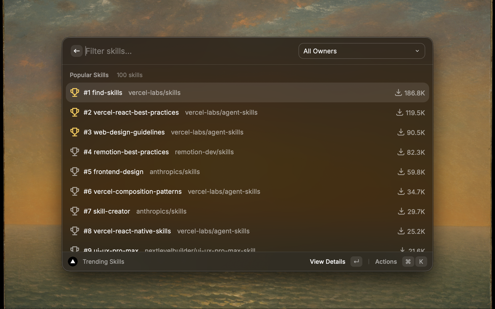
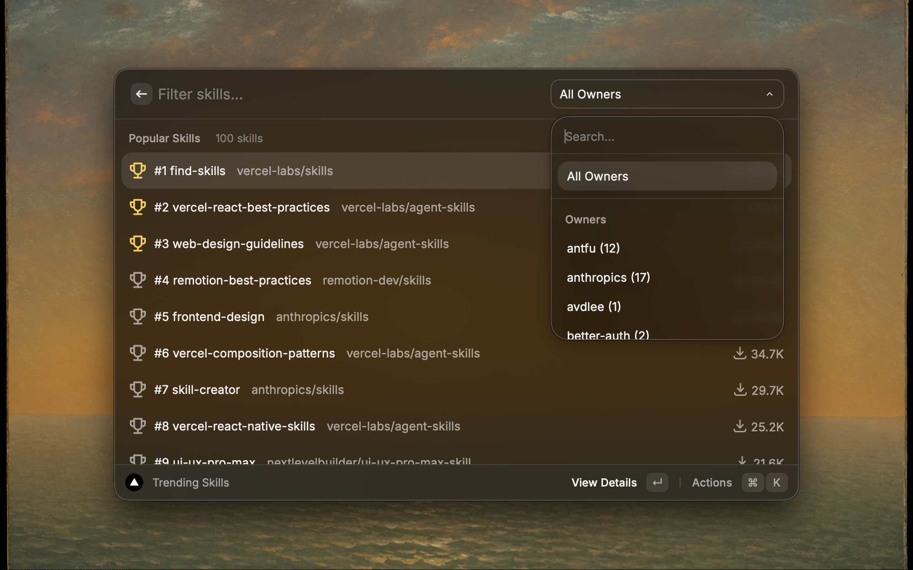
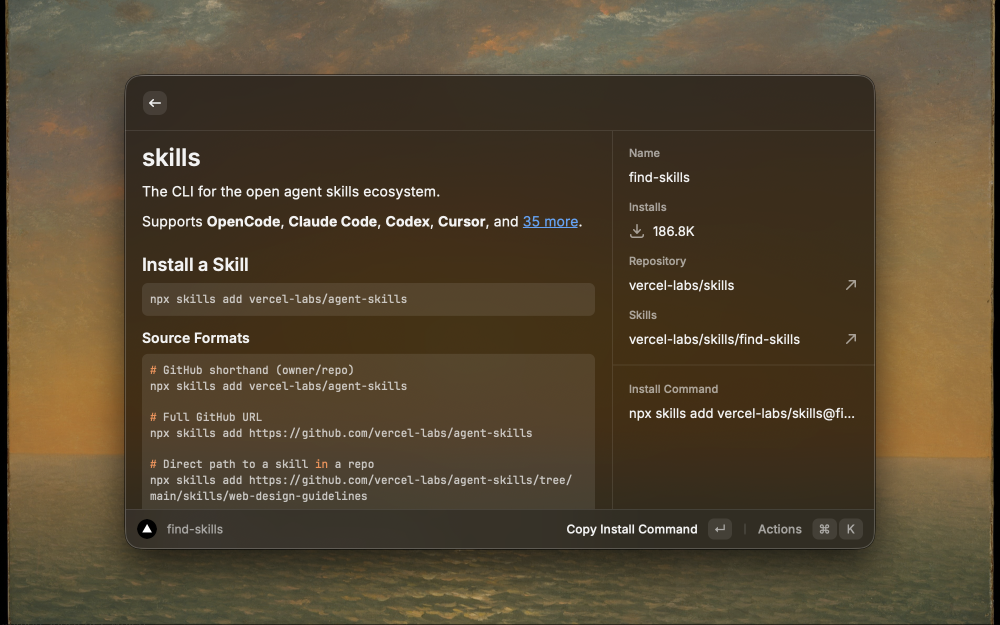
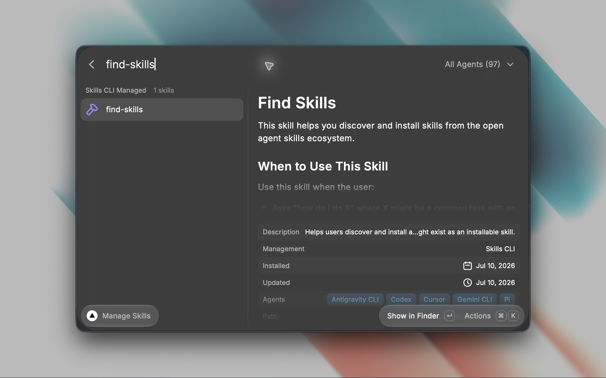
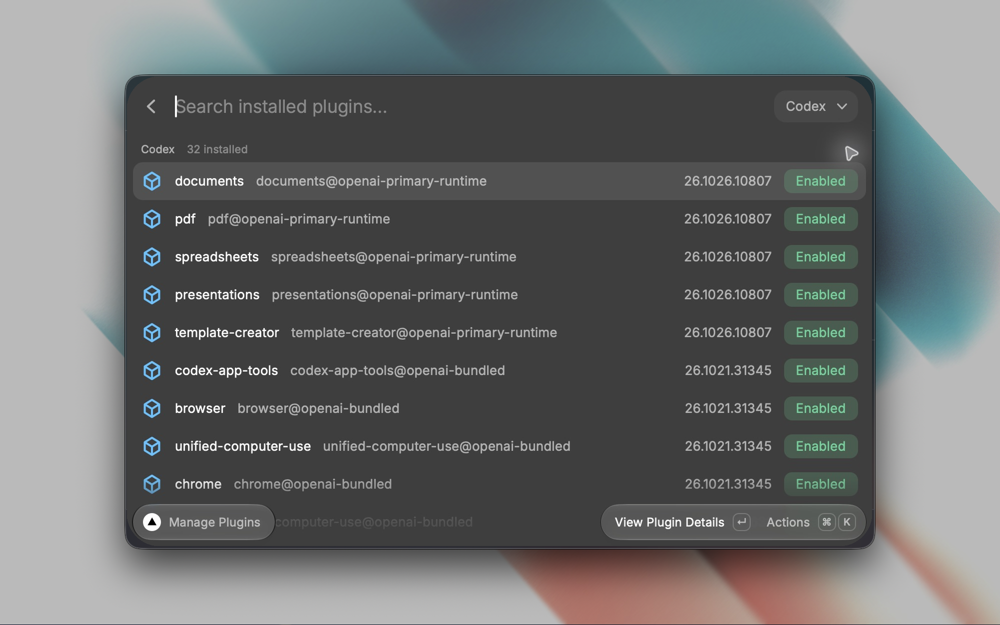
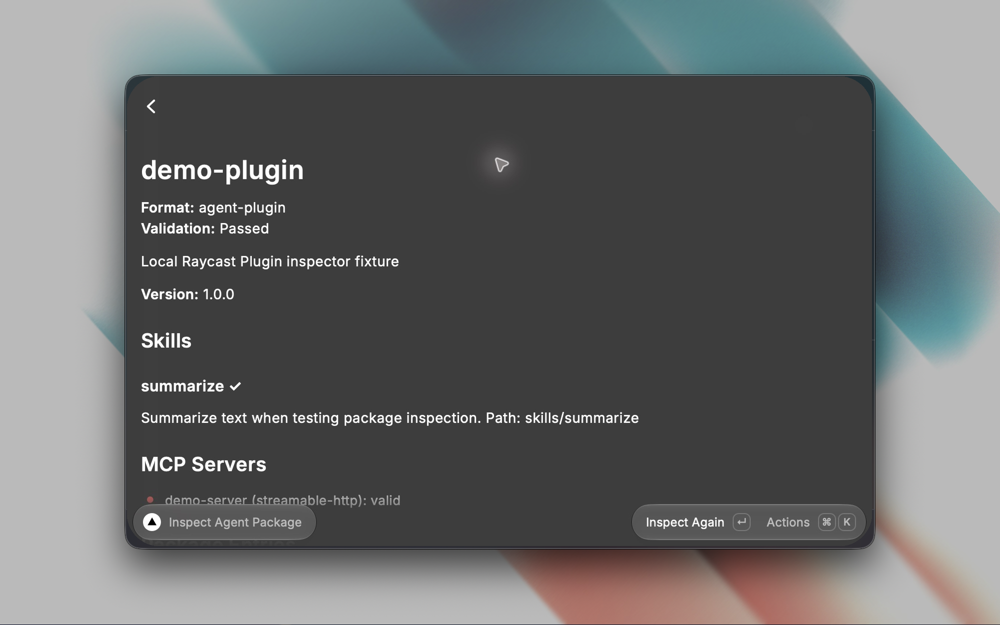

# Skills

Search and manage AI agent skills from [Skills](https://skills.sh) directly in Raycast.

## Features

- Search for specific skills
- See which search results are already installed with a green check-circle indicator
- Identify skills installed from a different source with a conflict warning
- Filter available skills by owner
- Install skills for all supported agents
- View security audit status from `skills.sh` before installing
- Review installed skills by management source; remove verified Codex and Claude Code installs
- View installed Claude Code and Codex plugins and manage supported installations
- Check for skill updates — outdated skills are highlighted with an orange icon for review
- Filter installed skills by agent
- View skill source, install date, and update date from the lock file
- Open installed skill repositories on GitHub
- Open search result details in a full-screen view with SKILL.md content, including description, license, compatibility, and allowed tools
- See GitHub star counts in the detail view
- Copy install commands
- Quick access to GitHub repositories
- Inspect a local Agent Skill or Agent Plugin v1 package, including its bundled skills, resources, and MCP server configuration
- Distinguish Claude Code and Codex compatibility layouts from portable Agent Plugins

## Commands

### Search Skills

Search for agent skills from skills.sh with real-time results. Results show which skills are installed locally and flag skills that may conflict with a local install from another source. Open a result to view full-screen details, including security audit status when available.

### Manage Skills

View installed skills discovered by the Skills CLI, grouped by management source. The extension verifies the installed GitHub skill contents against the CLI lock before enabling removal. Removal is available for verified Codex and Claude Code installations. Other local or externally managed skills remain available for reading, opening, and copying. For local-path installs, the source and dates are shown as recorded lock-file details, not verified ownership. Outdated verified skills are highlighted for review. Automatic updates are unavailable because the Skills CLI update command can change installations for other detected agents. Filter by agent to see which skills are available for each AI agent.

### Manage Plugins

View plugins already installed in Claude Code and Codex using each host's CLI. The full-width list shows each installation separately, including Claude Code project installations. Open a plugin to inspect its status, version, scope, and location. User-scope Claude Code plugins can be enabled, disabled, or removed; removal keeps their persistent data. Codex plugins can be removed. Project and local Claude Code plugins are shown for inspection, since changing them requires their owning project directory. Removal asks for confirmation.

The host CLI must be installed for its plugins to appear. The command reports a host-specific error if one CLI is unavailable.

### Inspect Agent Package

Enter the path to a local skill or plugin folder. The inspector checks Agent Skills frontmatter and portable Agent Plugins v1 structure, shows bundled resources and MCP servers, and reports invalid paths or metadata. It recognizes Claude Code and Codex compatibility layouts separately. Inspection does not install packages or run their code.

## Using a Custom Package Registry (Corporate Proxy)

This extension runs the Skills CLI via `bunx`/`npx`, which download the `skills` package from a package registry. If your machine installs packages through a corporate proxy instead of the public npm registry, note that Raycast is launched by the OS and does **not** inherit environment variables from your shell profile (`~/.zshrc`, `~/.bash_profile`, etc.). Registry overrides set only as shell environment variables (for example `NPM_CONFIG_REGISTRY` or `BUN_CONFIG_REGISTRY`) will not reach the CLI.

Configure your registry in **files in your home directory**, which every launch context reads:

- **npm / npx** — `~/.npmrc`:

  ```
  registry=https://your-proxy.example.com/
  ```

- **bun / bunx** (tried first by this extension) — `~/.bunfig.toml`:

  ```toml
  [install]
  registry = "https://your-proxy.example.com/"
  ```

After editing these files, fully quit and relaunch Raycast so it re-reads the configuration. If automatic `npx` detection also fails, set **Custom npx Path** in the extension preferences.

## Screenshots







