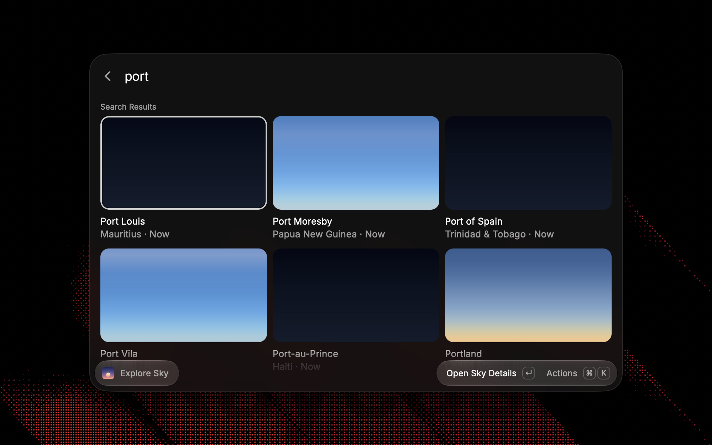
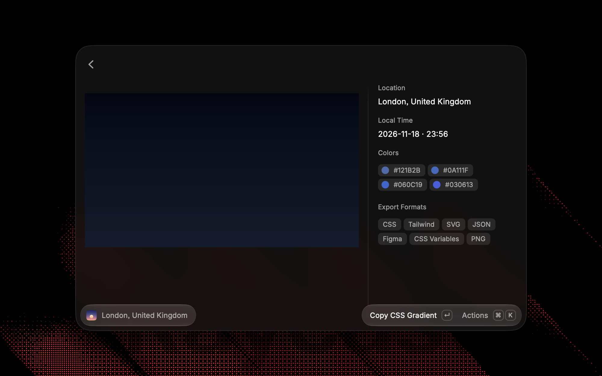

  
  <h3>SkyFrom</h3>
  
Explore sky gradients from around the world

SkyFrom is a Raycast extension for previewing the sky over a city, copying its gradient, and setting a desktop wallpaper that follows the local sky on macOS or Windows. It uses SkyFrom’s public API and requires no account.

## Explore and export

- Open **Explore Sky** and search for a city. Results show the country so you can distinguish cities with the same name.
- Press **Return** to open Sky Details. **Choose Time** offers custom dates and times, Sunrise, Noon, Sunset, Midnight, and Golden Hour. Times are local to the destination, and **Return to Now** restores the live sky.
- Press **⌘C** on macOS or **Ctrl+C** on Windows to copy in your preferred format. The action panel also offers CSS, Tailwind CSS v4, SVG, JSON, CSS variables, Figma design tokens, PNG, and a link to the sky on SkyFrom.
- Press **⌘F** on macOS or **Ctrl+F** on Windows to add or remove a favorite. **Favorite Skies** lets you search, rename, and reuse saved skies. A solar preset with the date left blank follows the event on the destination’s current day.
- Choose **Use City as Default** in Explore Sky or enter a default city in the extension settings. **Current Sky** always shows the default city’s live sky. Setting a favorite as the default also gives **Copy Sky Gradient** and **Set Sky Wallpaper** its saved time.

## Wallpaper

Press **⇧⌘W** on macOS or **Ctrl+Shift+W** on Windows, or run **Set Sky Wallpaper**. On macOS, this changes the active desktop on the primary display. On Windows, it sets one desktop-wide wallpaper. SkyFrom sizes the PNG for the primary display on both platforms, up to 4,096 pixels per side. **Download PNG** saves a copy to Downloads or your configured Wallpaper Directory.

To turn on periodic updates, enable **Automatic Wallpaper** in the extension settings, choose 15, 30, or 60 minutes, then run **Auto Update Wallpaper** once. Leave **Automatic Wallpaper City** blank to use your default city. You can also control Raycast’s **Background Refresh** in that command’s settings.

Raycast schedules updates on a best-effort basis while it is running. The wallpaper is a static image that changes periodically. When an update fails, the current wallpaper stays in place. After three failed updates, run **Auto Update Wallpaper** to retry. On macOS, **Sky Menu Bar** shows the latest cached sky for the default city and provides refresh and pause controls.

## Raycast AI

Mention **@SkyFrom** in Raycast AI to search cities, see sky colors, export a gradient, find a saved favorite, or download a PNG. Raycast asks for confirmation before changing your wallpaper.

- “Give me the CSS gradient for sunset in Lisbon.”
- “Show my favorite skies in Tokyo.”
- “Set my desktop wallpaper to sunrise in Helsinki.”

## Local times and privacy

SunCalc calculates sunrise, sunset, and golden hour from the city’s coordinates. Some cities have dates when those events do not occur. When clocks go forward, choose a valid local time. For repeated clock times, SkyFrom chooses the occurrence.

City choices, recent views, and favorites stay on your device. Raycast Cache shares recent SkyFrom responses across commands. If SkyFrom limits requests, the extension uses cached previews when available and waits before making another request. The extension sends requested city slugs, times, and output settings to SkyFrom to fetch gradients.

## Credits

SkyFrom was created by [Cyze](https://x.com/cyze_dev/status/2122798490795540847). This is an independent Raycast integration. [SkyFrom](https://skyfrom.app) · [SkyFrom API documentation](https://skyfrom.app/llms.txt)
