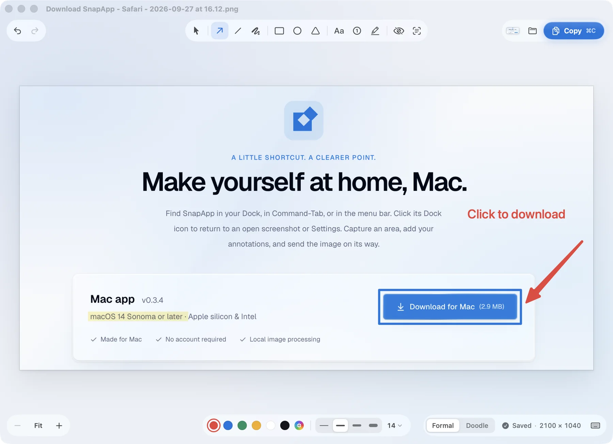

# SnapApp

Capture part of your screen and annotate it in [SnapApp](https://snapapp.im/?utm_source=raycast&utm_medium=extension&utm_campaign=raycast-store), a snipping tool for Mac: arrows, shapes, text, highlights and a pen, then copy the result with one shortcut.

## Commands

- **Capture Area**: select part of the screen and open it in SnapApp's editor.
- **Annotate Clipboard Image**: open the image you copied in SnapApp's editor.
- **Annotate Latest Screenshot**: open the newest screenshot from your macOS screenshot folder (set in the Screenshot app's Options, the Desktop by default).
- **Open Selected Images in SnapApp**: open the PNG, JPEG, HEIC or TIFF files selected in Finder.

## Setup

The extension drives the SnapApp app, so SnapApp has to be installed. It is free on the [Mac App Store](https://apps.apple.com/app/id6817683799) and also available from [snapapp.im](https://snapapp.im/?utm_source=raycast&utm_medium=extension&utm_campaign=raycast-store). Every edition works: the Mac App Store, the direct download and Setapp.

SnapApp asks for Screen Recording permission the first time it captures. Capture Area starts a capture at any time with SnapApp versions that register the `snapapp://` address; with older versions it starts one when SnapApp is not already open, and otherwise asks you to update.

Capturing and annotating are free. SnapApp Pro, an optional purchase in the app, adds blur and pixelate, redaction, text selection with on-device text recognition, and numbered steps.
