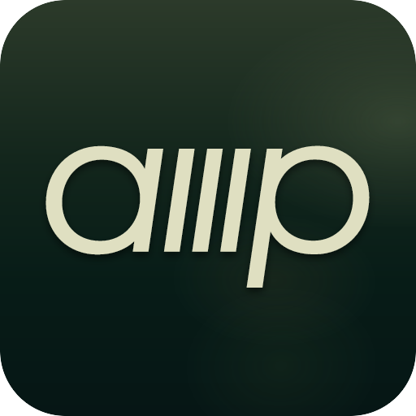
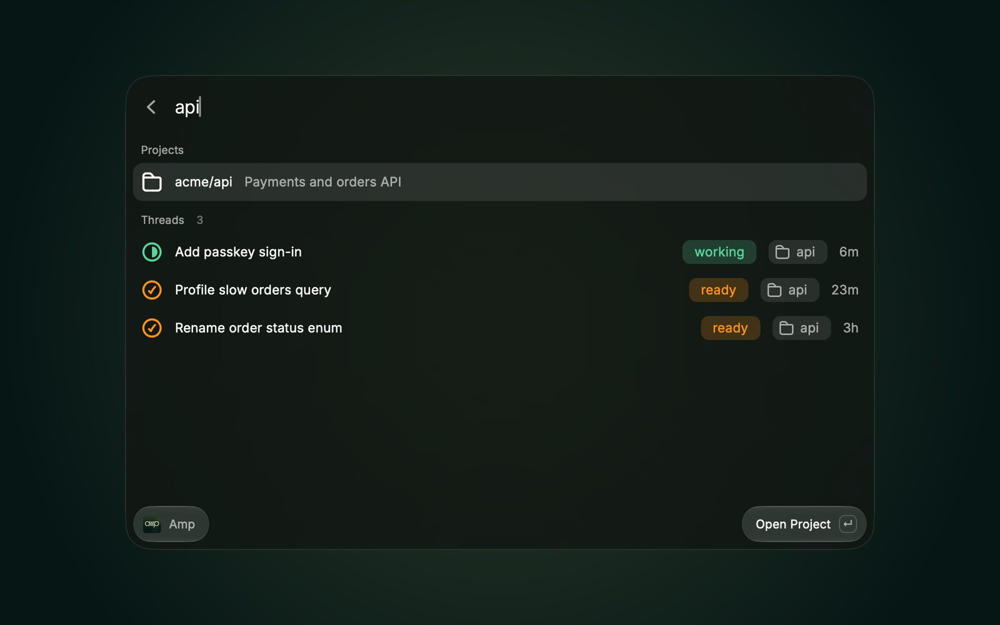
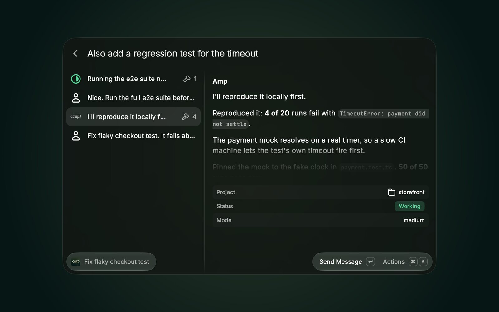
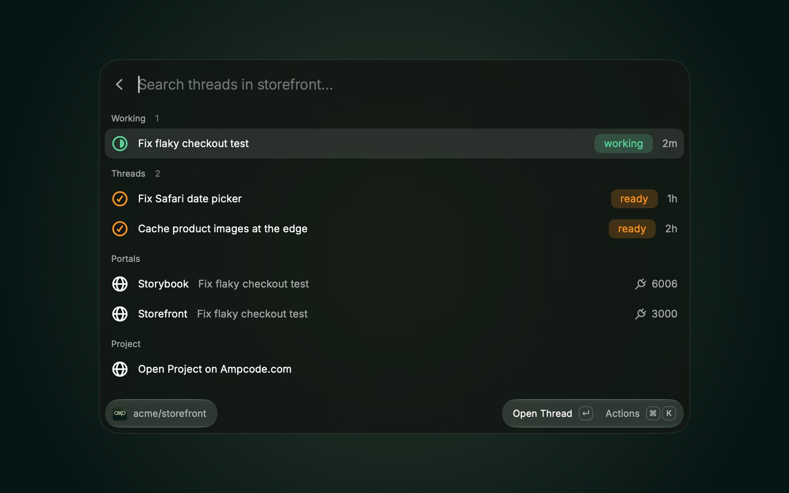
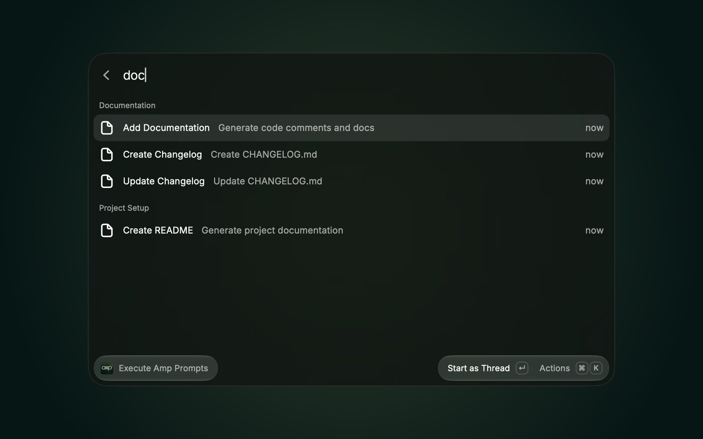
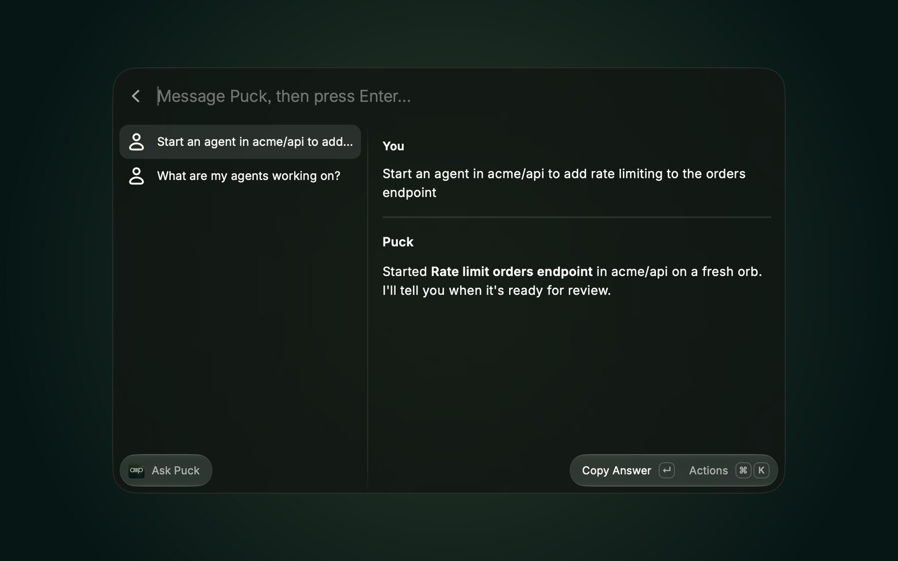
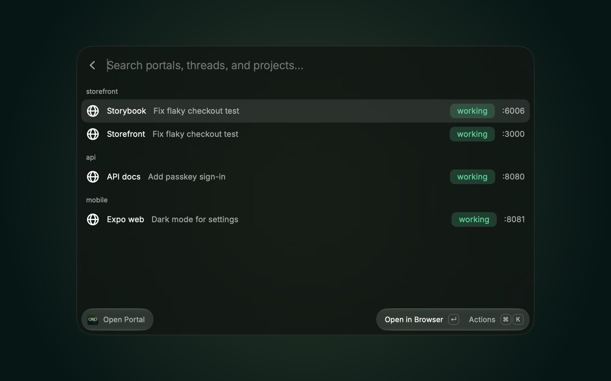
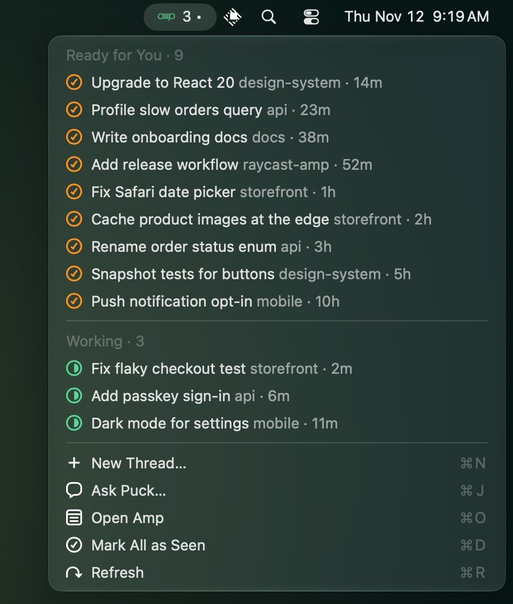
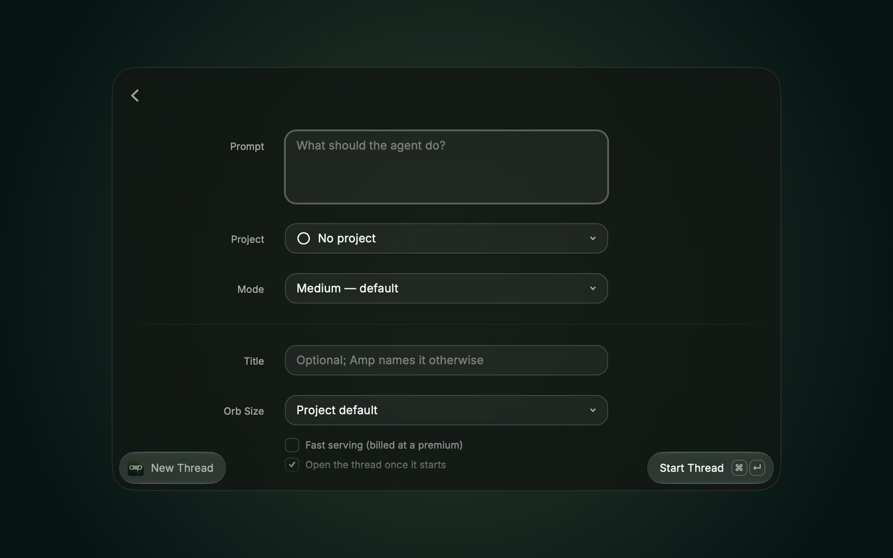

<h1 align="center">Amp for Raycast</h1>

Browse your [Amp](https://ampcode.com) projects and threads, steer agents, and start threads or saved prompts without leaving Raycast. Chat with Puck, see which agents are working from the menu bar, and jump into your orbs' portals.

  
  

> An unofficial, community extension. Not affiliated with Amp.

## Commands

| Command | What it does |
| --- | --- |
| **Amp** | Home for your threads, like the Amp web app: what is working, what is ready for you, your projects, and thread search with Amp's query syntax (`repo:`, `author:me`, `after:7d`, `pr:`). Enter on a project lists its threads and portals; Enter on a thread opens it. |
| **Thread view** | A thread's transcript, newest turn first, with tool calls summarized. The search bar is the composer: type and press Enter to send the agent a message. Also copy the URL, `@T-…` mention, or `amp threads continue` command, rename, and archive. |
| **New Thread** | Form with prompt, project, mode, title, orb size, and Fast. Starts an orb thread, copies its URL, and opens it. |
| **Start Thread** | The same from the root search: `Start Thread <prompt> [project]`, using your default project and mode. |
| **Execute Amp Prompts** | Your saved prompts, by category. Start one as an orb thread, in a project of your choice, or paste or copy it as an `amp -x` command. |
| **Manage Prompt Categories** | Add, rename, and delete prompt categories. |
| **Ask Puck** | Chat with Puck: type in the search bar and press Enter. Continues your latest Puck conversation; ⌘N starts a new one. |
| **Call Puck** | Runs the *Call Puck* shortcut that the Amp Mac app adds. Without the app, opens ampcode.com, where ⌃⇧/ starts a call. |
| **Open Portal** | Portals of your running orbs, grouped by project, with the thread that owns each. |
| **Amp Menu Bar** | How many agents are working, with a dot when threads are ready for you. Lists both, and shows a HUD when a thread it saw working finishes. |

Saved prompts and categories come from [Amp Dash X](https://www.raycast.com/jdorfman/sourcegraph-amp-dash-x), which this extension now includes; prompts you saved there carry over.

  
  

  
  

  
  

## Setup

Install the [Amp CLI](https://ampcode.com/install) and sign in with `amp login`. The extension finds the CLI on its own; if yours lives somewhere else, set **Amp Binary Path** in the extension preferences.

## Preferences

| Preference | Default | Notes |
| --- | --- | --- |
| Amp Binary Path | auto | Looks in `~/.amp/bin`, `~/.local/bin`, Homebrew, and `/usr/local/bin`. |
| Default Flags | – | Extra flags for the `amp -x` commands that saved prompts paste and copy. |
| Access Token | – | Only needed when the CLI isn't signed in. Create one at ampcode.com/settings/security. |
| Default Project | – | `namespace/name` for Start Thread and saved prompts when none is given. |
| Default Mode | Medium | Agent mode for new threads. |
| Open Threads In | Browser | Choose *Amp for Mac* to open links in the Mac app. |

## How it works

Everything goes through public Amp CLI commands: `threads list/search/export/markdown/rename/archive`, `projects list`, `--execute --orb-execute` to start and message threads, and `top --stream-jsonl` for live working state. No private APIs or stored credentials beyond the optional access token.

- **Puck** conversations are ordinary threads in `puck` mode. Ask Puck sends with `threads continue` and waits for the reply, using `amp top` to tell when Puck stops working.
- **Portals** have no CLI listing. Portal hosts embed the thread UUID in base36 (`t-<uuid36>-p<port>.onamp.dev`), so Open Portal reads the transcripts of threads whose orbs are connected and picks out URLs on their own hosts. Portals an agent never printed, and custom portal hostnames, don't appear.

