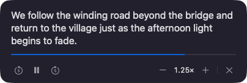

# Speak Text for Raycast

Speak Text supports Intel and Apple silicon Macs running macOS 13 or later with Raycast installed. The first reading downloads about 172 MB of model and runtime files. The player then reads English offline with Kokoro’s American English Heart voice. There is no API key or per-minute fee.

Run **Speak Selected or Copied Text** from Raycast. The command reads the selection in the frontmost app. If the app provides no selected text, the command reads plain text from the clipboard. Allow Raycast Accessibility access if macOS asks. The floating window shows which source was used and follows the spoken passage. Run the command again to replace the current reading. Close the window to stop.

Before speaking, the command removes Markdown formatting, reads link labels or bare domains, and shortens file paths to “path” plus the final name. This step runs locally on both selections and clipboard text.



| Action | In the focused player | From another app |
| --- | --- | --- |
| Start a reading | | Assign a Raycast hotkey to Speak Selected or Copied Text |
| Pause or resume | Space | Assign a hotkey to Pause or Resume Speech |
| Increase speed | = | Assign a hotkey to Increase Speech Speed |
| Decrease speed | - | Assign a hotkey to Decrease Speech Speed |

Assign global shortcuts in **Raycast Settings > Extensions > Speak Text**. The player remembers speeds from 0.5× to 2× in quarter steps. Changing speed preserves your playback position, including while paused. At the end, Space replays the passage.

The extension downloads checksum-verified releases from the sherpa-onnx project and keeps them in Raycast’s extension support folder. Selected text and generated audio stay on your Mac. The player keeps Kokoro loaded, prepares upcoming passages in memory, and queues them on one continuous audio stream. [Kokoro model](https://huggingface.co/hexgrad/Kokoro-82M) · [sherpa-onnx](https://github.com/k2-fsa/sherpa-onnx)

Maintained by Rami Maalouf. [rami-maalouf on GitHub](https://github.com/rami-maalouf)

## Build from source

Install Bun, Xcode with a macOS SDK, and Raycast. From this directory run:

```sh
bun install --frozen-lockfile
bun run dev
```

The universal player included in the release is built from the Swift and C sources in `native/`. To rebuild it and package the extension:

```sh
bash native/build.sh
bun run build
mkdir -p dist
bunx ray bundle -o dist/Speak-Text.rayext
```
