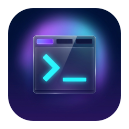

<p align="center">
  
</p>

<h1 align="center">Termini</h1>

<p align="center">
  <b>Your real terminal, inside Raycast.</b><br />
  Your own login shell and dotfiles, tabs that survive closing Raycast,<br />
  and one shortcut to continue the same session in Terminal, Warp or iTerm.
</p>

---

## Why Termini

Most "run a command" tools spawn a throwaway shell with Raycast's environment. Termini runs **your** shell instead. It starts your account's login shell (zsh, bash, fish…) the same way Terminal.app does, so your `~/.zprofile`, `~/.zshrc` or `~/.bash_profile` set up PATH, aliases, prompt and locale, exactly as they do in a terminal window.

## Features

- **Your real shell.** Uses the login shell set for your macOS account, with a clean login environment. Your rc files decide everything, and nothing leaks in from Raycast.
- **Persistent sessions.** A small background daemon owns every terminal. Close Raycast, come back later, and your shell, running jobs and scrollback are still there.
- **Tabs like a terminal app.** A tab strip across the top, tab switcher next to the search bar, `⌘1`–`⌘9` to jump.
- **Continue in your terminal app.** Press `⌘O` to attach Terminal, Warp or iTerm to the *same live session*. Closing that window just detaches; the session keeps running.
- **TUI friendly.** Full-screen and raw-mode apps (Vim, `less`, Bubble Tea / Ink based CLIs…) render correctly: line feeds, autowrap, tab stops, alternate screen, synchronized updates.
- **Midnight Glass theme**, plus One Dark Pro, Dracula, Catppuccin Mocha and Pure. Adjustable text scale.

## Getting Started

1. Open **Termini** from Raycast.
2. Type a command in the search bar and press `↵`.
3. Need full interactivity (arrow keys, mouse, live typing)? Press `⌘O` to continue the same session in your terminal app.

## Keyboard Shortcuts

| Action | Shortcut |
| --- | --- |
| Send text + Enter | `↵` |
| Send text without Enter | `⌥ ↵` |
| Open session in terminal app | `⌘ O` |
| New tab | `⌘ N` |
| Go to tab 1–9 | `⌘ 1` … `⌘ 9` |
| Next / previous tab | `⌘ ⇧ ]` / `⌘ ⇧ [` |
| Arrow keys | `⌘ ⌥ ↑ ↓ ← →` |
| Tab / Escape / Backspace | `⇧ ⇥` / `⇧ ⎋` / `⇧ ⌫` |
| Ctrl-A … Ctrl-Z | `⌃ A` … `⌃ Z` |
| Scroll up / down | `⌘ ↑` / `⌘ ↓` |
| Jump to bottom | `⌘ J` |
| Text scale | `⌘ =` / `⌘ -` / `⌘ 0` |
| Restart tab / clear | `⌘ ⇧ R` / `⌘ ⇧ K` |

## Preferences

| Preference | Default | Description |
| --- | --- | --- |
| Shell Path | *(account shell)* | Leave blank to use your login shell, same as Terminal.app. |
| Shell Arguments | `-il` | Interactive login shell, so your rc files load. |
| Working Directory | `~` | Where new tabs start. |
| Terminal App | Terminal | App used by **Open in Terminal**: Terminal, Warp, iTerm… |
| Python Path | `/usr/bin/python3` | Interpreter that runs the background daemon. |
| Terminal Columns | `90` | Width reported to the shell. |
| Transcript Line Limit | `4000` | Scrollback kept per tab. |

## How It Works

```
Raycast ──► termini-client ──unix socket──► terminid.py (daemon) ──► PTY ──► your shell
                                                  ▲
Terminal / Warp ──► termini-attach.py ────────────┘   (⌘O: raw bytes in/out, resize)
```

- **`terminid.py`** owns one PTY per tab and runs a small VT emulator. Raycast reads the screen and renders it as an SVG frame.
- **`termini-attach.py`** connects a real terminal window to a session, like `tmux attach`. It repaints the current screen, then streams raw bytes both ways and forwards window resizes.
- Sessions are only stopped when you close a tab, restart it or reset. Closing a tab hangs up its foreground job too, so nothing is left orphaned.

## Requirements

- macOS
- Python 3. `/usr/bin/python3` ships with the Xcode Command Line Tools (`xcode-select --install`).

## Limitations

Raycast extensions only receive the search bar text, not raw key presses. In Raycast, Termini is line based: you type a line and send it. For live keystrokes, mouse and every key combination, use `⌘O` to continue in your terminal app.

## License

MIT
