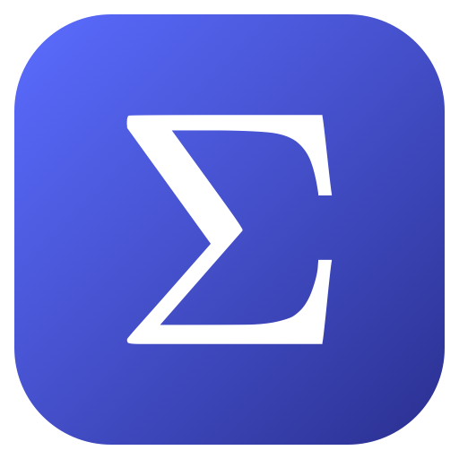

<p align="center">
  
</p>

<h1 align="center">TeXPaste</h1>

A Raycast extension for getting LaTeX equations into Keynote quickly. Type LaTeX, watch a live preview, and press ⏎ to paste a crisp **vector PDF**, an **SVG** or a **high-res PNG** into the app you're in.

Equations are rendered by MathJax bundled inside the extension. There is no TeX install and no network involved.

## Install

You need macOS, [Raycast](https://raycast.com), [Node.js](https://nodejs.org) 18 or newer, and Xcode 16.3 or newer. Raycast compiles the extension's Swift code with Xcode the first time you build it.

```bash
git clone https://github.com/abhii-roy/texpaste.git ~/Projects/texpaste
cd ~/Projects/texpaste
npm install
npm run dev
```

`npm run dev` imports the extension into Raycast. Once Raycast shows **TeXPaste**, you can stop the command with Ctrl+C and the extension stays installed. Keep the folder where it is, because Raycast runs the extension from it.

### First-time setup
1. **Hotkey:** in Raycast Settings → Extensions → TeXPaste → *LaTeX Equation*, assign a hotkey such as ⌥T.
2. **Auto-paste permission:** the first ⏎ asks to let Raycast control *System Events*. Click Allow. Without it, the equation is still copied and you press ⌘V yourself.
3. **Preferences:** set color, font size, PNG scale, inline/display style and auto-paste in the same settings pane.

## Usage

| Key | Action |
|---|---|
| ⏎ | Paste in your last-used format (PDF by default) |
| ⌘⏎ | Copy only, no paste |
| ⌘1 / ⌘2 / ⌘3 | Paste as PDF / SVG / PNG. This becomes the new default |
| ⌘T | Set equation color: presets, macOS color panel, eyedropper (pick from your slide), custom hex, saved customs (applies to PDF, SVG and PNG, and stays until changed) |
| ⌘E | Edit a history item |
| ⌘⇧C | Copy the LaTeX source |
| ⌘⇧M / ⌘R | Open / reload your macros file |
| ⌃X | Delete a history item |

- Paste `$…$`, `$$…$$`, `\[…\]` or `\(…\)`. The delimiters are stripped automatically.
- With the input empty, the list shows **templates** (fraction, matrix, cases, aligned, …). Type a name such as `matrix` to filter them.
- **Macros** live in `~/.config/texpaste/macros.tex`, one `\newcommand` per line.
- **History** keeps your last 100 equations.

## Commands

- **Paste LaTeX Equation:** the main window, with live preview, history and templates.
- **Pick Equation Color:** an eyedropper that sets the equation color from any pixel on screen, for example your slide's accent color.

## How it works

- `src/render.ts`: MathJax turns LaTeX into a self-contained SVG, sized in points.
- `swift/`: native code, compiled by Raycast's [Swift tools](https://github.com/raycast/extensions-swift-tools). It converts the SVG to a vector PDF or PNG, writes it to the clipboard as a native type (so Keynote gets a real vector object), and provides the color panel and eyedropper.
- `src/tex.tsx`: the Raycast UI. `src/pick-color.ts`: the color-picking command.

## Development

```bash
npm run dev       # load into Raycast with hot reload
npm run lint      # Raycast store checks (ESLint, Prettier, manifest)
npm run publish   # submit to the Raycast Store
```
