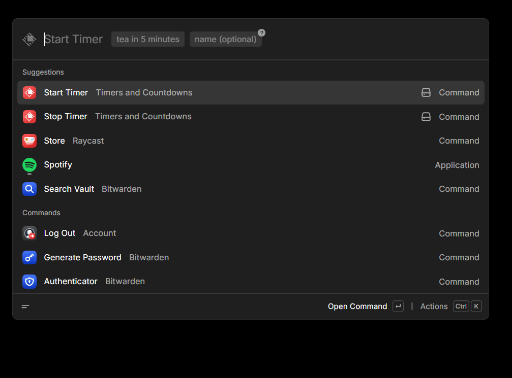

# Timers and Countdowns

Start and stop countdown timers in Raycast using natural language.

## Commands

### Start Timer

Enter a duration or time. A name is optional, either as a second argument or in the phrase itself.

Examples: `5 minutes`, `tea in 10m`, `eggs - 1h 30m`, `standup at 3pm`.

### Stop Timer

Lists every running timer with time remaining. Stop one, or stop them all.

### Change Ring Sound

Preview system sounds and pick the one that plays when a timer finishes. Tada is the default.
