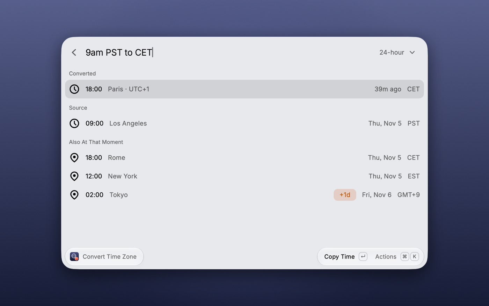
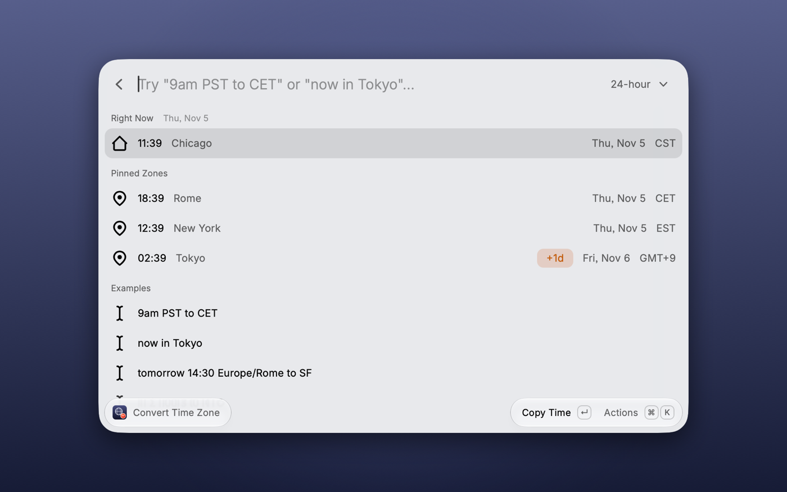
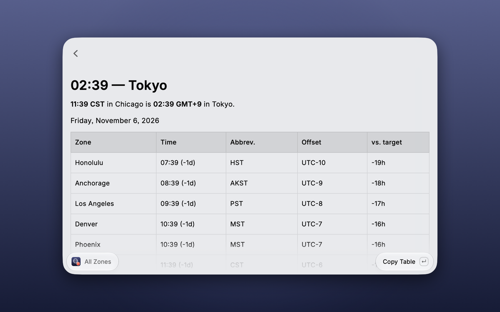

  

<h1 align="center">Time Zone Converter</h1>

  Convert times between time zones in Raycast, the way you convert units.

  <code>9am PST to CET</code> → <strong>6:00 PM in Paris</strong>

## Screenshots

## What it understands

**Times:** `9am`, `9:30 am`, `21:00`, `noon`, `midnight`, `9 o'clock`, bare hours (`9`).

**Dates:** `today`, `tomorrow`, `yesterday`, weekdays (`monday`, `next friday`), `2026-11-05`,
`05/11/2026` (day first), `nov 5`, `5 november`.

**Relative:** `now`, `in 2 hours`, `2h ago`, `+90m`, `-1d`.

**Zones:** IANA ids (`Europe/Rome`), cities and countries (`rome`, `italy`, `nyc`, `sf`, `bangalore`),
abbreviations (`PST`, `CET`, `IST`, `JST`, `AEST`, …), fixed offsets (`UTC+2`, `GMT-5`, `-03:30`) and
`local` / `here`.

A unique prefix also works: `amster` finds Amsterdam.

Abbreviations are ambiguous by nature: `CST` means US Central (type `shanghai` for China Standard Time),
`IST` means India (type `dublin` for Irish Standard Time) and `BST` means British Summer Time.

## Using it

- **In the command:** open *Convert Time Zone* and type. With an empty search bar it shows your local
  time plus pinned zones.
- **From Raycast root search:** type the command name, press `Tab`, then type the query — the command
  takes an optional text argument.
- **Actions:** copy the time, the full conversion (`9:00 AM PST → 6:00 PM CET`), ISO 8601 or the Unix
  timestamp; swap zones; or open *Show All Zones* for a table of ~50 zones at that moment.

## Preferences

- **Pinned Zones** — comma-separated zones shown under every result and in the world clock
  (default `Europe/Rome,America/New_York,Asia/Tokyo`).
- **Time Format** — 24-hour or 12-hour. It can also be switched from the dropdown in the search bar.
