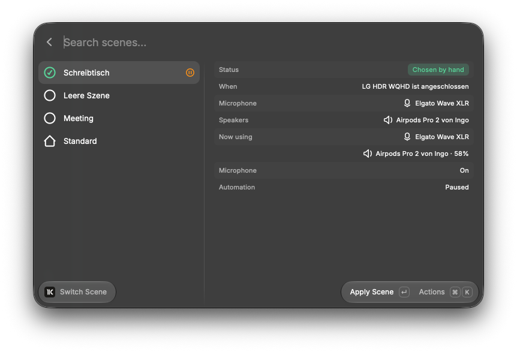
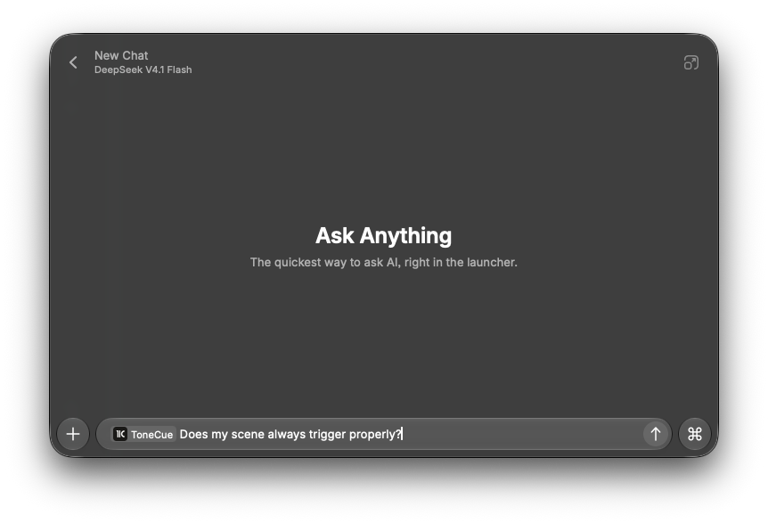

# ToneCue for Raycast

Switch your [ToneCue](https://didact.digital/tonecue/) audio scenes from Raycast. ToneCue is a macOS menu bar app that picks your microphone and speakers to fit the moment (a meeting, dictation, your desk) and tells you why it switched.

## Setup

**This extension needs the ToneCue menu bar app, version 2.1 or later, to be running.** It talks to the app over a private local socket and does nothing on its own. Without the app, every command says so.

1. [Download ToneCue](https://github.com/4IngoJ/tonecue/releases/latest) (14-day trial, then a one-time license) or install it with `brew install --cask 4ingoj/tap/tonecue`.
2. Open ToneCue and create your scenes. Scenes are created and edited in ToneCue; the extension only uses them.
3. Run **Switch Scene** in Raycast.

## Commands

| Command | What it does |
|---|---|
| Switch Scene | Lists your scenes with a detail pane: why the active one is active, when each applies, which devices it would use, and what is in use now. Apply one, mute the microphone, pause or resume automation, create a Quicklink for a scene. |
| Apply Scene | Applies a scene by name, no list. Give it an alias or a hotkey in Raycast. |
| Toggle Microphone Mute | Mute or unmute the current microphone. |

## AI

Ask `@tonecue` which scene is active and why, why your devices switched (it reads the switch history), to apply a scene, or to mute.

Picking a scene by hand pauses automation, exactly like in the ToneCue popover. The connection is a Unix socket in `~/Library/Application Support/ToneCue`, readable only by your macOS user.
