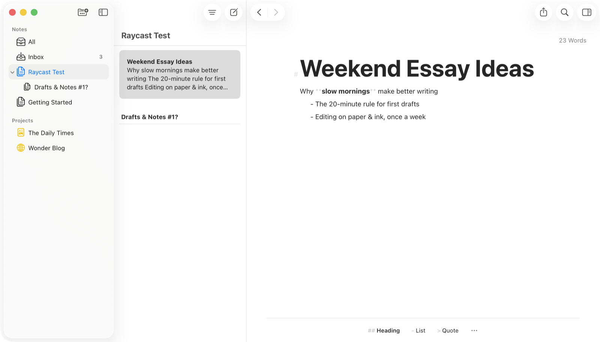
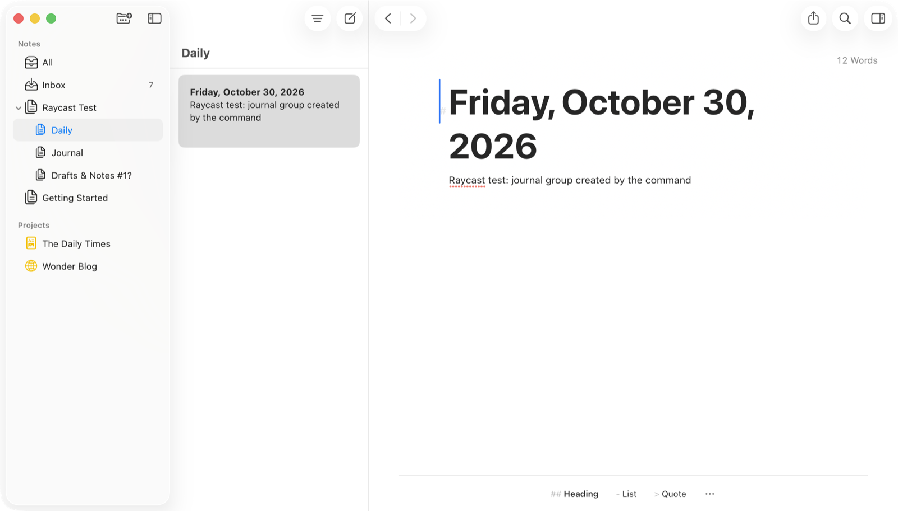

# Ulysses for Raycast

Capture text, keep a journal, and open [Ulysses](https://ulysses.app) without leaving Raycast.

## Commands

| Command | What it does |
| --- | --- |
| **Quick Capture** | Write a sheet with a title, text, group and format. |
| **Capture Text** | Save typed text, the selected text, or the clipboard as a new sheet, in that order. |
| **Create Journal Entry** | Create a sheet titled with today's date, like "Friday, October 30, 2026", in your Journal group. Add an entry to start it with some text. |
| **Create Empty Sheet** | Open a new empty sheet. |
| **Create Group** | Create a group, optionally inside a parent group. |
| **Open All**, **Open Recent**, **Open Favorites** | Jump to those views in Ulysses. |



## Groups

Anywhere you can pick a group, use a name like `Drafts` or a path like `/Blog/Drafts`. A name matches the first group with that name in your library.

- If a capture's group doesn't exist, the sheet goes to your Inbox, so nothing is lost.
- Create Journal Entry creates its group the first time, then keeps adding to it.
- Create Group creates the group at the top level if its parent doesn't exist.



## Quicklinks

In Quick Capture, press `⌘⇧L` (**Create Quicklink for Group**) to save a Quicklink that opens Quick Capture with that group already filled in.

## Preferences

| Preference | Default | |
| --- | --- | --- |
| Default Group | Inbox | Where Quick Capture, Capture Text and Create Empty Sheet save. |
| Text Format | Markdown | Markdown or plain text. Plain text keeps characters like `**` as they are. |
| Bring Ulysses to the front | On | Turn off to save in the background. |
| Journal Group | Journal | Set on the Create Journal Entry command. |

## Development

```bash
npm install
npm run dev
```

`npm test` runs the unit tests for the Ulysses URLs. `npm run lint` and `npm run build` run the same checks as the Raycast Store.
