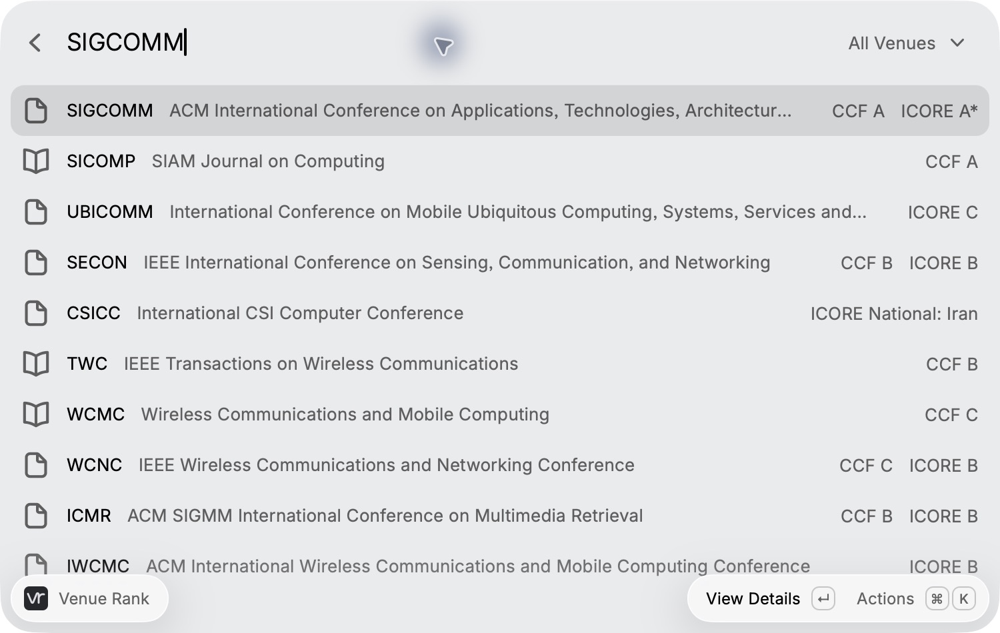
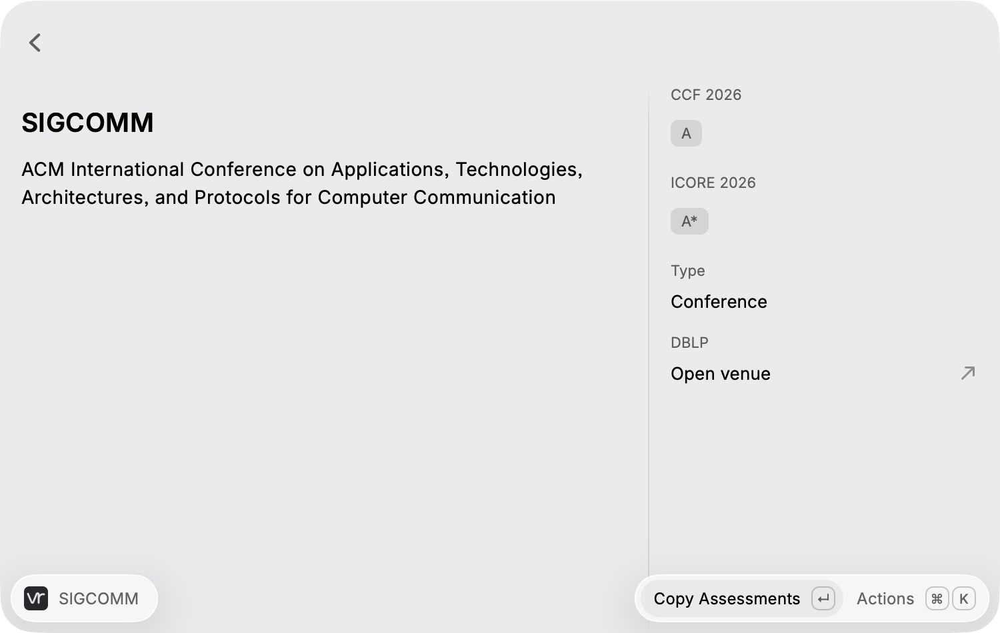
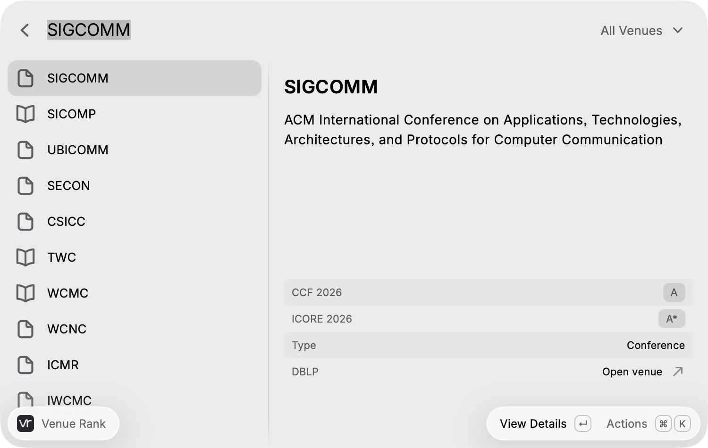

# Venue Rank

Venue Rank searches computer science conferences and journals by acronym, full name, or alias. It shows source-specific CCF 2026 and ICORE2026 assessments from a bundled snapshot. No account, API key, or network connection is required for searching.

## Usage

Open **Search Venues** and type a venue name, such as `SIGCOMM`, `AAAI`, or `TKDE`. You can filter conferences and journals with the dropdown.

- You can press Return to open the selected venue’s details.
- You can press Command-D to toggle the split preview.
- You can press Command-Shift-C to copy the assessments and dataset version.
- You can press Command-I to read the source notes and dataset context.
- You can use the action panel to open the original source or DBLP in your browser.

## Screenshots

The list keeps venue names and assessments together.

The detail view shows each source and edition.

The optional preview shows details alongside the search results.

## Assessment coverage

The bundled snapshot contains 1,347 venue identities and 1,666 assessments. Its 679 CCF entries come from the 2026 community transcription in [CCFrank4dblp](https://github.com/WenyanLiu/CCFrank4dblp/tree/540396b36bfb46b18cfed22bf5c578d73257c4b9). Its 987 ICORE2026 entries come from the [official conference portal](https://portal.core.edu.au/conf-ranks/). Each source retains its own scale and edition.

**Not verified** means that this snapshot contains no verified association with that list. It does not establish that a venue is unranked. ICORE’s conference list does not apply to journals. CSRankings, Tsinghua, and HKUST lists are not included.

The data is bundled with the extension and updates through extension releases. Opening external source links requires an internet connection. The project is independent of the ranking publishers. [NOTICE.md](NOTICE.md) documents the data provenance and third-party attribution.

You can also search in your browser at [Venue Rank](https://wgeng.site/venue-rank/). The [project repository](https://github.com/ViGeng/venue-rank) contains the shared library and data sources.
