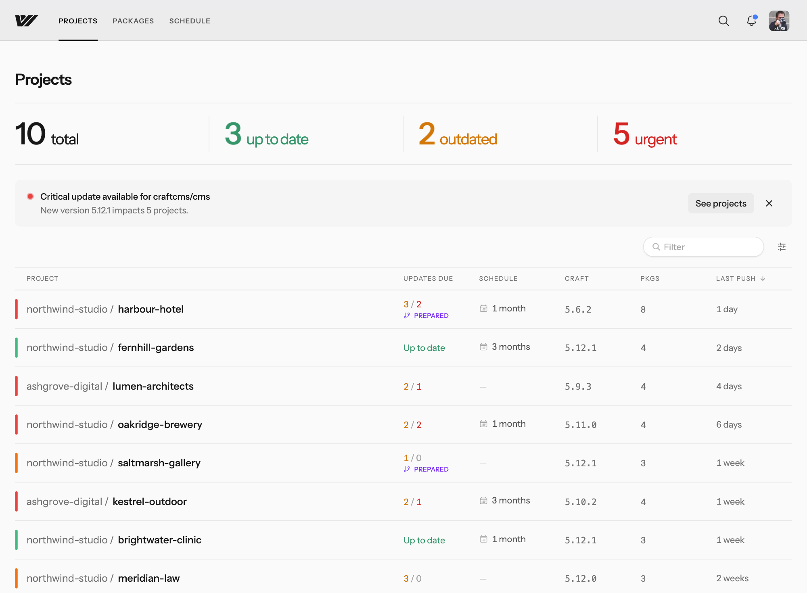

# VerWatch

Search your Craft CMS projects in [VerWatch](https://verwatch.com) across all your teams, see where each package stands and start an update run, all without leaving Raycast.

## Commands

- **Search Projects** lists every project across your teams, with the number of urgent packages in red and outdated ones in orange, and ⌘P switches team. Open a project to see its packages grouped as urgent, outdated and up to date, and from any package you can see every project that uses it. Press ⌘U on a project to start an update run.
- **Recent Updates** lists the latest update runs across your teams, with their status, any pull requests waiting for review and, when a run fails, the reason why.

## Signing in

You'll need an active VerWatch account. The first time you open a command, Raycast asks you to sign in to VerWatch, so approve the request in your browser and Raycast takes it from there. You can disconnect Raycast at any time in your VerWatch settings, under API / MCP.

If you'd rather not sign in, create a personal API token under Settings → API / MCP in VerWatch and paste it into the extension's API Token preference.

## What is VerWatch?

### Craft CMS updates, sent as pull requests

- Keep track of Craft CMS and every plugin across all your sites
- Run updates on a schedule and open PRs for staging and production
- Find expired licences (and costs), auto fix critical packages, get updates in Slack, update just one plugin across every project and connect to it all over MCP

[Get started at verwatch.com](https://verwatch.com)
