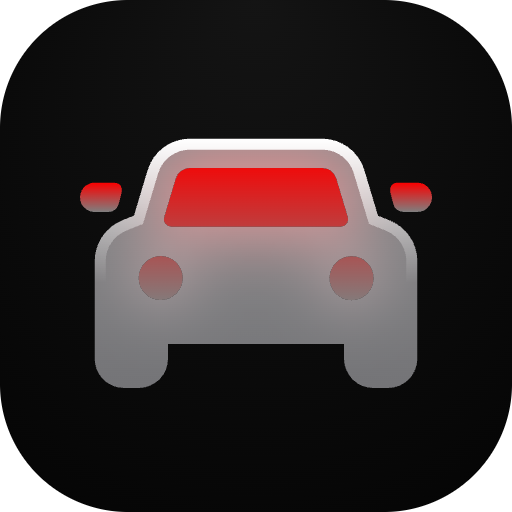

<div align="center">
    <br/>
    <br/>
    
    <h3>window-kickflip</h3>
    <p>Make the focused window take flight with a full 2D spin and air thrusters</p>
    <br/>
    <br/>
</div>

Window Kickflip is a Raycast extension that launches the focused window into a full 360° 2D rotation, a jump arc, and cold-air thruster bursts. Inspired by the [Tesla Roadster kickflip](https://x.com/Tesla/status/2110926164306931860).

## Requirements

- macOS 14 or later
- Screen Recording permission for Raycast. If prompted, enable it in System Settings → Privacy & Security → Screen & System Audio Recording, then restart Raycast.
- Any standard window. Fullscreen windows are skipped.

## Commands

- **Kickflip** runs the animation on the focused window. Assign it a hotkey in Raycast Settings to launch it directly.
- **Kickflip Guide** opens the instructions. Press Return or choose the **Do a Kickflip** action to animate the window behind Raycast.

Focus your target window before opening Raycast. The extension closes Raycast, captures that window, and runs the animation on it.

## Animation

A bundled Swift helper picks the frontmost app's front window and uses ScreenCaptureKit to capture it and a background image of its display with that window excluded. Core Animation shows the snapshot in a temporary overlay for about 2.7 seconds: a powered lift, one complete rotation near the apex, opposing jets to brake the roll, and a controlled landing with a small rebound. White air plumes follow each thruster burst.

Quiet air hisses and a soft touchdown thump follow the same timeline as the animation. The helper synthesizes the audio in memory. Sound is on by default; turn off **Sound Effects** in the extension's preferences to mute it. **Kickflip Guide** includes an **Open Extension Preferences** action.

The four corner nozzles adapt the [Roadster Rally](https://roadster.game/) layout to a flat 2D window. The lower pair lifts and lands; one diagonal drives the roll and the opposite diagonal brakes it. Nozzle positions and exhaust directions follow the window's rotation and scale. Emitted smoke remains in screen coordinates and trails behind independently.

The real window is never moved, resized, minimized, or hidden. Closing the overlay reveals it in its original position. The snapshots stay in memory, are never saved or uploaded, and are discarded when the helper exits. The display behind the animation is a still image for its duration.

Large windows scale down during the spin to fit on screen. A window that hangs off the edge or spans displays flies on the display showing most of it; any part on another display stays put during the animation. The helper stops before showing the overlay if capture fails, the focused app has no window, or the focused app changes during capture. Running Kickflip again while a window is in the air does nothing.

## Development

```sh
npm install
npm run dev
```

Building the Swift helper requires Xcode 16.3 or later. Raycast compiles and bundles it automatically through [Swift for Raycast Extensions](https://github.com/raycast/extensions-swift-tools).

The native integration follows the [Color Picker extension](https://github.com/raycast/extensions/tree/main/extensions/color-picker):

- `swift/window-kickflip/Package.swift` declares one Swift package with Raycast's macro and binding plugins.
- `swift/window-kickflip/Sources/` contains the implementation. `@raycast` exposes `animateKickflip` to TypeScript.
- `src/lib/kickflip.ts` imports it through `swift:../../swift/window-kickflip`. Raycast generates the typed bridge and invokes the helper.
- `npm run build` and `npm run dev` compile the Swift source and generate `assets/compiled_raycast_swift/`. This executable is build output, not a prebuilt dependency to commit or maintain. It and the native build caches are excluded from Git.

Contribute the Swift sources and package files with the TypeScript extension. Raycast bundles the generated executable for runtime use, so people installing the extension do not need Xcode or a separate helper installation.

Validate changes with `npm test`, `npm run test:native`, `npm run build`, `npx tsc --noEmit`, and `npm run lint`.

For a manual check, focus a normal window and run each command. Confirm lift before rotation, visible launch and counter-thruster bursts, a controlled landing, synchronized sound, and a return to the unchanged live window. Disable Sound Effects and confirm the animation runs silently. Repeat with a fixed-size window (System Settings), partly off-screen, across two displays, and with a fullscreen window to confirm it is skipped.
