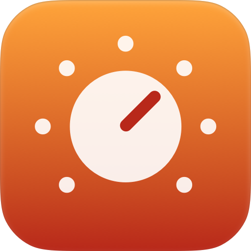

# XDR Boost

**Make SDR content brighter on your XDR display by using its extra EDR headroom, controlled from Raycast.**

[Features](#features) • [Requirements](#requirements) • [Quick Start](#quick-start) • [Usage](#usage)

---

## Features

- **Brighter SDR content** — works on the MacBook Pro's built-in Liquid Retina XDR and the Pro Display XDR, using the EDR headroom macOS normally reserves for HDR
- **Per-display levels** — set all displays or each display to Off, Low, Medium, High or Max, from the menu bar, a list, or the search bar
- **Safe by design** — the helper never asks for more than the panel's current headroom allows, and holds external XDR displays to a conservative limit, because a Pro Display XDR can go black when pushed too far
- **Pauses by itself** — while the screen saver runs, the screen is locked or asleep, Low Power Mode is on, or the battery is below your chosen level, and comes back when that ends
- **Raycast AI** — ask, for example, "@xdr-boost boost my display to max"

### How it works

A small Swift helper, built from source in `swift/Sources/XDRBoostHelper/`, runs in the background while
the boost is on. It keeps each XDR panel in EDR mode with a 1×1 pixel window and raises the display's
gamma table. Turning the boost off or quitting Raycast quits the helper, and macOS restores the original
table the moment the helper exits, even if it crashes.

How much brighter a level gets depends on the display and on your brightness slider.

---

## Requirements

- [Raycast](https://www.raycast.com/) installed
- A Mac with an XDR display. Displays without EDR headroom are skipped. On M5 Pro and M5 Max Macs the
  gamma table has no visible effect, so the boost does nothing there.
- Other external HDR monitors that report EDR headroom are boosted too, with the same conservative limit
  as a Pro Display XDR. We haven't tested XDR Boost on any of these monitors, so results may vary.

---

## Quick Start

1. Open Raycast and search for **"Show XDR Boost in Menu Bar"**
2. Pick a level for all displays or for one display; the helper starts the moment a boost is on
3. Use **"Toggle XDR Boost"** to turn the boost on at your default level, or off. Its subtitle in root search shows the current state, such as "On · High"

---

## Usage

### Commands

| Command                    | Mode       | Description                                                                                        |
| -------------------------- | ---------- | -------------------------------------------------------------------------------------------------- |
| Show XDR Boost in Menu Bar | `menu-bar` | Set all displays or each display to Off, Low, Medium, High or Max, and see why the boost is paused |
| Set XDR Boost              | `view`     | Pick a level for all displays or for one display                                                   |
| Quick Set XDR Boost        | `no-view`  | Set every display from the search bar: `1.5`, `50%` or `High`                                      |
| Toggle XDR Boost           | `no-view`  | Turn the boost on at your default level, or off                                                    |
| Increase Boost             | `no-view`  | Step each display up one preset from its own level                                                 |
| Decrease Boost             | `no-view`  | Step each display down one preset from its own level, down to off                                  |

### Actions

| Action                          | Shortcut       | Description                     |
| ------------------------------- | -------------- | ------------------------------- |
| Off / Low / Medium / High / Max | `⌘ 0` to `⌘ 4` | Set the level from the menu bar |

### Preferences

| Preference               | Values                                                                                                                                                                                            | Default           |
| ------------------------ | ------------------------------------------------------------------------------------------------------------------------------------------------------------------------------------------------- | ----------------- |
| Default Level            | Low (1.19), Medium (1.38), High (1.56), Max (1.75)                                                                                                                                                | High              |
| After Restart            | checkbox: when on, the menu bar command restarts the boost at your last levels if the helper is gone, for example after a restart or a Raycast update. There is no login item and no LaunchAgent. | Off               |
| Boost Strategy           | Follow Brightness (raises Max as you lower the brightness slider), Fixed Maximum (keeps Max the same)                                                                                             | Follow Brightness |
| External XDR Maximum     | With Fixed Maximum, how far Max goes on an external XDR display: 1.5×, 2×, 2.5×, 3×, 3.4× (full, may blank a Pro Display XDR)                                                                     | 2×                |
| Pause When Battery Below | Never, 10%, 20%, 30%, 50% (on battery power)                                                                                                                                                      | 20%               |
| Notifications            | checkbox: a notification after every change                                                                                                                                                       | On                |

---

## Tech Stack

| Package                     | Role                                                             |
| --------------------------- | ---------------------------------------------------------------- |
| `@raycast/api`              | Raycast extension primitives                                     |
| `@raycast/utils`            | Higher-level Raycast utilities                                   |
| `@chrismessina/raycast-kit` | Shared error toasts and secret redaction                         |
| `extensions-swift-tools`    | Builds the Swift helper from source and calls it from TypeScript |

---

## Credits

XDR Boost builds on these open-source projects:

- [Headroom](https://github.com/fich-l/headroom) by fichl (MIT): the Swift helper is ported from its
  `Gamma.swift`, including the EDR trigger window, the gamma-table write and the preset levels.
- [xdr-lift](https://github.com/Justaboringname/xdr-lift) by Yihan Zhu (MIT): the trigger window setup,
  the finding that the gamma table is gamma-encoded, and the cap that keeps light below 95% of the
  panel's headroom.
- [Illuminate](https://github.com/fackelmeyer/illuminate) by Jonas Fackelmeyer (MIT): the boost curve
  that follows the brightness slider, the per-model display peaks, pausing for system states, and the
  M5 Pro / M5 Max detection.
- [BrightIntosh](https://github.com/niklasr22/BrightIntosh) by niklasr22 (GPL-3.0): its described
  behavior informed waiting for EDR before writing a table. None of its code was read or used.
- [extensions-swift-tools](https://github.com/raycast/extensions-swift-tools) by Raycast: builds the
  Swift helper from source and calls it from TypeScript.

License texts and the commits read are in [NOTICE.md](NOTICE.md).

---

MIT © [Chris Messina](https://github.com/chrismessina)
