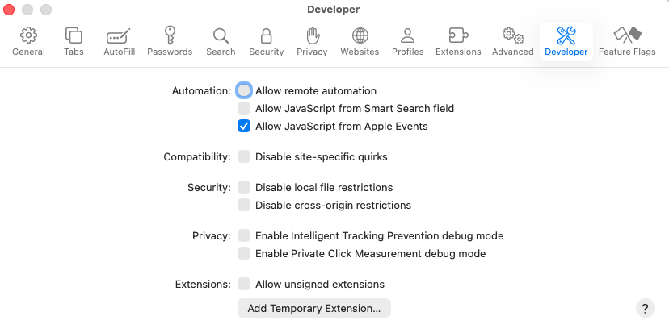
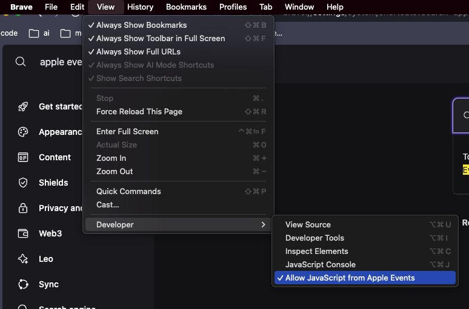

# YouTube Music

Control the YouTube Music tab in the browser with your keyboard.

The `Play Music` command searches YouTube Music songs, albums, artists, and playlists, or YouTube videos, and starts the chosen item in the selected browser. The source dropdown, the **Search in…** action (⌘K), and the **Play Music Source** preference choose which catalogue it reads; albums, artists, and playlists open as grid tiles, and album and playlist tiles start the whole queue rather than a single track, with `⌘↵` opening the track list instead. With the search bar empty it shows your library instead — Albums, Artists, Playlists, Liked songs, and Recently played, each opening into its own list — read from the signed-in music tab, so that tab needs to be signed in to YouTube Music. `Now Playing` shows the current track, the recently played tracks and the queue, with transport and rating actions. How many recently played tracks to list is set in the extension preferences. Both follow the playback setup below; no additional permissions are required.

## Quick add and per-scope entry points

`Play Music` accepts a launch context that makes **Add to Queue** the primary action, so a hotkey or deeplink can queue a track without opening the action panel:

```
raycast://extensions/danieldbird/youtube-music/play-song?launchContext=%7B%22mode%22%3A%22add%22%7D
```

The same context takes a `source`, which saves opening the dropdown when you only ever search one catalogue. Assign a hotkey to a [Quicklink](https://manual.raycast.com/quicklinks) pointing at one of these and each scope gets its own keystroke:

```
raycast://extensions/danieldbird/youtube-music/play-song?launchContext=%7B%22source%22%3A%22albums%22%7D
```

`source` accepts `both`, `ytmusic`, `albums`, `artists`, `playlists`, or `youtube`.

## Required Setup

The extension controls your browser via AppleScript by running JavaScript in the YouTube Music tab. You must enable **Allow JavaScript from Apple Events** in the browser you select in the extension preferences; otherwise commands will fail (often with "Unknown Error").

### Safari

1. Enable the Develop menu: **Safari → Settings → Advanced** → check **Show features for web developers**.
2. Turn on **Develop → Allow JavaScript from Apple Events**.



### Chrome, Chromium, or WebCatalog apps

1. Open **View → Developer** in the menu bar.
2. Enable **Allow JavaScript from Apple Events**.



After enabling this setting, pick the same browser (or WebCatalog app) in the extension’s **Browser where YouTube Music opened** preference.

---

Credit to [@alexstrnik](https://www.raycast.com/alexstrnik) for the [Yandex Music](https://www.raycast.com/alexstrnik/yandex-music) extension which this extension was based on.
