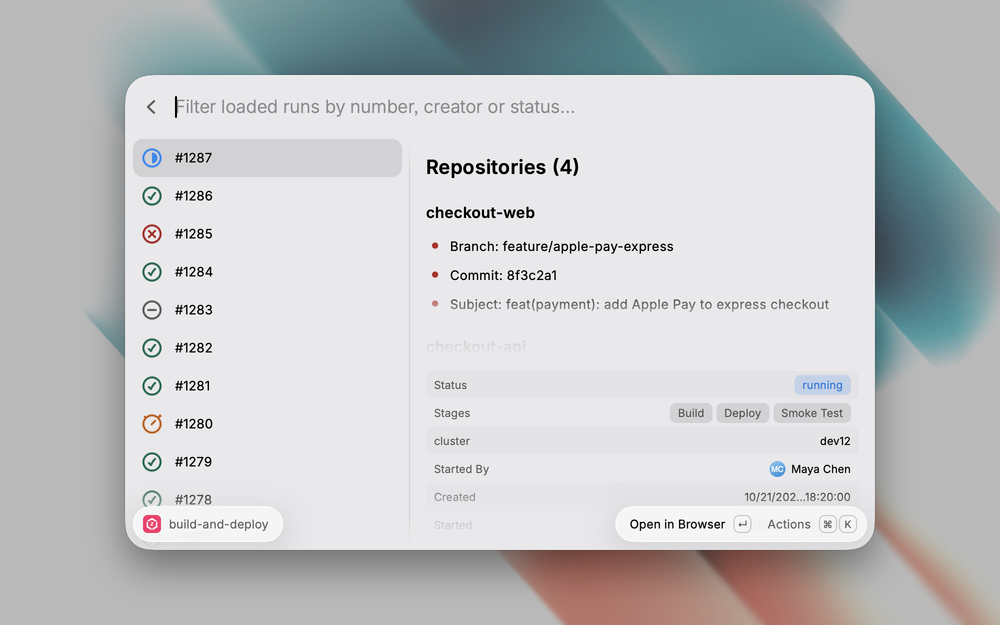

# Zadig

Search [Zadig](https://koderover.com) workflow runs and environments, and manage sub-environments from Raycast.

## Commands

- **Search Workflows**: browse a project's custom workflows and their runs, with each run's status, repositories, parameters and stages. Retry a failed, canceled, rejected or timed-out run, or cancel a running one.
- **Search Environments**: browse test and production environments with their status and deployed services. Restart a service, delete a test environment, and in Helm projects create a sub-environment or add services.

## Setup

1. In Zadig, click your account in the upper right corner, choose **Account Settings**, and copy the **API Token**.
2. In the extension preferences, fill in:
   - **Domain**: the domain your company serves Zadig from, such as `zadig.example.com`.
   - **API Token**: the token from step 1.

Every action runs as your Zadig account.

## Compatibility

Built on the [Zadig v5.0 OpenAPI](https://docs.koderover.com/zadig/en/Zadig%20v5.0/api/usage/).

## Limitations

- Starting a new run, approvals and release plans are not supported.
- Sleeping and waking environments are not supported.
- Job logs are not shown, because Zadig returns credentials in cleartext in task data and build logs.
- Creating environments and adding services work only in Helm projects, and removing services is not supported.
