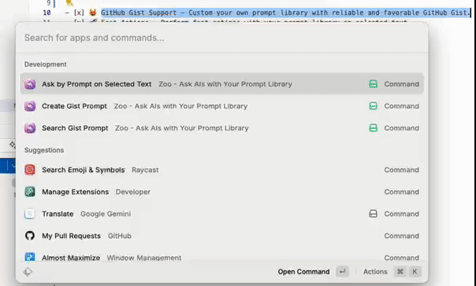

# Zoo: Your AI Prompt Library, Your API Key

Zoo turns your GitHub Gists into reusable AI actions in Raycast. Save a prompt once, select text in another app, and run that prompt with your own API key. You can translate a paragraph, polish an email, explain code, or summarize an article without copying the same instructions into a chat every time.

**Zoo works with Raycast Free. You do not need Raycast Pro or a Raycast AI subscription.** You connect your own AI provider and pay that provider for any billable API usage.

[Find Zoo in the Raycast Store](https://www.raycast.com/ViGeng/zoo).

## Why Zoo?

- You bring your own API key for OpenAI, Google Gemini, Anthropic Claude, or DeepSeek.
- You keep your prompt library in GitHub Gist, where you can create, edit, and reuse your instructions.
- You turn selected text into an AI task with a searchable prompt and a keyboard shortcut.
- You can connect another OpenAI-compatible service, including OpenRouter or a compatible local server.
- You see answers as they stream and can copy, paste, stop, or retry them.

Raycast v2's built-in BYOK feature [requires Raycast Pro](https://www.raycast.com/changelog/macos/2-2). Zoo makes its own API requests directly to your selected service, so its commands work independently of Raycast AI membership.

## Get started

1. Install Zoo and open **Search Gist Prompt** to connect your GitHub account.
2. Open Zoo's extension preferences and choose your **AI Provider**.
3. Enter that provider's key in **LLM API Key** and choose **Provider Default** under **LLM Model Name**.
4. Run **Create Gist Prompt** to save your first reusable instruction.
5. Select text in another app and run **Ask by Prompt on Selected Text**.
6. Choose your prompt and press Return. Zoo streams the answer, which you can copy or paste into your work.

If selected text is unavailable, Zoo lets you enter or paste the text before sending the request. It does not silently use your clipboard as AI input.

## Choose your AI service

For a named provider, Zoo supplies the official endpoint automatically. You only need that provider's API key and a model it supports.

| AI Provider                  | Where you get API access                                                         | How Zoo connects                                       |
| ---------------------------- | -------------------------------------------------------------------------------- | ------------------------------------------------------ |
| OpenAI                       | You can create a key in the [OpenAI API platform](https://platform.openai.com/). | Zoo uses OpenAI's Chat Completions API.                |
| Google Gemini                | You can create a key in [Google AI Studio](https://aistudio.google.com/).        | Zoo uses Google's official OpenAI-compatible endpoint. |
| Anthropic Claude             | You can create a key in the [Claude Console](https://console.anthropic.com/).    | Zoo uses Anthropic's native Messages API.              |
| DeepSeek                     | You can create a key in the [DeepSeek platform](https://platform.deepseek.com/). | Zoo uses DeepSeek's OpenAI-compatible API.             |
| Custom OpenAI-Compatible API | You use the access details from your service.                                    | You set **LLM API Endpoint** and **Custom Model ID**.  |

**Provider Default** chooses a bundled model for that service. You can choose another preset or enter an exact model ID in **Custom Model ID**, which takes precedence over the model dropdown. Model availability depends on your provider and API account.

Zoo currently uses one configured API key at a time. When you switch services, replace the key with the one issued by the new service.

### Use a custom endpoint

Choose **Custom OpenAI-Compatible API**, enter the API base URL in **LLM API Endpoint**, and set **Custom Model ID**. For example, OpenRouter uses `https://openrouter.ai/api/v1`. A local Ollama server with the compatible API enabled uses `http://localhost:11434/v1`. Enter the base URL rather than a URL ending in `/chat/completions`.

**Automatic** mode preserves existing custom endpoints and otherwise detects the provider from the model name. The named provider choices always use their official endpoints. **LLM API Endpoint** applies to Automatic and Custom modes.

If you are upgrading from an older Zoo version, choose your provider and **Provider Default**, clear any obsolete **Custom Model ID**, and check that your API key belongs to that provider. Old experimental model IDs may no longer be available.

## Create prompts you will reuse

A Gist file contains the instructions. Zoo sends that file as the system prompt and sends your selected text as the user message. You can keep several prompt files in one Gist.

For example, save a file named `polish-email.md` with these instructions:

```text
Rewrite the user's email in clear, natural English.
Keep the original meaning and use a friendly, professional tone.
Return only the revised email.
```

You can create more prompts for recurring tasks:

- You can translate text while preserving its Markdown formatting.
- You can summarize an article into five concise bullet points.
- You can explain code and identify potential bugs.
- You can turn rough notes into a structured meeting summary.

Add the word `prompt` to a Gist's description if you want it to appear under the **Prompt** filter. You can also browse your own Gists, starred Gists, and public Gists. Assign a Raycast hotkey or alias to **Ask by Prompt on Selected Text** for faster access.



## Commands

| Command                            | What you can do                                                                                           |
| ---------------------------------- | --------------------------------------------------------------------------------------------------------- |
| **Ask by Prompt on Selected Text** | You can apply a Gist prompt to selected or manually entered text.                                         |
| **Create Gist Prompt**             | You can create a prompt from selected text, clipboard content, or text you enter.                         |
| **Search Gist Prompt**             | You can find, preview, edit, copy, and paste your Gist prompts.                                           |
| **Check AI Connection**            | You can check API access and whether the selected model is listed without sending a prompt or input text. |

## Costs and data

Zoo does not use Raycast AI credits. Your selected provider's pricing, quota, and data policies apply. A paid chat subscription does not necessarily include API access.

Your prompts are stored in GitHub Gist. Public Gists are visible to everyone, and secret Gists are accessible to anyone who has their link. When you run a task, Zoo sends the chosen prompt and input text to the configured AI endpoint. Zoo does not add its own relay server.

Zoo displays token counts when the provider reports them. To show a cost estimate, set both **Custom Model Input Price** and **Custom Model Output Price** in USD per million tokens. The estimate uses your rates and reported usage. It does not account for cache discounts, pricing tiers, or other provider charges. Your provider's billing dashboard is the source of truth.

## Troubleshooting

- If a model is unavailable, choose **Provider Default** or enter a model ID supported by your account.
- If access is rejected, check that your API key belongs to the chosen service and has the required permissions.
- If Gemini reports HTTP 400, run **Check AI Connection**. Google can reject an invalid key or account configuration with this status. Zoo identifies recognized key, region, billing, and API restriction errors without displaying raw provider responses or credentials.
- If you reach a quota or rate limit, check the provider's API balance and usage limits before retrying.
- If Gist content fails to load, use **Retry Loading Gist** before running the prompt.
- If selected text cannot be read, enter the text in Zoo or check Raycast's macOS Accessibility permission.

## Credits

Zoo was inspired by [GitHub Gist](https://www.raycast.com/koinzhang/github-gist) and [ChatGPT Quick Actions](https://www.raycast.com/alanzchen/chatgpt-quick-actions).
